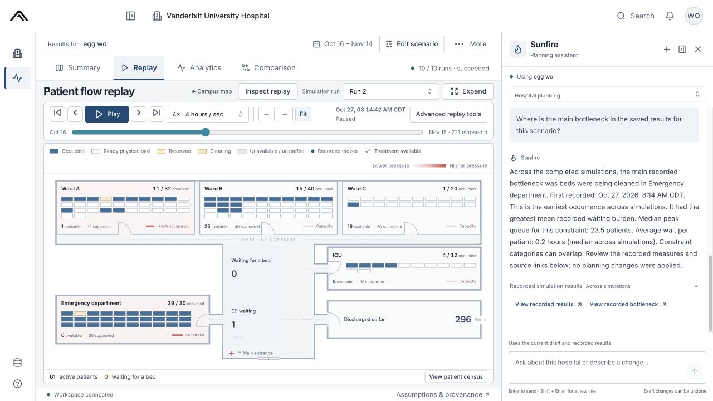
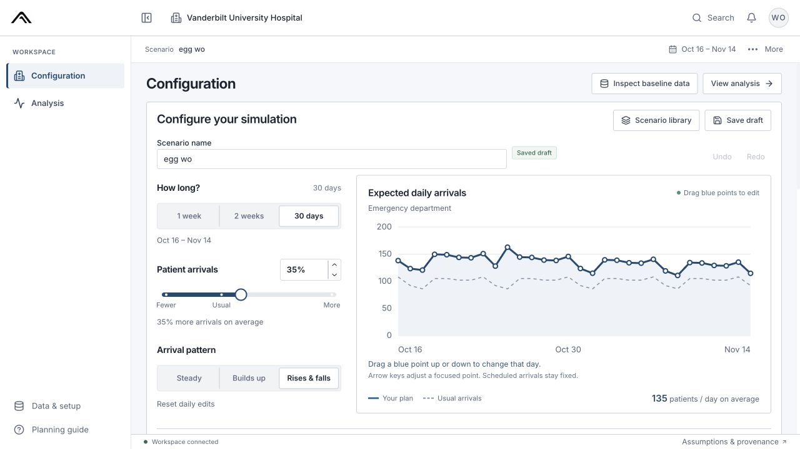

# AEGIS

**Hospital Operations Intelligence**

Simulate patient surges. Find bottlenecks. Compare response plans.

AEGIS is a full-stack hospital planning workspace that helps teams explore how changes in patient demand, beds, staffing, equipment and supplies affect patient flow. Configure a scenario, run a discrete-event simulation, and inspect where delays occur before testing a different response.

**[Watch the demo video][demo] · [View the slide deck][slides] · [Open AEGIS Console][console]**

The hosted console requires sign-in. Start with the video or slide deck for a product walkthrough.

[][demo]

*Patient-flow Replay and Sunfire: inspect recorded bed occupancy, trace a bottleneck, and ask questions about saved simulation results. Click the screenshot to watch the demo.*

## Why AEGIS?

A hospital can have open beds and still lack the staff, equipment or supplies needed to use them. AEGIS makes those constraints visible so teams can explore questions such as: **What happens if arrivals rise, beds close, or staffing changes—and which response reduces the resulting delays?**

The workflow connects scenario design to the evidence behind each result:

| Step | What you can do |
|---|---|
| **Configure** | Adjust duration, drag the daily-arrivals curve, and edit beds, staffing, patient severity, supplies and disruptions. Save and revise scenarios. |
| **Simulate** | Run constrained patient-flow simulations as background jobs, with progress, cancellation and retry support. |
| **Analyze** | Review bottlenecks, waits, occupancy and resource pressure in Summary and Analytics; inspect individual patients and units. |
| **Replay** | Follow recorded patient movements and bed states on an interactive hospital floor plan, with playback and time controls. |
| **Compare** | Compare completed results from two saved scenarios to explore staffing and capacity tradeoffs. |
| **Ask Sunfire** | Use the planning assistant to prepare validated configuration changes, start simulation jobs and explain recorded results. |

<details>
<summary><strong>See the scenario configuration workspace</strong></summary>



*Tune demand and capacity before running a simulation. Exact settings are available under More parameters.*

</details>

## Engineering highlights

- **Reproducible simulation.** Completed runs preserve frozen inputs, model/generator versions, random seeds and checksums so results remain tied to the assumptions that produced them.
- **Durable execution.** FastAPI records simulation jobs in PostgreSQL; Redis/RQ dispatches work to a separate Python worker. Private OCI Object Storage holds results, replay artifacts and backups.
- **Traceable analysis.** Replay uses recorded patient events and bed states. Summary, Analytics and Comparison read saved simulation evidence.
- **An integrated planning assistant.** Sunfire uses OpenAI GPT-OSS 120B through OCI Generative AI, shares the manual editor's draft and Undo history, and uses typed, validated actions. Conversations and action receipts persist; delayed replies cannot overwrite newer manual edits.
- **Deployment and verification.** The application runs on OCI Compute with Docker Compose, HTTPS, database migrations and backup/restore tooling. [Hosted verification](docs/hosted-verification.md) documents tested releases, workflow checks and measured performance.

## Tech stack

| Layer | Technologies |
|---|---|
| Interface | React, TypeScript, Vite, Mantine |
| API | Python, FastAPI, Alembic |
| Simulation | SimPy, NumPy, SciPy |
| Persistence & jobs | PostgreSQL, Redis, RQ |
| Planning assistant | OpenAI GPT-OSS 120B via OCI Generative AI |
| Hosting & storage | OCI Compute, private OCI Object Storage, Docker Compose, Caddy, Nginx |

The browser configures scenarios and displays results; authoritative simulation calculations run on the server. Local development uses SQLite and local artifacts, while the deployment stack uses PostgreSQL, Redis/RQ and private object storage.

## Run locally

Prerequisites: **Python 3.12**, **uv**, **Node.js 24** and **npm**. Docker is required for the PostgreSQL/Redis container stack.

```sh
make setup
make migrate
make seed-demo
make dev
```

Open **[localhost:5173](http://localhost:5173)**. The API is available at [127.0.0.1:8000/api](http://127.0.0.1:8000/api), with its OpenAPI schema at [127.0.0.1:8000/openapi.json](http://127.0.0.1:8000/openapi.json).

Local development uses a visibly marked seeded session. `make setup` installs locked dependencies and creates private `.env` settings with unique generated secrets, preserving an existing `.env`. Python dependencies are locked in `uv.lock`; frontend dependencies are locked in `apps/web/package-lock.json`.

<details>
<summary><strong>Developer commands</strong></summary>

| Command | Purpose |
|---|---|
| `make setup` | Install locked dependencies and create local settings |
| `make dev` | Start the local API and web server |
| `make migrate` | Apply versioned database migrations |
| `make seed-demo` | Generate and validate fixtures, then load the local workspace |
| `make generate-data` | Reproduce the synthetic planning and stress datasets |
| `make validate-data` | Validate both canonical synthetic snapshots |
| `make simulate-demo` | Run the model without the browser |
| `make check` | Run backend/frontend tests and build the frontend |
| `make test-e2e` | Run browser acceptance checks |
| `make benchmark` | Measure a 30-day, 10-replication workload |
| `make benchmark-full` | Measure 30-day and 365-day, 100-replication workloads |
| `make build` | Build the frontend and production container images |
| `make containers-up` | Start PostgreSQL/Redis, migrate, then start API/worker/web |
| `make containers-down` | Stop containers while preserving named data volumes |
| `make backup` | Create a consistent local SQLite backup |
| `make restore-check BACKUP=backups/<file>.sqlite` | Restore into a temporary database and verify integrity |
| `make oci-readiness` | Read current OCI access/resources without provisioning |
| `make deploy-demo` | Deploy to a configured, existing authorized OCI VM |
| `make audit-status` | List requirements awaiting acceptance evidence |

The `demo` command names refer to the supplied synthetic fixtures. See the [runbook](docs/runbook.md) for identity and storage setup, hosted configuration, migrations, health checks, recovery and deployment verification.

</details>

## Project structure

```text
apps/web/          React interface, charts and recorded patient replay
apps/api/          FastAPI service, authentication, scenarios and jobs
packages/engine/  Simulation engine and synthetic-data generator
infra/            Container configuration and database migrations
scripts/          Development, benchmarking, backup and deployment tools
docs/             Workflow guides, architecture and verification records
evidence/         Screenshots and release-specific acceptance results
```

## Documentation

- **Product walkthrough:** [Single-hospital workflow](docs/single-hospital-workflow.md) · [Configuration and Analysis](docs/overview-analysis-flow.md) · [Replay and comparison](docs/replay-and-scenario-comparison.md)
- **Sunfire:** [Planning assistant](docs/sunfire.md) · [Action and draft contract](docs/sunfire-contract.md) · [Provider setup](docs/sunfire-provider.md)
- **Engineering:** [API integration](docs/api-integration.md) · [Storage design](docs/storage-design.md) · [Operations runbook](docs/runbook.md)
- **Scope and evidence:** [Build specification](docs/reference/hospital-surge-planner-build-spec.md) · [Acceptance ledger](docs/acceptance-tracker.md) · [Hosted verification](docs/hosted-verification.md)

## Data and scope

AEGIS uses **synthetic operational data and medical parameters** for engineering demonstrations. It does not dispatch patients or make clinical treatment decisions. The optional Vanderbilt campus reference provides geographic context; the internal floor plan is illustrative and does not imply a hospital or EHR integration.

`make generate-data` reproduces arrivals, staff rosters, resource inventories and travel assumptions from the versioned [generator](packages/engine/surge_engine/generator.py). Planning and stress snapshots pass the same import validation used by the app. Upgrades preserve older datasets, scenarios and runs; historical links retain their original context.

Live hospital integrations, calibrated prediction, generalized optimization and 3D remain deferred. Performance measurements and verification claims are attributed to their tested release in the [hosted verification record](docs/hosted-verification.md).

The product mark, campus geometry, charts and Replay floor plan are code-native assets. Original visual references are retained under `docs/reference/`; locally served fonts include their license notices in `apps/web/public/fonts/`.

[demo]: https://drive.google.com/file/d/1prJO-x-6FVq2yElAnugoXhcneqvObUJW/view?usp=drivesdk
[slides]: https://docs.google.com/presentation/d/1BtggTBE_sto_7kUav7wNeMWHjQIoSqrYEwspo8XEN-8/edit?slide=id.p1#slide=id.p1
[console]: https://aegisconsole.131.186.0.156.sslip.io
