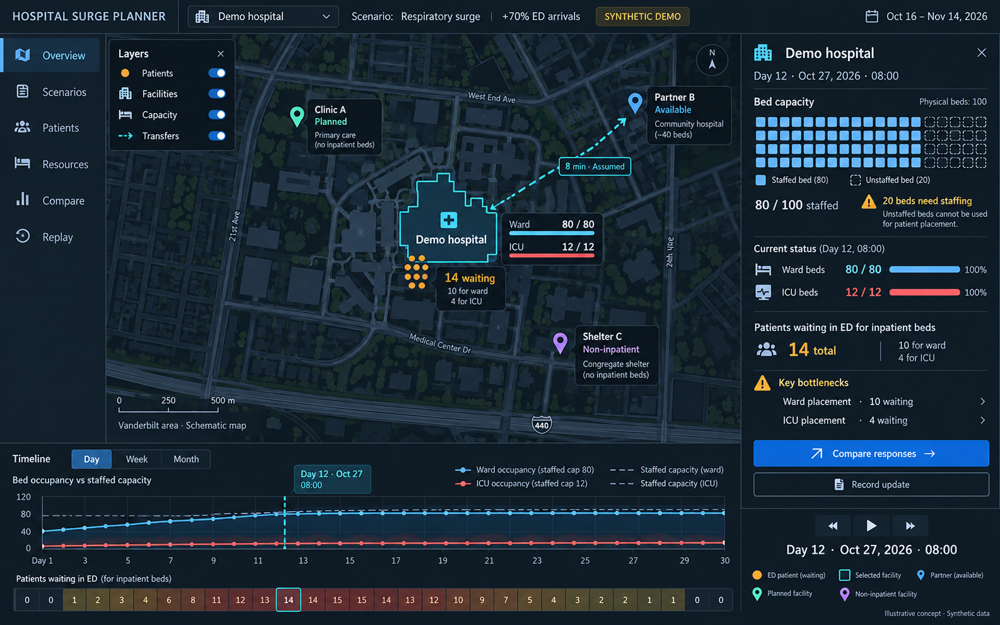
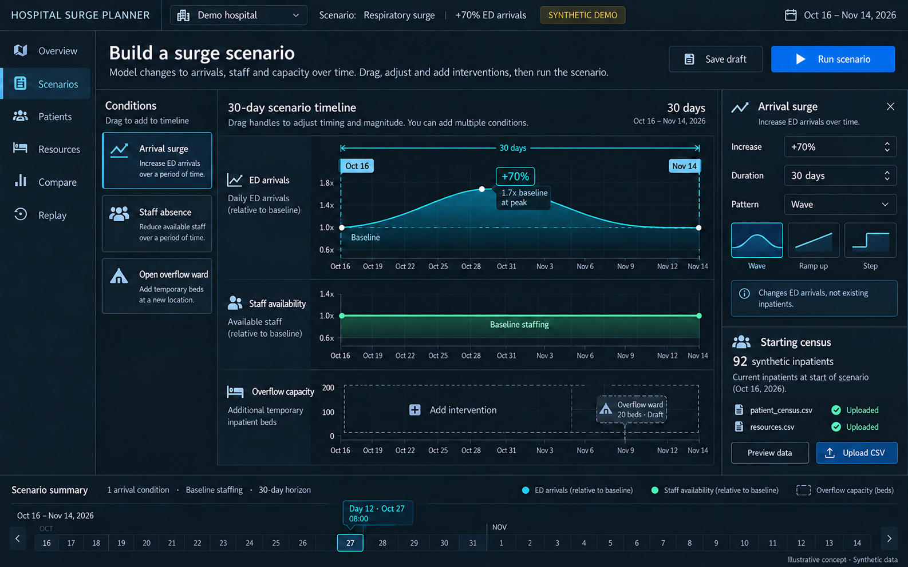
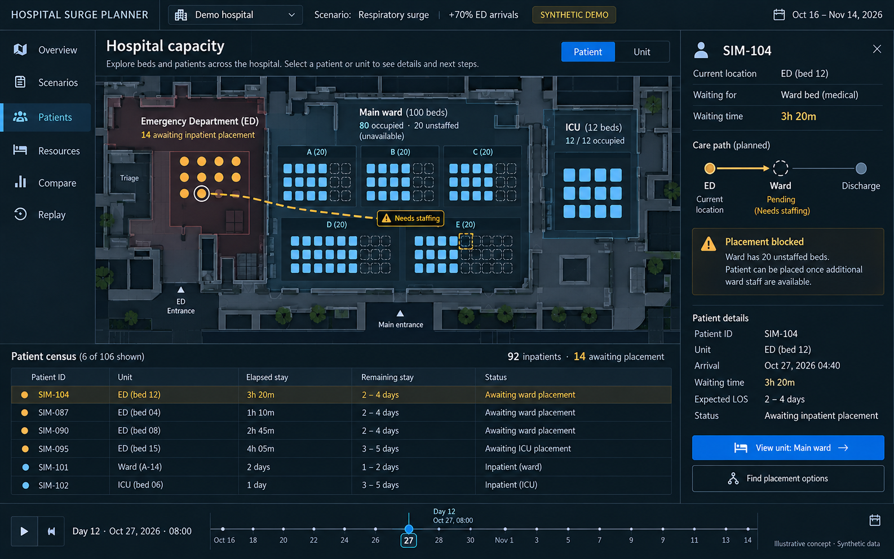
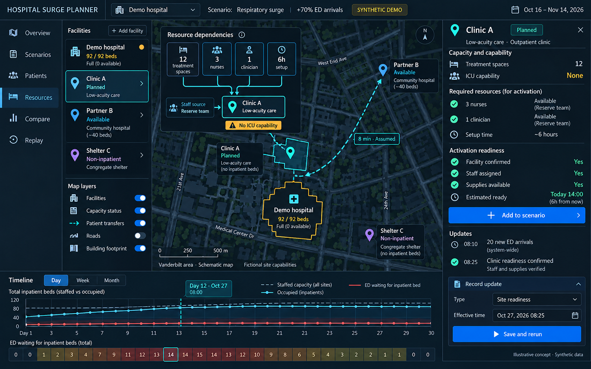
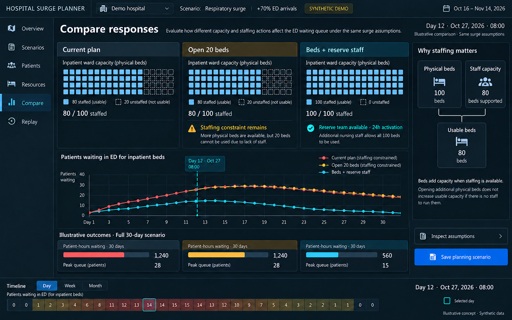
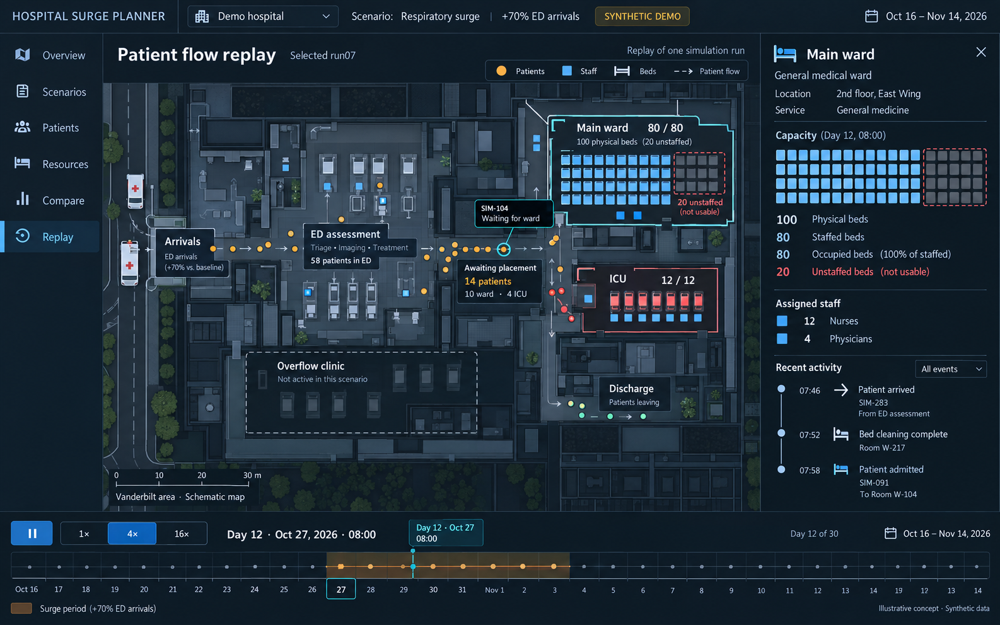
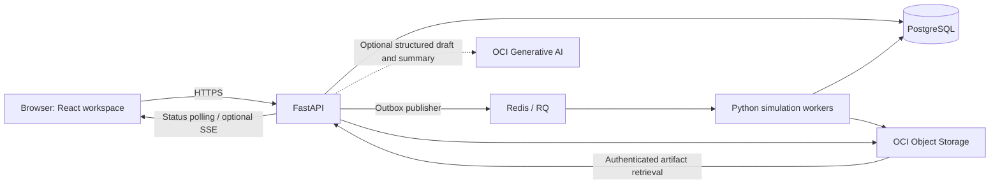

# Hospital Surge Planner — Complete Build Specification

**Version:** 1.0 · **Design baseline:** October 16, 2026 · **Status:** implementation specification, not an implemented or clinically validated system.

This document specifies the product, its synthetic demonstration data, simulation behavior, interface, workflows, application architecture, API, deployment, verification, and staged delivery. A development team should be able to implement the complete demonstration without inventing core business rules. The six supplied images define the intended visual direction; the structured rules and data contracts in this document define actual behavior.

The product helps hospital operations teams rehearse surges, identify when and why suitable capacity becomes unavailable, and compare feasible responses. It supports planning decisions; it does not autonomously dispatch patients, select medical treatments, approve facilities, or decide who receives care.

## Reading and implementation conventions

- **MUST** is required behavior for the stated delivery stage. **SHOULD** is a recommended implementation choice. **MAY** is an optional extension.
- **P0 — focused MVP:** a working hospital scenario, constrained patient-flow engine, forecasts, drilldown, intervention comparison, reproducibility, and actual OCI execution/storage.
- **P1 — complete illustrated product:** the bounded nearby-facility workflow, updates, visual scenario editor, detailed 2D replay, exports, and all six illustrated screens. Implement P0 and P1 to deliver the entire app described by the mockups.
- **P2 — subsequent extensions:** deeper operational stations, live hospital integrations, validated predictive models, generalized optimization, and optional 3D. These require additional data and validation; their contracts and boundaries are specified later.
- All numeric medical/operational parameters below are **invented engineering fixtures**, not recommended clinical staffing ratios, length-of-stay estimates, or validated Vanderbilt data.
- The initial dataset is **synthetic only**. Real maps, if later used, do not make the facility capacities or fictional site capabilities real.
- If an image conflicts with a schema, computed result, or rule, the schema and rules win. Never hardcode image values into results.
- This portable copy embeds the six images with relative paths. Keep the gotham-inspired-mockups folder beside this file.

## Contents

- [1. Product definition and boundaries](#1-product-definition-and-boundaries)
- [2. Feature inventory and completion conditions](#2-feature-inventory-and-completion-conditions)
- [3. Data specification and synthetic demonstration dataset](#3-data-specification-and-synthetic-demonstration-dataset)
- [4. Simulation, intervention evaluation, and model correctness](#4-simulation-intervention-evaluation-and-model-correctness)
- [5. UI specification, mockups, and complete workflows](#5-ui-specification-mockups-and-complete-workflows)
- [6. Application architecture and engineering decisions](#6-application-architecture-and-engineering-decisions)
- [7. API and integration contracts](#7-api-and-integration-contracts)
- [8. Reliability, performance, security and accessibility](#8-reliability-performance-security-and-accessibility)
- [9. Verification, acceptance and evidence](#9-verification-acceptance-and-evidence)
- [10. Implementation order and handoff checklist](#10-implementation-order-and-handoff-checklist)
- [11. Extension contracts for the broader vision](#11-extension-contracts-for-the-broader-vision)
- [12. References and interpretation](#12-references-and-interpretation)

**Suggested reading order:** product/features → data contracts → simulation rules → UI/workflows → architecture/API → verification and delivery. For an implementation sprint, begin with the vertical slices in section 10.


## 1. Product definition and boundaries

### 1.1 Problem, user, and outcome

**Primary user:** a hospital capacity manager. **Secondary users:** emergency preparedness coordinators, hospital incident-command planners, and unit operations leads.

**Friction:** existing patients, uncertain departures, changing arrivals, staffing, equipment, and overflow options are difficult to evaluate together over time. An empty physical bed may not be a usable bed. A nearby clinic may not have the right capability for the patients waiting.

**Primary decision:** “Under this surge, when and where will suitable capacity become insufficient, and which available response reduces waiting?”

**Primary outcome:** reduction in simulated patient-hours awaiting an appropriate inpatient bed. Supporting outcomes include peak waiting, first shortage time, hours with unmet placement demand, capacity deficits, resource usage, and the cost/lead-time tradeoffs of interventions.

**Hackathon alignment:** operational effectiveness and care coordination are the direct mechanisms; improved access is the intended patient benefit. Demonstrated simulation improvements are not demonstrated real-world health outcomes.

### 1.2 What the product does

1. Loads or generates a hospital snapshot and planning assumptions.
2. Describes changes to demand and available resources over a user-selected horizon.
3. Simulates individual synthetic patients competing for compatible resources.
4. Displays forecasts, uncertainty, bottlenecks, and explanatory drilldowns.
5. Evaluates alternative operating plans with the same underlying random demand.
6. Represents nearby candidate facilities and the resources needed to activate them.
7. Applies timestamped operational updates to a new version of a plan.
8. Replays the patient-flow events behind an individual simulation run.
9. Saves input versions, results, and exports so another user can reproduce a comparison.

### 1.3 Explicit boundaries

- A user-entered arrival curve is a conditional scenario, not an epidemiological prediction.
- A disease-name preset cannot silently infer future admissions, acuity, or length of stay. Each assumption must be visible and editable.
- Chronic illness does not imply indefinite inpatient occupancy. Injury recovery time does not automatically equal hospital length of stay.
- The MVP models ED, general ward, ICU, discharge, and bounded transfers/overflow. It does not claim to model every hospital operation.
- Geography supports understanding and planning. Nearby buildings are candidate objects with declared capabilities, not automatically approved clinics.
- No simulation recommendation is sent to ambulance services, hospital systems, staff, or external recipients automatically.
- Every additional operational station must have its own service-time, routing, capacity, and resource model before it appears as a functioning simulation feature.

### 1.4 Roles and permissions

| Role | Allowed actions |
|---|---|
| Viewer | Read permitted datasets/scenarios/results; inspect patients with synthetic IDs; replay; download permitted exports. |
| Planner | Viewer actions; create/import datasets; edit drafts; run scenarios; compare plans; record planning updates; export results. |
| Workspace admin | Planner actions; manage members, presets, resource policies, execution limits, retention, and archives. |

P0 local development may use a clearly marked demo session with seeded users. A publicly reachable hosted demo MUST have authenticated access or an intentionally read-only public sample. Never expose an unauthenticated arbitrary file-upload/compute endpoint. Application roles and OCI infrastructure IAM are separate systems.

## 2. Feature inventory and completion conditions

| ID | Feature | Stage | Required behavior / completion condition |
|---|---|---|---|
| F01 | Demo workspace | P0 | One-click load of a versioned synthetic fixture; reset creates a fresh sandbox without deleting saved exports. |
| F02 | Dataset import | P0 | CSV/JSON preview, field mapping, types/units validation, cross-file consistency, row-specific errors, atomic commit, immutable snapshot ID. |
| F03 | Hospital/resource setup | P0 | Facilities, units, bed types, staff-supported capacity, equipment pools, shifts and closures are editable in a draft dataset. |
| F04 | Patient census | P0 | Synthetic IDs, current location, care requirements, elapsed/remaining stay, queue status, and unit/patient inspection. |
| F05 | Scenario creation | P0 | Named versioned scenario; input snapshot; start; 1–365 local calendar days; arrival and resource changes; no hidden assumptions. |
| F06 | Visual condition editor | P1 | Drag/select time-window blocks; curve/percentage edits synchronized with numeric controls; keyboard equivalent for every edit. |
| F07 | Surge presets | P0 | Baseline, sustained surge, wave, short arrival pulse, and staffing loss. Presets are editable, explicitly hypothetical. |
| F08 | Constrained simulation | P0 | Patient state machine, compatible units, joint resources, queues, remaining stay, cleaning, shifts, and conservation checks. |
| F09 | Replications/uncertainty | P0 | 100 default repetitions; 10 quick-preview repetitions; up to 500 full repetitions with quota checks; median and named percentile bands. |
| F10 | Forecast charts | P0 | Occupancy, operational capacity, waiting, and resource deficits; labeled axes and aggregation; daily/weekly/monthly views from the same run set. |
| F11 | Calendar heatmap | P0 | Day selection, keyboard navigation, named metric, consistent legend, missing-data states, drilldown without rerunning. |
| F12 | Day/unit detail | P0 | Arrivals, departures, peak/end occupancy, available suitable capacity, queue, staff/equipment limits, and explanatory events. |
| F13 | Bottleneck explanation | P0 | Structured reason codes tied to resources and patient eligibility; simultaneous blockers are visible. |
| F14 | Intervention comparison | P0 | Current plan versus bed activation and bed+staff options; paired random streams; full-horizon waiting and resource tradeoffs; infeasible choices explained. |
| F15 | Capacity map | P0/P1 | P0 shows hospital and defined facility objects; P1 adds selectable site dependencies, route assumptions, readiness, and candidate filtering. |
| F16 | Temporary clinic | P1 | Capability-specific spaces, staffing, supplies/equipment, operating hours and lead time; outpatient spaces never become inpatient beds. |
| F17 | Partner transfers | P1 | Eligibility, receiving reservations, transport resources, travel time, handoff, release and explicit vehicle repositioning; no double booking. |
| F18 | Timestamped updates | P1 | Create, validate, preview, and apply an observation or assumption to a new scenario revision; preserve old forecasts. |
| F19 | Reforecast | P1 | Recompute the future from an explicitly selected observed or simulated state; label provenance and effective time. |
| F20 | 2D replay | P1 | Play/pause, speeds, seek, token selection, unit detail, event feed; render the stored event log from one replication. |
| F21 | Run management | P0 | Queue, progress by completed work, cancellation, safe retry, failure explanation, duplicate-request protection. |
| F22 | Save/clone/archive | P0 | Draft editing and immutable published revisions; clone to branch; archive removes from default lists without altering past runs. |
| F23 | Export | P1 | Scenario JSON, aggregates CSV, manifest, assumptions, selected event trace, and comparison report in an authenticated downloadable ZIP. |
| F24 | In-app alerts | P1 | Configurable planning thresholds; severity and time; click-through to context; acknowledge does not alter model state. |
| F25 | Audit and provenance | P0 | Who changed what, input/model versions, random seeds, timestamps, source origin, and exact comparison context. |
| F26 | OCI deployment | P0 | Backend/worker actually runs on OCI; real Object Storage writes/reads; deployment proof and observable job IDs. |
| F27 | AI assistance | P2 | Optional natural-language-to-draft conversion and numerical-result explanation with structured validation and explicit assumptions. |
| F28 | General optimization | P2 | Feasible candidate sets across facilities; explicit objective and constraints; no solver output bypasses simulation checks. |
| F29 | Additional hospital operations | P2 | Diagnostics, operating rooms, elective-case scheduling/rescheduling, supply consumption and restocking via the station/task interface. The basic direct-ward arrival stream is already supported in P0. |
| F30 | 3D presentation | P2 | Same event/state API as 2D; visual enhancement only; no second simulation engine. |
| F31 | Historical calibration/live feeds | P2 | Approved source integrations, reconciliation, held-out validation, missingness handling, governance, and readiness review. |

### 2.1 Controls that must be common everywhere

- Selected workspace, facility, dataset version, scenario revision and run set.
- Visible synthetic/observed/planning provenance and timestamp.
- Selected time and timezone; display aggregation is distinct from simulation resolution.
- Distinct ensemble view versus selected-replication view.
- Working state: saved, unsaved, running, partial, failed, complete, or stale after edits.
- Comparison scope and reference plan; never silently compare different horizons or datasets.
- Undo/redo for draft editing; no mutation of completed runs.

### 2.2 Demo acceptance narrative

Load the planning fixture; run a 70% ED-arrival surge; select a stressed period; identify staffing as one constraint; compare activation of physical beds with activation plus available reserve staff; inspect the change in waiting. Then use the stress snapshot to examine 14 existing boarders, add a bounded site/transfer option, record a timestamped update, and replay the resulting future. Actual values and shortage dates must be computed. If a configured intervention does not help, the product must show that result honestly.

---

## 3. Data specification and synthetic demonstration dataset

### Data boundaries and canonical demonstration snapshot

All demonstration people, resource counts, staffing schedules, travel times, readiness assessments, and site capabilities are fabricated. Use approximate Vanderbilt-area map geometry only as a visual setting. Name operational entities `Demo Central Hospital`, `Demo Partner East`, `Demo Partner West`, `Demo Clinic North`, `Demo Overflow South`, and `Demo Shelter West`; do not imply that these represent Vanderbilt facilities or independently verified receiving sites. Patient identifiers must be generated tokens. No names, birthdates, addresses, phone numbers, medical record numbers, or actual patient records are required.

Use a reproducible `demo-v1` dataset, generator seed `41021`, timezone `America/Chicago`, and `t0 = 2026-10-16T00:00:00-05:00` (`2026-10-16T05:00:00Z`). The default horizon is 30 local calendar days; selectable horizons are 1–365 days. Resolve the endpoint as the same local clock time N calendar days later and store its UTC instant, so a daylight-saving transition does not silently shift shift boundaries. The default exclusive endpoint is `2026-11-15T00:00:00-06:00` (`2026-11-15T06:00:00Z`), an elapsed 721 hours. The visible period is October 16–November 14 inclusive. Simulate using monotonic elapsed minutes derived from UTC; bin charts into local calendar days. Stored event timestamps are UTC ISO 8601 strings. Label local times with timezone in the UI.

**The following stress_snapshot t0 ledger is the source of truth for the overloaded fixture. Mockup images and any sample “Day 12” values are design illustrations and must not override this ledger.**

| Unit ID | Unit type | Physical slots | Staffed slots at t0 | Occupied at t0 | Notes |
|---|---|---:|---:|---:|---|
| `UNIT-WARD-A` | General ward | 40 | 32 | 32 | Eight unused physical beds |
| `UNIT-WARD-B` | General ward | 40 | 32 | 32 | Eight unused physical beds |
| `UNIT-WARD-C` | General ward | 20 | 16 | 16 | Four unused physical beds |
| `UNIT-ICU` | ICU | 12 | 12 | 12 | All physical ICU beds occupied |
| `UNIT-ED` | ED | 30 | 24 | 24 | 14 boarding after admission decision; 10 under assessment |
| **Main hospital** | | **142** | **116** | **116** | Includes ED treatment spaces |

For `stress_snapshot`, show **ward: 80/80 staffed beds; ICU: 12/12 staffed beds; ED: 24/24 staffed treatment spaces**, plus **14 waiting for an inpatient bed: 10 ward, 4 ICU**. Do not call 116 the inpatient-bed count; there are 92 occupied inpatient beds and 24 occupied ED spaces. ED boarders are a subset of ED occupancy, not extra patients. A hypothetical ED waiting room is a queue with no treatment slot; it starts empty and may grow. Every patient is in exactly one location/state at a time.

The default `planning_baseline` fixture uses the same physical resources and on-shift staffing but starts with **84 patients**: Ward A 26, Ward B 25, Ward C 13 (64 ward), ICU 8, ED 12 under assessment, and no boarders. This fixture supports examining a future breach; the stress fixture intentionally starts with a shortage at t0 and therefore has time-to-first-shortage=0. Do not promise a fixed future breach day before running the simulation. Store the two snapshots separately, select one at scenario creation, and never combine their patient rows.

### Required dataset sizes

| Dataset | `demo-v1` count | Purpose |
|---|---:|---|
| Organizations | 1 | Single fictional hospital operator |
| Facilities/sites | 6 | Main hospital, 2 receiving partners, 1 potential clinic, 1 potential overflow facility, 1 shelter |
| Units | 12 | 5 main, 2 per partner, 1 at each candidate site |
| Current patients, default planning fixture | 84 | 64 ward + 8 ICU + 12 ED assessment |
| Current patients, optional stress fixture | 116 | Exact overloaded t0 ledger above; separate snapshot |
| Main-hospital staff | 208 | Four rotating teams of 52 |
| Reserve staff | 28 | Four teams of 7:5 RN,1 provider,1 support; deployment competes with other reserve uses |
| Staff total | 236 | Synthetic staff IDs; no personal data |
| Main physical bed/treatment-slot records | 142 | Enables unit and individual-slot drilldown |
| Partner/candidate slot records | 132 | 76 partner +12 clinic +20 planned overflow +24 shelter spaces; planned slots are not installed physical beds |
| Slot total | 274 records | 254 installed +20 planned; typed, shelter spaces never count as inpatient beds |
| Equipment pools | 9 | Six main-hospital pools plus three deployable reserve pools |
| Partner equipment advertisements | 6 | Three capability balances per partner:ward oxygen,ICU monitor,ventilator; aggregate, separate from explicit pools |
| Transport vehicles | 3 | 2 basic transport, 1 advanced-capability transport, with explicit capabilities |
| Directed travel routes | 30 | All ordered pairs of six sites, excluding self routes |
| Baseline history | 90 local days, exactly 9,360 episodes | 9,000 ED arrivals + 360 direct ward admissions; synthetic historical records |
| Historical daily summaries | 90 rows | Arrivals and admissions per day; derive from historical episodes |
| Hour-of-day baseline | 24 rows | Shared normalized arrival weights; sum exactly 1 |
| Weekday baseline | 7 rows | Multipliers normalized to arithmetic mean 1 |
| New-admission LOS templates | 5 | Ward short/standard/extended; ICU standard/extended |
| Current-census remaining-stay templates | 5 | Independently specified residual stays, described below |
| ED assessment template | 1 | Assessment duration and outcome probabilities |
| Clinic service template | 1 | Fixed 90 minutes for eligible low-acuity ambulatory demo profile |
| Reusable resource profiles | 7 | Two ED, two ward, two ICU, one clinic profile |
| Replay unit geometry | 12 rows | Normalized positions for every unit, plus generated slot-grid coordinates |
| Virtual locations | 3 rows | ED waiting,direct ward waiting,reserve depot; no additional capacity |
| Built-in scenario presets | 6 | Baseline, sustained 70% surge, wave 70% surge, short arrival pulse, staff loss, combined surge+staff loss |
| Intervention templates | 4 | Staff existing 20 unused physical ward beds; partner transfer; temporary clinic; add 20 physical overflow spaces, separately staffed |
| Scripted operational updates | 5 | Arrival batch, staff absence, clinic ready, capacity change, correction/retraction |
| Default future shift assignments | 10,679 rows | 59 staff ×2 shifts/day ×90 days +59 carry-in assignments covering t0 until 07:00 |
| Shift assignments for maximum horizon | 43,129 rows | 59 staff ×2 shifts/day ×365 days +59 carry-in assignments |

The shift count refers to assignment rows, not unique staff. Four 52-person hospital teams plus four 7-person reserve teams cover one day team and one night team. Each shift has 52 hospital staff and 7 reserve staff:59 staff ×2 shifts =118 assignments/day. Include the preceding night shift that starts before midnight t0 and ends at 07:00, adding 59 carry-in records. For an exact midnight-to-midnight 90-day coverage bundle the total is 10,679 assignment rows; for 365 days it is 43,129. Do not clip real shift timestamps merely to match the scenario boundary.

Partner/candidate slots are `East: ward32+ICU4`, `West: ward36+ICU4`, `clinic12`, `overflow20`, `shelter24`: total **132**. The 12 units are main 5 + East 2 + West 2 + clinic 1 + overflow 1 + shelter 1.

### Main-hospital staffing, equipment, and effective capacity

One hospital team has 32 registered nurses, 6 physicians/providers, and 14 support personnel. Four teams yield 128 nurses, 24 providers, and 56 support personnel. Use a repeating 8-day rotation: two day shifts, two night shifts, four days off, with teams offset by 0, 2, 4, and 6 days. Shifts are 07:00–19:00 and 19:00–07:00 local time; persist actual UTC start/end instants. Credential codes are fictional simulation capabilities, not clinical authorization.

| Unit | Nurses on shift | Providers on shift | Support on shift | Toy nurse capacity rule | Other minimum operating conditions |
|---|---:|---:|---:|---|---|
| Ward A | 8 | 1 | 4 | 4 bed slots/nurse | ≥1 ward-qualified provider; ≥1 support |
| Ward B | 8 | 1 | 4 | 4 bed slots/nurse | ≥1 ward-qualified provider; ≥1 support |
| Ward C | 4 | 1 | 2 | 4 bed slots/nurse | ≥1 ward-qualified provider; ≥1 support |
| ICU | 6 | 1 | 2 | 2 bed slots/nurse | ≥1 ICU-qualified provider; ≥1 support; one monitor/occupied bed |
| ED | 6 | 2 | 2 | 4 treatment slots/nurse | ≥2 ED-qualified providers; ≥1 support |
| **Total** | **32** | **6** | **14** | | |

These ratios and minimum teams are **fictional demonstration parameters**, not recommended staffing standards. Make them visible and editable in the resource-policy configuration. Compute capacity from physical slots, available qualified nursing allocation, enabled slots, and any explicit per-bed equipment requirements. Provider/support minima gate *new admissions*: losing a minimum operating team must not eject existing patients or silently remove occupied beds. Report over-capacity and staffing deficits; cap additional admissions at zero until resolved.

A reserve shift has **five ward/clinic-qualified nurses, one provider, and one support person**. Allocate its five nurses to the 20 already-installed but unstaffed ward beds to increase usable ward capacity from 80 to 100, subject to placement across units. Existing ward providers/support meet the stated minimum-team policy; this demo does not impose a provider-per 20-bed ratio. Alternatively deploy 2 reserve nurses +1 provider +1 support to the clinic, enabling 8 clinic spaces and leaving 3 nurses to staff 12 existing hospital ward beds. A third alternative installs 20 overflow spaces after 12 hours; staffing all 20 requires 5 nurses +1 provider +1 support, and consumes the entire reserve team. Adding physical spaces alone yields zero staffed capacity there. Assignments are exclusive across locations and shifts. Reserve personnel cannot perform ICU duties without the corresponding synthetic capability.

Equipment pools:

| Pool ID | Location | Quantity | Capability/usage |
|---|---|---:|---|
| `EQ-ICU-MONITOR` | Main ICU | 16 | One per ICU occupant |
| `EQ-ICU-VENT` | Main ICU | 6 | One per ventilator-requiring ICU occupant; 4 initially in use |
| `EQ-WARD-O2-A` | Ward A | 16 | One per oxygen-requiring occupant; 8 initially in use |
| `EQ-WARD-O2-B` | Ward B | 16 | One per oxygen-requiring occupant; 8 initially in use |
| `EQ-WARD-O2-C` | Ward C | 8 | One per oxygen-requiring occupant; 4 initially in use |
| `EQ-ED-MONITOR` | ED | 16 | Required only by tagged monitored patients; 6 initially in use |
| `EQ-RES-MONITOR` | Reserve depot at main | 8 | Deployable; transfer/setup delay applies |
| `EQ-RES-O2` | Reserve depot at main | 8 | Deployable |
| `EQ-RES-CLINIC-KIT` | Reserve depot at main | 12 | One kit per enabled temporary-clinic space |

A patient with multiple requirements reserves all of them atomically before placement. Keep `in_use`, `reserved`, and `available` distinct; `in_use + reserved <= serviceable quantity`. Additional extensions can track oxygen flow, medicines, PPE, and consumption; the MVP tracks reusable capacities only.

### Patient generation and length-of-stay assumptions

Use operational care cohorts, not diagnosis-to-stay rules. Diagnosis labels may be optional descriptive tags; they never determine stay length automatically. Every admitted patient gets a resource-requirement set, compatible unit type, readiness rules, and either a configured remaining-stay distribution or a sampled total stay conditioned on elapsed stay. Never silently restart an existing patient's stay at t0.

**Exact stress_snapshot census assignments:**

- Ward occupants: 32 short-residual, 32 standard-residual, 16 extended-residual. Split across Ward A as 13/13/6; Ward B as 13/13/6; Ward C as 6/6/4. Tag 8, 8, and 4 occupants respectively as needing ward oxygen.
- ICU occupants: 8 standard-residual and 4 extended-residual. Tag exactly 4 as needing a ventilator; all 12 require an ICU monitor.
- Ward-bound ED boarders: 4 short, 4 standard, 2 extended new-admission cohorts. These 10 patients have completed assessment, await a ward bed, and still consume their ED slot. Their inpatient stay starts at actual admission; they do not complete an inpatient stay while waiting.
- ICU-bound ED boarders: 3 standard, 1 extended new-admission cohort. They await an ICU bed, consume an ED slot, and require monitoring while boarding. Tag 2 additional ED assessment patients as monitored, producing the six ED monitor uses above.
- ED assessment patients: 10; generate an already-elapsed assessment duration and a positive remaining duration. Their eventual disposition is sampled at the assessment completion event using the scenario's configured probabilities.
- Seed boarders with `admission_requested_at` between t0−1 hour and t0−8 hours. Historical waiting before t0 appears in patient detail; scenario-period waiting metrics start at t0.

**Planning_baseline assignments:** Ward A 26 =10 short/10 standard/6 extended; Ward B 25 =10 short/10 standard/5 extended; Ward C 13 =5 short/5 standard/3 extended. Oxygen requirements:6A,6B,3C. ICU 8 =6 standard/2 extended, all requiring monitors, with 2 requiring ventilators. ED 12 are under assessment,2 requiring monitors. There are no pending inpatient admissions at t0. Prefix snapshot-local patient IDs with `PAT-PLAN-` or `PAT-STRESS-` so exports from different fixtures cannot accidentally merge. Derive each fixture’s initial usage ledger from its patient requirements rather than reusing the stress usage counts.

`Gamma(shape, scale_hours)` is the canonical distribution representation. Round sampled durations to minutes and clamp at a minimum of 30 minutes. Draw once per patient trajectory and persist the sampled value for reproducibility.

| Template | Gamma shape | Scale (hours) | Mean | Use |
|---|---:|---:|---:|---|
| `RES-WARD-SHORT` | 2 | 12 | 24 h | Already admitted current ward patients |
| `RES-WARD-STANDARD` | 4 | 24 | 96 h | Already admitted current ward patients |
| `RES-WARD-EXTENDED` | 4 | 60 | 240 h | Already admitted current ward patients |
| `RES-ICU-STANDARD` | 3 | 24 | 72 h | Already admitted current ICU patients |
| `RES-ICU-EXTENDED` | 4 | 48 | 192 h | Already admitted current ICU patients |
| `LOS-WARD-SHORT` | 3 | 12 | 36 h | 40% of future ward admissions |
| `LOS-WARD-STANDARD` | 4 | 24 | 96 h | 45% of future ward admissions |
| `LOS-WARD-EXTENDED` | 5 | 48 | 240 h | 15% of future ward admissions |
| `LOS-ICU-STANDARD` | 5 | 12 | 60 h | 85% of future ICU admissions |
| `LOS-ICU-EXTENDED` | 6 | 24 | 144 h | 15% of future ICU admissions |
| `ED-ASSESSMENT` | 3 | 60 minutes | 180 min | Assessment; store as `scale_hours=1` |
| `CLINIC-SERVICE` | fixed | `fixed_minutes=90` | 90 min | Synthetic ambulatory clinic service; no Gamma parameters |

These distributions exist to make the demo behave coherently; they are not estimates for any actual hospital or diagnosis. MVP ICU discharges exit the modeled hospital rather than automatically stepping down to a ward. If step-down is enabled as an extension, configure its probability, ward stay distribution, and a queue that retains the ICU bed until a ward bed is obtained.

### Baseline and scenario arrival generation

Baseline demand is an expected 100 ED arrivals and four direct ward admissions per local day. ED assessment dispositions are 80% discharge and 20% inpatient admission; admitted patients are 80% ward and 20% ICU. Expected baseline inpatient requests are therefore 20 ward/day and 4 ICU/day including direct admissions. Mean modeled ward stay is 93.6 hours and ICU stay 72.6 hours. This baseline can produce queues and is not a guaranteed equilibrium.

For the 90-day synthetic history, generate exactly 9,000 ED episodes and 360 direct-admission episodes. Allocate daily counts using a seeded multinomial draw with weekday weights, then allocate arrival times with hour weights. Set exactly 1,800 historical ED admissions: 1,440 ward and 360 ICU; the remaining 7,200 ED episodes discharge. Direct admissions add 360 ward episodes. Historical episodes may arrive within the 90-day window and depart after it; preserve that fact. The current t0 census is a **separately constructed snapshot**, not reconstructed from historical episodes. Disclose this in the dataset manifest and never claim historical/current longitudinal consistency.

Future arrivals use a nonhomogeneous Poisson process or equivalent piecewise Poisson hourly counts. Normalize hourly and weekday weights so a baseline seven-day week has expected 700 ED arrivals and 28 direct admissions. Default daily hour weights are intentionally simple: 00–05 each 0.02; 06–11 each 0.04; 12–17 each 0.06; 18–23 each `0.28/6`; sum 1. Weekday multipliers Monday–Sunday are `[1.05,1.05,1.02,1.02,1.08,0.92,0.86]`; sum 7. Resolve repeated/missing daylight-saving hours explicitly: distribute the local day's total among actual elapsed hour intervals without doubling or dropping the intended local-day demand.

`surge_percent=70` means baseline ×1.70; `200` means ×3.00. The default 70% scenario affects **ED arrivals only** for 30 local days; direct admissions remain at baseline unless explicitly selected. Build a piecewise schedule of multipliers, enabling immediate step, ramp, peak-and-recovery, or manually entered date ranges. Validate that conflicting segments are rejected or have an explicit composition rule; never multiply accidentally overlapping edits.

Allow preview of the expected arrival curve before running. UI breakdown granularity does not change the model's event timing. Default scenario repetitions:100. Quick preview:10. Allowed maximum:500. Long-horizon/high-repetition runs execute as background jobs; expose progress and cancellation. Persist actual repetition count; do not imply that small ensembles establish precision. After all repetitions finish, select the representative replication with total inpatient waiting patient-hours nearest to the ensemble median, breaking ties by lowest replication index. Persist that choice; label replay as one selected replication, never as the ensemble itself.

### Partner and candidate-site data

| Site | Physical slots | At t0 staffed / occupied / available | Capability | Activation / transport assumptions |
|---|---:|---|---|---|
| Main | Ward 100 + ICU 12 + ED 30 | See canonical ledger | ED, ward, ICU | Active |
| Partner East | Ward 32 + ICU 4 | Ward 24/20/4; ICU 4/3/1 | Ward, ICU; ICU admits need compatible transport | Active; explicit synthetic acceptance required |
| Partner West | Ward 36 + ICU 4 | Ward 28/24/4; ICU 4/4/0 | Ward, ICU | Active; explicit synthetic acceptance required |
| Clinic North | 12 clinic spaces | 0/0/0 | Low-acuity ambulatory assessment only | 6h activation; reserve team yields 8 staffed spaces |
| Overflow South | 0 installed;20 planned ward spaces | 0/0/0 | Stable non-ICU ward patients only | 12h to install 20 physical spaces; staffing 20 requires full reserve team |
| Shelter West | 24 shelter spaces | 24/0/24 | Nonclinical shelter only | Active in demo; never substitutes for hospital care |

Partner `occupied` counts are aggregate background demand. They do not create extra main-hospital patient records. MVP partner background occupancy remains fixed; outgoing main-hospital transfers consume advertised residual capacity until the modeled transferred patient departs. On transfer acceptance, reserve destination capacity; on actual arrival, convert reservation to occupancy. Travel consumes vehicle capacity, source occupancy persists until actual departure, and the patient is counted as in-transit until arrival. Reject unsupported care or unavailable capabilities. Artificial travel durations should be plausible test values in a 5–25 minute range and labeled “synthetic travel estimate,” not obtained from live routing. Include loading/unloading and turnaround duration, default 10 minutes each, rather than treating a vehicle as immediately reusable at departure.

Clinics can receive only scenario-tagged low-acuity ambulatory patients under a configured diversion policy. Shelter eligibility must be explicit and excludes any patient currently requiring inpatient or emergency clinical care. Neither building availability nor map proximity proves suitability. Site markers should distinguish `active`, `candidate`, `activating`, `unavailable`, and `closed`.

Canonical site IDs are `FAC-MAIN`, `FAC-EAST`, `FAC-WEST`, `FAC-CLINIC-NORTH`, `FAC-OVERFLOW-SOUTH`, and `FAC-SHELTER-WEST`. In addition to the five main-unit IDs above, use `UNIT-EAST-WARD`, `UNIT-EAST-ICU`, `UNIT-WEST-WARD`, `UNIT-WEST-ICU`, `UNIT-CLINIC-NORTH`, `UNIT-OVERFLOW-SOUTH`, and `UNIT-SHELTER-WEST`. `virtual_locations.csv` contains `location_id:string R`, `facility_id:string R FK`, `kind:enum R (waiting_zone,reserve_depot)`, `label:string R`, `layout_x:number R`, `layout_y:number R`; seed `QUEUE-ED`, `QUEUE-DIRECT-WARD`, and `RESERVE-MAIN` at main. These three virtual locations create no additional beds, units, or patient capacity. Main slot prefixes are `SLOT-WA-`, `SLOT-WB-`, `SLOT-WC-`, `SLOT-ICU-`, and `SLOT-ED-`; number from 001. Other unit slots use a stable prefix from their unit ID. Cohort IDs are `COHORT-WARD-SHORT`, `COHORT-WARD-STANDARD`, `COHORT-WARD-EXTENDED`, `COHORT-ICU-STANDARD`, `COHORT-ICU-EXTENDED`, and `COHORT-ED`; the last refers to assessment template `ED-ASSESSMENT` rather than an inpatient LOS.

### Common schema rules

Use IDs as strings matching `^[A-Za-z0-9][A-Za-z0-9_-]{2,63}$`; do not encode personal data. API timestamps are RFC 3339 UTC strings ending in `Z`; imports accept an explicit offset and normalize to UTC. Coordinates are WGS 84 decimal degrees, distances meters, durations integer minutes or explicit `_hours` fields, quantities integer units, probability values in [0,1], monetary amounts integer cents with currency if enabled. Integer count fields cannot be fractional or negative. `null` means unknown/not applicable, never zero. Every mutable input row has `created_at`, `updated_at`, `data_source`, and `dataset_version_id`. IDs are opaque and case-sensitive; uppercase fixture prefixes and lowercase API example IDs are both valid. All referenced IDs must exist within the workspace, organization and dataset version. Every tenant-owned persisted record carries `workspace_id:string R`; the API verifies tenant scope on every FK traversal and result lookup.

Common source enum: `synthetic`, `manual`, `import_csv`, `integration`. Provenance is displayed in dataset details. Import mode must be `replace_snapshot` or `append_events`; never append a second copy of the same census implicitly. Require explicit scenario-version references for every run. Input schema version starts at `1.0`; this is a supported contract-version string, distinct from the semantically versioned model and generator releases.

In the schemas below `R` means required; `O` means optional. System-generated fields are required in stored records but may be omitted on create. The following tables define MVP data contracts; later modules must version extensions rather than silently change units or semantics.

### Input and persisted entity contracts

**Dataset / import manifest**

| Field | Type | Requirement / validation |
|---|---|---|
| `dataset_version_id` | string | R, unique immutable version ID |
| `organization_id` | string | R, organization FK |
| `schema_version` | string | R, supported contract version |
| `label` | string | R, 1–120 chars |
| `snapshot_at` | timestamp | R, single consistent t0 for snapshot records |
| `timezone` | string | R, valid IANA zone |
| `synthetic` | boolean | R; demo always true |
| `generator_seed` | integer | R for synthetic, O otherwise |
| `generator_version` | string | R for synthetic |
| `files` | array of `{name,sha256,row_count}` | R, checksums and expected counts |
| `historical_census_linkage` | enum | R: `independent_demo_snapshot` or `longitudinal` |
| `validation_report_id` | string | O until validated |

**Facility / site**

| Field | Type | Requirement / validation |
|---|---|---|
| `facility_id`, `organization_id` | string | R, ID and FK |
| `name` | string | R, synthetic display name |
| `kind` | enum | R: `hospital`, `clinic`, `ward_overflow`, `shelter` |
| `latitude`, `longitude` | number | R for map; ranges [-90,90],[-180,180] |
| `location_quality` | enum | R: `synthetic_approximate`, `verified` |
| `status` | enum | R: `active`, `candidate`, `activating`, `unavailable`, `closed` |
| `capabilities` | string[] | R, nonempty except unavailable candidate |
| `activation_minutes` | integer | R, >=0 |
| `readiness_checked_at` | timestamp | O; no inferred recency |
| `acceptance_mode` | enum | R: `internal`, `synthetic_auto`, `manual_confirmation` |
| `suitability_notes` | string | O, <=2,000 chars; informational |

**Unit**

| Field | Type | Requirement / validation |
|---|---|---|
| `unit_id`, `facility_id` | string | R, ID and facility FK |
| `name`, `kind` | string / enum | R; `ed`, `ward`, `icu`, `clinic`, `shelter` |
| `physical_capacity` | integer | R, >=0; equals number of installed enabled + installed disabled slots |
| `enabled_capacity` | integer | R, between 0 and physical |
| `capacity_policy_id` | string | R, FK to staffing/resource policy |
| `capabilities` | string[] | R |
| `background_occupied` | integer | R, 0 for fully patient-modeled main units; aggregate partners use value |
| `capacity_mode` | enum | R: `staff_derived`, `advertised_aggregate` |
| `advertised_staffed_capacity` | integer | R only for aggregate mode; cannot exceed enabled |
| `map_x`, `map_y` | number | O, normalized [0,1] for schematic replay |

**Bed / treatment slot**

`slot_id:string R`; `unit_id:string R FK`; `slot_kind:enum R (ward_bed,icu_bed,ed_bay,clinic_space,shelter_space)`; `enabled:boolean R`; `installation_status:enum R (planned,installed,removed)`; `capabilities:string[] R`; `display_label:string R`; `layout_x:number R`; `layout_y:number R`; coordinates are normalized [0,1]. `installation_status` and `enabled` are input flags; runtime status uses the turnover/state contract below. Only installed slots contribute to physical capacity; planned slots require an installation event before enabling or staffing. Occupancy is derived from assignments, not overwritten in the slot master table. Partner background occupancy may reserve an anonymous set of slots, distinct from patient IDs.

**Patient snapshot**

| Field | Type | Requirement / validation |
|---|---|---|
| `patient_id` | string | R, unique synthetic ID |
| `facility_id`, `unit_id` | string / nullable string | facility R while in modeledsystem; unit R when occupying a unit, null for externalqueues/transit/discharged; consistent FKs |
| `slot_id` | string | R when occupying a modeled slot; O for waiting/in-transit |
| `state` | enum | R: `ed_waiting`, `direct_waiting`, `ed_assessment`, `ed_boarding`, `inpatient`, `clinic_assessment`, `transfer_reserved`, `in_transit`, `discharged` |
| `care_level` | enum | R: `ambulatory`, `ward`, `icu`, `nonclinical` |
| `acuity_rank` | integer | R, 1–5, lower = higher model priority; fictional operational classification |
| `arrival_at` | timestamp | R, <=snapshot |
| `unit_entered_at` | timestamp | R while in a careunit; null for ed_waiting/direct_waiting/in_transit/discharged |
| `admission_requested_at` | timestamp | R for ed_boarding or direct_waiting and unresolved inpatient requests; <=snapshot |
| `admitted_at` | timestamp | R for inpatient; <=snapshot |
| `target_unit_kind` | enum | R for pending admission/transfer |
| `cohort_template_id` | string | R, template FK |
| `remaining_stay_template_id` | string | Optional legacy CSV shorthand for residual template; normalize into remaining_stage_spec, exactly one method |
| `remaining_stay_minutes` | integer | O override, >0; mutually exclusive with residual template |
| `assessment_remaining_minutes` | integer | Optional CSV shorthand for ED assessment remaining service, >0; normalize into remaining_stage_spec |
| `resource_requirements` | array | R, `{capability_code:string,quantity:integer>0}` |
| `eligible_for_transfer` | boolean | R, applies only to configured compatible sites |
| `eligible_for_clinic_diversion` | boolean | R; inpatient must be false |
| `needs_advanced_transport` | boolean | R |
| `tags` | string[] | O, nonidentifying synthetic operational labels |

**Required normalized patient runtime fields:** The CSV table above is a compact import surface. Imports require `entry_type` and `source_type`; the census template sets source_type=initial_census. Derive state_entered_at from unit_entered_at for in-service stages, admission_requested_at for boarding/direct waiting, and arrival_at for ED waiting; preserve explicit state_entered_at when supplied. Derive current_stage_started_at from actual unit entry, never from future admission-request time. Initial inpatient and ED-assessment stages are in_service; boarders have a completed assessment and a not-started inpatient stage. An explicit source state is required for imported reserved/transit states; the simple census CSV template does not import transit patients. Normalize each row into `entry_type:enum R (ed,direct_ward)`, `source_type:enum R (initial_census,baseline_arrival,surge_arrival,reported_batch)`, `state_entered_at:timestamp R`, `current_stage_started_at:timestamp O`, `stage_status:enum R (not_started,in_service,ready_to_exit)`, `queue_location_id:string O`, `queue_entered_at:timestamp O`, `remaining_stage_spec:object O`, `pending_transfer:object O`, and `departure_kind:enum O (discharge,transfer_out)`. `queue_entered_at` is required for an unresolved request. `remaining_stage_spec` is required when a service stage is in progress. A stage not yet started obtains its duration from its cohort/stage template at actual service entry.

Use `direct_waiting` for a direct ward admission with no available ward bed: `facility_id=FAC-MAIN`, `unit_id=null`, `slot_id=null`, `queue_location_id=QUEUE-DIRECT-WARD`. This virtual holding queue consumes no modeled treatment space; show that simplification and count the patient's inpatient waiting. `ed_waiting` similarly uses `QUEUE-ED` without an ED bay. `ed_boarding` keeps its ED unit/slot while `target_unit_kind` distinguishes ward versus ICU. `inpatient` plus care_level identifies ward/ICU. `clinic_assessment` occupies a clinic slot. `transfer_reserved` applies only after a receiving reservation exists; waiting for transfer acceptance keeps the source state and pending-transfer metadata. `in_transit` uses vehicle location, null unit/slot, and explicit destination reservation. `discharged` holds no resources; `departure_kind=transfer_out` is only for an unmodeled receiver. Transfers to modeled partners remain in the modeled system and enter `inpatient` there.

`remaining_stage_spec` is a discriminated union with exactly one active kind:

- `{kind:"fixed_minutes",minutes:positive_integer}`;
- `{kind:"expected_end",expected_end_at:timestamp_after_snapshot}`;
- `{kind:"remaining_distribution",distribution_id:existing_remaining_template_id}`;
- `{kind:"conditional_total",distribution_id:existing_total_template_id,elapsed_minutes:nonnegative_integer}`.

Validate flat CSV shorthand and normalize it to this union; reject conflicting methods. `remaining_stay_minutes` maps to fixed_minutes; `remaining_stay_template_id` maps to remaining_distribution; `assessment_remaining_minutes` maps to fixed_minutes for the assessment stage. The current stage's service clock continues while waiting for a transfer at its source unit, pauses in transit, and resumes from its remaining duration at the destination. Completion before transfer departure cancels the transfer and releases reservations. ICU stepdown is optional: when enabled use inpatient + stage_status=ready_to_exit + target_unit_kind=ward, retaining ICU resources until placement. Canonical demo stepdown_probability=0; no unconfigured extra ward stay is generated.

`pending_transfer` fields are `request_id:string R`, `requested_at:timestamp R`, `destination_unit_id:string R FK`, `status:enum R (requested,reserved,departed,arrived,cancelled)`, `reservation_id:string O until reserved`, `vehicle_id:string O until assigned`, `planned_departure_at:timestamp O`, `planned_arrival_at:timestamp O`, `remaining_stage_minutes:integer O`, `cancellation_reason:string O`. Never reset a transferred patient's stage duration.

Do not import a sampled future discharge date as an observed fact. Store supplied expectations as inputs and realized simulated departures in results. If admission dates and residual estimates disagree, display an import warning rather than silently adjusting a clinician-supplied estimate; synthetic generation must be internally consistent.

**Staff / staff assignment**

`staff_id:string R`, `role:enum R (rn,provider,support,driver,responder)`, `capabilities:string[] R`, `team_id:string R`, `employment_pool:enum R (hospital,reserve,transport)`. MVP rosters count only hospital/reserve staff; transport personnel are modeled as part of vehicle availability to avoid inventing an uncounted staff pool. Individual drivers/responders are an extension.

Assignment: `assignment_id:string R`; `staff_id:string R FK`; `unit_id:string O FK` or `reserve_pool_id:string O`, exactly one; `start_at:timestamp R`; `end_at:timestamp R > start_at`; `status:enum R (scheduled,unavailable,reassigned)`; `allocation_fraction:number R` in (0,1]. Active allocations for a staff member cannot exceed 1 at any instant. MVP uses 1.0 allocations. Reserve deployment closes/replaces the prior interval atomically and creates a destination interval; it never creates overlapping double coverage.

**Equipment / resource requirement / policy**

Pool: `equipment_pool_id:string R`, `capability_code:string R`, `facility_id:string R FK`, `unit_id:string O FK`, `quantity:integer R >=0`, `unserviceable_quantity:integer R >=0 <=quantity`, `portable:boolean R`, `setup_minutes:integer R >=0`. Reservations and usage are separate event-derived ledgers.

Policy: `capacity_policy_id:string R`, `unit_kind:enum R`, `nurse_capability:string R`, `slots_per_nurse:integer R >0`, `minimum_provider_count:integer R >=0`, `minimum_support_count:integer R >=0`, `per_slot_resources:array R`, `allowed_patient_care_levels:string[] R`, `is_demonstration_assumption:boolean R`. Ventilators and ward oxygen are patient-specific, not blanket per-slot requirements.

**Transport / route**

Vehicle: `vehicle_id:string R`, `home_facility_id:string R FK`, `capabilities:string[] R`, `patient_capacity:integer R >0` (default 1), `available_from:timestamp R`, `available_until:timestamp O`, `turnaround_minutes:integer R >=0`. Route: `route_id:string R`, `from_facility_id:string R`, `to_facility_id:string R`, `travel_minutes:integer R >0`, `loading_minutes:integer R >=0`, `unloading_minutes:integer R >=0`, `estimate_source:enum R (synthetic,manual,provider)`, `effective_at:timestamp R`. Require opposite direction explicitly; do not assume symmetrical durations.

**Distribution / cohort / baseline**

Distribution: `template_id:string R`, `purpose:enum R (total_los,remaining_los,assessment,clinic_service)`, `family:enum R (gamma,fixed)`, `shape:number R if gamma >0`, `scale_hours:number R if gamma >0`, `fixed_minutes:integer R if fixed >0`, `minimum_minutes:integer R >=0`, `description:string R`, `synthetic:boolean R`.

Cohort: `cohort_id:string R`, `care_level:enum R`, `los_template_id:string R FK for ward/icu`, `assessment_template_id:string O FK required for ambulatory ED cohort`, `selection_weight:number R [0,1]`, `resource_profile_weights:array R` of `{resource_profile_id:string FK,weight:number}` summing to 1, `transfer_eligibility:boolean R`. Weights must sum to 1 within each care level. Baseline: `baseline_id:string R`, `ed_arrivals_per_local_day:number R >=0`, `direct_ward_arrivals_per_local_day:number R >=0`, `hour_weights:number[24] R sum1`, `weekday_weights:number[7] R mean1`, `ed_admission_probability:number R`, `icu_fraction_of_admissions:number R`, `cohort_mix:object R`, `history_dataset_id:string O`, `method:enum R (configured,estimated)`.

Historical episode: `episode_id:string R`, `arrival_at:timestamp R`, `entry_type:enum R (ed,direct_ward)`, `assessment_end_at:timestamp O`, `admitted_at:timestamp O`, `care_level:enum R`, `departure_at:timestamp O`, `cohort_id:string O`, `censored:boolean R`. State whether episodes were still open at the history boundary; do not treat missing departure as zero stay.

**Scenario / version / intervention**

Scenario: `scenario_id:string R`, `name:string R`, `owner_id:string R`, `created_at:timestamp R`. Version: `scenario_revision_id:string R`, `scenario_id:string R FK`, `revision_number:integer R >0`, `parent_revision_id:string O FK`, `dataset_version_id:string R FK`, `baseline_id:string R FK`, `start_at:timestamp R`, `end_at:timestamp R`, `timezone:string R`, `conditions:array R`, `interventions:array R`, `assumption_notes:string R`, `created_at:timestamp R`, `created_by:string R`. Immutable after a run references it. The canonical persisted/API condition format is the typed `conditions` contract below. A worker may normalize conditions into hourly arrival bins or internal surge segments, but those are derived execution artifacts, not a second editable API format.

Intervention: `intervention_id:string R`, `template_kind:enum R (staff_existing_beds,partner_transfer,activate_clinic,activate_overflow)`, `start_at:timestamp R`, `activation_minutes:integer R`, `source_resource_ids:string[] R`, `destination_unit_id:string R`, `patient_eligibility_filter:object R`, `max_patients:integer O >=0`, `resource_costs:array R`, `enabled:boolean R`. `patient_eligibility_filter` permits only `care_levels:string[]`, `allowed_profile_ids:string[]`, `excluded_profile_ids:string[]`, `require_transfer_eligible:boolean`, and `minimum_remaining_stage_minutes:integer>=0`; omitted arrays impose no additional filter. `resource_costs` lists `{resource_id,quantity,unit,start_at,end_at}` for resource consumption/assignment, not financial estimates. An optional financial costing extension uses separate currency fields. Source staff selections are assignment IDs or stable pool requests resolved to exclusive staff intervals for every affected shift. Implement filters as structured comparisons, never executable user code. Validate contention before running; four total compared plans including the reference is the initial limit.

### Supporting contracts needed to execute the model

**Capability vocabulary.** Seed an explicit `capabilities` table with `capability_code:string R PK`, `kind:enum R (care,staff,equipment,transport)`, `label:string R`, and `description:string R`. Canonical care codes are `ED_CARE`, `WARD_CARE`, `ICU_CARE`, `CLINIC_CARE`, `SHELTER_ONLY`; equipment codes are `ICU_MONITOR`, `VENTILATOR`, `WARD_OXYGEN`, `ED_MONITOR`, `CLINIC_KIT`; staff codes are `WARD_NURSING`, `ICU_NURSING`, `ED_NURSING`, `CLINIC_NURSING`, `WARD_PROVIDER`, `ICU_PROVIDER`, `ED_PROVIDER`, `CLINIC_PROVIDER`, `GENERAL_SUPPORT`; transport codes are `BASIC_TRANSPORT`, `ADVANCED_TRANSPORT`. Do not equate a staff capability with equipment inventory merely because labels are similar. Main site has ED/ward/ICU care; partners ward/ICU; clinic only clinic; overflow only ward; shelter only shelter. Source a resource requirement by matching its equipment capability to a pool or explicit partner advertisement at the actual patient location.

**Resource profile.** Fields: `resource_profile_id:string R PK`, `name:string R`, `stage_kind:enum R (ed,ward,icu,clinic)`, `required_site_capability:string R FK`, `required_equipment:array R` of `{capability_code:string FK,quantity:integer>0}`, `allowed_unit_kinds:string[] R nonempty`, `transfer_allowed:boolean R`, `required_transport_capability:string O`, `synthetic:boolean R`. Profiles are requirements, not reservations. Actual allocations are created only by the allocation manager.

| Profile ID | Stage | Equipment required | Compatible unit/site | Transport |
|---|---|---|---|---|
| `RP-ED-BASIC` | ed | None | ED_CARE / ed | None |
| `RP-ED-MONITORED` | ed | ED_MONITOR×1 | ED_CARE / ed | ADVANCED_TRANSPORT if transferred |
| `RP-WARD-BASIC` | ward | None | WARD_CARE / ward | BASIC_TRANSPORT |
| `RP-WARD-OXYGEN` | ward | WARD_OXYGEN×1 | WARD_CARE / ward | ADVANCED_TRANSPORT |
| `RP-ICU-MONITORED` | icu | ICU_MONITOR×1 | ICU_CARE / icu | ADVANCED_TRANSPORT |
| `RP-ICU-VENTILATED` | icu | ICU_MONITOR×1 + VENTILATOR×1 | ICU_CARE / icu | ADVANCED_TRANSPORT |
| `RP-CLINIC-BASIC` | clinic | CLINIC_KIT×1 | CLINIC_CARE / clinic | BASIC_TRANSPORT only if transportation is required by routing policy |

The clinic kit is a reusable examination-space kit, not a consumable supply. Each active clinic patient occupies one allocated kit. Kits are unavailable during site transport/setup and available after activation. The five new inpatient LOS cohorts select ward profiles with weights basic 0.75/oxygen 0.25 or ICU profiles monitored 2/3/ventilated 1/3. Current-census equipment tags use the exact fixture counts, rather than these future-arrival probabilities. Partner capability advertisements must state equipment availability for profile acceptance; baseline partner East and West each advertise 2 spare ward oxygen devices,1 spare ICU monitor, and 0 spare ventilators, in addition to bed counts. These advertised equipment balances are aggregate receiver capabilities, separate from the nine explicitly modeled main/reserve equipment pools. Decrement them on accepted reservations and release them on patient departure/cancellation. This means a ventilator-requiring patient cannot be transferred merely because a partner ICU bed is free.

**Entry stream.** `entry_stream_id:string R PK`, `entry_type:enum R (ed,direct_ward)`, `destination_facility_id:string R FK`, `enabled:boolean R`, `baseline_id:string R FK`, `expected_arrivals_per_local_day:number R >=0`, `hour_weights:number[24] R sum1`, `weekday_weights:number[7] R sum7`, `disposition_weights:object R`, `assessment_template_id:string O`, `clinic_eligibility_probability_given_discharge:number R [0,1]`, `initial_queue_location_id:string R FK`. `ED_MAIN` uses 100 arrivals/day, assessment `ED-ASSESSMENT`, disposition `{discharge:0.80,ward:0.16,icu:0.04}`, and clinic eligibility probability 0.375 conditional on discharge (30% of all ED arrivals in expectation). `DIRECT_WARD_MAIN` uses 4 arrivals/day, disposition `{ward:1}`, no ED assessment, no clinic eligibility, and virtual queue `QUEUE-DIRECT-WARD`. Both use the declared normalized hour/weekday profiles unless explicitly overridden. Direct admissions never occupy an ED slot implicitly.

At arrival, draw the synthetic latent disposition/cohort, resources, and clinic-eligibility tag from keyed independent streams. The allocator may use explicit synthetic routing eligibility; the interface must not expose a predicted ED disposition as a known observation before assessment completes. Reveal the simulated disposition at that completion event. This prevents policy changes from changing a patient's random outcome merely because events happen in a different order. ED monitor requirement is probability 1 for the latent ICU-admission group and 0.10 for other ED arrivals. Demo queue priorities are explicit profile values: ICU-bound 1, ward-bound 3, ambulatory 4; they are fictional operational inputs, not inferred clinical triage. A known initial census overrides these defaults with its imported fields.

**Clinic service and diversion policy.** `clinic_policy_id:string R`, `site_id:string R FK`, `service_template_id:string R FK` (default `CLINIC-SERVICE`, fixed 90 min), `eligibility_tag:string R` (`eligible_for_clinic_diversion`), `routing_mode:enum R (new_arrivals_only)`, `hospital_fallback:boolean R` (defaulttrue), `transport_required:boolean R` (defaultfalse for the demo's hypothetical self-arriving eligible stream), `admission_start_at:timestamp R`, `admission_end_at:timestamp R`, `drain_after_close:boolean R` (defaulttrue). Only future eligible new arrivals after activation are diverted. Diversion requires an immediate atomic allocation of a ready clinic slot, staffing headroom, and the full RP-CLINIC-BASIC equipment bundle. If that allocation fails, preserve the hospital ED arrival pathway; there is no clinic waiting queue in P1. No already-admitted or boarding patient is relabeled as an outpatient. If transport_required=true, route only after acquiring suitable transport; report failed transport as an explicit reason and follow configured fallback. A clinic's operating interval must be covered by its assigned staff/equipment; at cutoff stop admissions and drain service without making active patients disappear.

**Patient pathway configuration.** `pathway_profile_id:string R`, `entry_stream_id:string R FK`, `ed_disposition_weights:object O`, `ward_cohort_weights:array R`, `icu_cohort_weights:array R`, `icu_stepdown_probability:number R [0,1]`, `stepdown_ward_cohort_weights:array O required if probability>0`, `clinic_policy_id:string O FK`. Default ICU stepdown probability 0. When enabled, sample the transition once and use a separately specified ward-stage duration after an actual ward admission; do not overwrite elapsed ICU time.

**Turnover and slot state.** Every unit has `turnover_minutes:integer R >=0`: ward 30, ICU 45, ED 15, clinic 10, shelter 0. No initial slot is cleaning. Runtime slot fields are `status:enum R (ready,occupied,reserved,cleaning,disabled)`, `patient_id:string O`, `reservation_id:string O`, `cleaning_end_at:timestamp O`, `closing_pending_vacancy:boolean R`. The installation status remains a separate field. A service departure releases the patient's resources and starts a fixed turnover timer on its slot; at cleaning_end_at, the slot becomes ready if enabled, otherwise disabled. Reserved-only cancellation returns an unused slot directly to ready. Closing an occupied slot sets closing_pending_vacancy; after departure/turnover it becomes disabled. A unit can have physical capacity while beds are cleaning. `staffed_capacity` remains coverage-derived; `ready_unreserved_physical_slots` and actual compatible availability are separate. Initial cleaning_count=0 for both fixtures. Reusable equipment returns to its pool on service exit; separate equipment-cleaning delays are not modeled in P0. This is a fixed-delay model, not a simulated cleaning-workforce module.

**Resource allocation ledger.** `allocation_id:string R PK`, `replication_id:string R FK`, `patient_id:string R FK`, `resource_kind:enum R (slot,equipment,transport)`, `resource_id:string R FK`, `quantity:integer R >0`, `status:enum R (reserved,in_use,released,cancelled)`, `start_at:timestamp R`, `end_at:timestamp O`, `reason_code:string R`. One occupied slot has one in-use allocation. Several equipment allocations may belong to one patient. Reservations consume availability without counting as occupancy. Source equipment stays with the source stage until departure; receiving equipment is separately reserved and never created by copying source quantities. Vehicle allocations cover departure, transport, loading/unloading and turnaround under the route/mission policy.

**Canonical condition types.** Every persisted condition has `id:string R`, `kind:enum R`, `source:enum R (user_assumption,synthetic_preset,observed_update)`, and `description:string O`.

- `arrival_multiplier`: `entry_stream_id:string R FK`, `shape:enum R (step,piecewise_linear)`, `control_points:array R` of `{at:timestamp,multiplier:number>=0}`, sorted strictly by time. A step curve holds a point's value until the next point; a linear curve interpolates in elapsed UTC time between points. Require a point at start_at and a final point at end_at. Outside the condition's declared coverage use multiplier 1; overlapping conditions on the same stream are rejected. Normalize into hourly expected-count bins by integrating the multiplier over each actual hour interval, rather than only taking an endpoint value.
- `arrival_batch`: `entry_stream_id:string R FK`, `at:timestamp R`, `count:integer R >=0`, `spread_minutes:integer R >=0`, `care_mix:object R` with normalized weights. This is additive demand, not a percentage multiplier.
- `staff_unavailability`: `staff_ids:string[] R FK`, `start_at:timestamp R`, `end_at:timestamp R >start_at`. For a pool-count UI selection, resolve exact scheduled staff IDs for each affected interval when freezing the revision. Reject requests exceeding available eligible staff instead of choosing nonexistent people.
- `stage_duration_multiplier`: `stage_kind:enum R`, `multiplier:number R >0`, `start_at:timestamp R`, `end_at:timestamp R`; apply to stages starting in that interval only, unless a distinct explicit current-census update is supplied.

The public scenario revision additionally requires `start_at`, `end_at`, `horizon_calendar_days`1–365, `timezone`, `base_seed`, `replications`1–500, `conditions`, and `interventions`; end_at is server-derived from local-calendar horizon and validated against supplied values. Storage may put run controls in the run-group request instead, but the frozen canonical input snapshot records their resolved values. Local-condition preset offsets are computed as calendar operations in the scenario timezone, not a fixed count of 24-hour days.

**Six exact synthetic presets.** All share the selected dataset fixture, the same baseline streams, and a 30-calendar-day default horizon. Durations are editable before running.

| Preset ID | Conditions |
|---|---|
| `PRESET-BASELINE` | No changes; multiplier 1 throughout |
| `PRESET-SUSTAINED-70` | ED_MAIN step multiplier 1.7 for the entire horizon; direct admissions unchanged |
| `PRESET-WAVE-70` | ED_MAIN linear control points at start 1.0, local day 10 at 1.7, exclusive end 1.0 |
| `PRESET-PULSE` | ED_MAIN additive 20 arrivals at local day 2 at 12:00 spread over 60 minutes; default disposition mix 0.80/0.16/0.04 |
| `PRESET-STAFF-LOSS` | Remove 2 scheduled qualified WardA nurses from every shift during local day 5 through day8 exclusive; resolve named assignments per shift |
| `PRESET-COMBINED` | Sustained 70% ED surge plus the same WardA absence interval |

The preset describes assumptions only; resulting breach days, occupancy, and recommendation benefits are computed. Its presence must not create hand-coded outcome cards.

**Replay geometry.** Seed `unit_layouts` with `unit_id:string R FK`, `facility_id:string R FK`, `x:number R`, `y:number R`, `width:number R`, `height:number R`, and `label:string R`. Values are normalized [0,1] within a facility's schematic. Main positions are WardA(0.15,0.15), WardB(0.15,0.42), WardC(0.15,0.69), ICU(0.60,0.15), ED(0.60,0.58); main unit width 0.30, height 0.20. Each partner has ward(0.10,0.25,width 0.35,height 0.40) and ICU(0.55,0.25,width 0.30,height 0.40). Clinic/overflow/shelter each has one unit at(0.20,0.20,width 0.60,height 0.60). These 12 rows fully cover the unit IDs. Place slot tokens in a deterministic grid with `columns=ceil(sqrt(slot_count))`, normalized spacing, and stable order by slot_id. Queue zones are separate schematic objects, not physical beds. Coordinates affect presentation only.

Use the following **fabricated approximate map positions**, which indicate a general Vanderbilt-area demonstration rather than an assertion of actual facilities or readiness: main(36.1447,−86.8026); East(36.1468,−86.7961); West(36.1438,−86.8116); ClinicNorth(36.1505,−86.8022); OverflowSouth(36.1378,−86.8039); ShelterWest(36.1452,−86.8144). Do not attach real organization names to these markers. Synthetic directed travel minutes are defined by this matrix; diagonal cells have no route:

| From / to | Main | East | West | Clinic | Overflow | Shelter |
|---|---:|---:|---:|---:|---:|---:|
| Main | — | 8 | 11 | 7 | 9 | 14 |
| East | 9 | — | 18 | 10 | 13 | 20 |
| West | 12 | 17 | — | 14 | 12 | 6 |
| Clinic | 8 | 11 | 14 | — | 16 | 18 |
| Overflow | 10 | 14 | 13 | 17 | — | 18 |
| Shelter | 15 | 21 | 7 | 18 | 17 | — |

Add loading 10 minutes and unloading 10 minutes per patient mission, plus vehicle turnaround 10 minutes after unloading; all are synthetic. Vehicles start at main: `VEH-BASIC-1`, `VEH-BASIC-2`, `VEH-ADV-1`, each patient_capacity 1. Advanced vehicle supports both BASIC_TRANSPORT and ADVANCED_TRANSPORT. The vehicle remains at its destination after a completed mission; acquiring it for a later pickup requires a repositioning route/time from its actual location, or it must return to main as a scheduled empty repositioning leg. Include its new location and available_at in checkpoints. Vehicle crew availability is bundled with the vehicle for this demo; a separate driver/responder roster is P2.


### Operational updates, corrections, and versioning

An update is a recorded observation or planning input, not an untracked mutation of history. Required fields: `update_id:string`, `scenario_id:string FK`, `effective_at:timestamp`, `recorded_at:timestamp`, `type:enum`, `payload:object`, `author_id:string`, `source:enum`, `state_origin:enum(simulation_branch,observed_reset)`, `idempotency_key:string`, `status:enum(active,retracted,superseded)`. Optional: `supersedes_update_id:string FK`, `reason:string`, `expected_base_revision_id:string` for optimistic concurrency. Unique `(scenario_id,idempotency_key)` prevents duplicate submissions.

| Update type | Required payload | Application |
|---|---|---|
| `arrival_batch` | `facility_id`, `count`, `care_mix`, `resource_profile_mix`, `spread_minutes` | Creates a reproducible batch of new patient IDs; explicitly added on top of the modeled baseline |
| `patient_departure` | `patient_id`, `destination_kind` | Releases that patient's actual resources at the effective time |
| `staff_unavailable` | `staff_ids` or validated pool/count, `until` | Removes exclusive assignments for the interval; reports deficits |
| `staff_available` | roster IDs, qualifications, interval | Adds modeled staff availability; never fabricates skills |
| `site_ready` | `facility_id`, `enabled_slots`, `assigned_staff_ids`, `equipment_allocations` | Rechecks capability and resource consistency before availability |
| `capacity_change` | `unit_id`, `enabled_capacity`, `reason` | Changes physical enabled slots, not automatic staffing |
| `advertised_capacity_change` | `unit_id`, `advertised_staffed_capacity`, `reason` | Aggregate receiving unit only; sets an absolute staffed total without deleting physical slots or changing background occupancy |
| `census_replacement` | `observed_dataset_version_id`, `effective_at` | Complete validated census/resource snapshot at that effective time; observed_reset only, not a partial observation patch |
| `equipment_change` | pool ID, quantity delta, reason | Preserves existing reservations; negative availability becomes explicit deficit |
| `route_change` | route ID, travel minutes or unavailable flag, interval | Applies to eligible future departures; already-moving vehicles retain defined policy |
| `retract_or_correct` | referenced update ID, reason, replacement payload if any | Creates new scenario version; preserves old run artifacts |

`advertised_capacity_change` is valid only for a unit with capacity_mode=advertised_aggregate. Its integer advertised_staffed_capacity is an absolute total and must satisfy 0 <= advertised_staffed_capacity <= enabled installed physical capacity. It is not an available-bed delta. Derive receiving headroom as max(0, advertised_staffed_capacity − background_occupied − modeled_patient_occupancy − valid_incoming_reservations), then apply ready-slot and compatible-equipment constraints. Background occupancy, modeled occupants, and reservations remain separate and are not overwritten by this update. A reduction below existing commitments preserves those commitments and reports capacity_deficit=max(0, background_occupied + modeled_patient_occupancy + valid_incoming_reservations − advertised_staffed_capacity); block additional reservations and visibly re-evaluate conflicting incoming missions. Never delete a patient, reservation, or physical slot merely to make the revised total reconcile. Reject negative values and totals above installed enabled capacity. The scripted East update changes its ward unit from physical 32/staffed 24 to physical 32/staffed 22; its 20 background occupants remain, so initial advertised free headroom falls from 4 to 2 before modeled reservations or arrivals.

`census_replacement` requires state_origin=observed_reset and an immutable observed_dataset_version_id whose snapshot_at equals effective_at, including matching timezone-normalized UTC instants. The referenced dataset must pass the same complete census, placement, staffing, equipment, site availability, and resource-reconciliation validation as an initial dataset. It includes every modeled active patient and all resource state needed to continue the scenario at that instant; it is not a partial list of reported patients or selected capacity counts. The observation's effective_at must match the update's effective_at. Preserve the prior dataset and projection, record explicit reconciliation of previously predicted versus now observed entities, and generate future uncertainty from the new observed snapshot. Missing required snapshot components are blocking validation errors; do not fill them silently from a simulated median or assume an omitted patient departed. Incremental arrival/staff/capacity changes use their explicit update types instead.

Recompute from the last checkpoint at or before the effective time, or deterministically replay from t0 for the MVP. Preserve the chosen history before the updated point; label the new run as a new version. Require `state_origin:enum (simulation_branch,observed_reset)`: a simulation branch identifies its parent replication/checkpoint or branches each paired replication, while an observed reset requires a supplied census/resource snapshot at effective_at. Never label a prior simulated checkpoint as observed, and never resume from an ensemble-median census. For late updates, disclose affected interval and compare revisions. A synthetic future update belongs to the scenario plan, not the observed-current-state panel. Implement five demo update fixtures: 20 new arrivals; two ward nurses unavailable for one shift; clinic becomes ready; partner East loses two advertised ward slots; arrival batch corrected from 20 to 12.

### Simulation outputs: separate from inputs

**Run group / ensemble:** `run_group_id:string R`, `workspace_id:string R`, immutable `scenario_revision_id:string R FK`, `model_version:string R`, `input_sha256:string R`, `base_seed:integer R`, `replications_requested:integer R 1–500`, `replications_completed:integer R`, `status:enum R (VALIDATING,QUEUED,RUNNING,AGGREGATING,SUCCEEDED,FAILED,CANCEL_REQUESTED,CANCELLED)`, `created_at:timestamp R`, `started_at:timestamp O`, `completed_at:timestamp O`, `selected_replication_id:string O until selected`, `warnings:array R`, `failure_code:string O`. Keep requested/completed counts distinct.

**Individual replication:** `replication_id:string R`, `run_group_id:string R FK`, `replication_index:integer R >=0`, `seed:integer R`, `status:enum R (QUEUED,RUNNING,SUCCEEDED,FAILED,CANCELLED)`, `lease_expires_at:timestamp O`, `attempt:integer R >=0`, `runtime_milliseconds:integer O`, `scalar_metrics:object R on success`, `trace_artifact_id:string O`. Unique `(run_group_id,replication_index)`. Every replication has deterministic derived random streams for arrivals, dispositions, and durations, keyed by stable entity IDs; a policy change must not perturb unrelated draws. The API path `/runs/{replication_id}` addresses one replication, never an ensemble.

**Event log (per selected replication):** `event_id`, `run_group_id`, `replication_id`, `replication_index`, `sequence_number`, `occurred_at`, `elapsed_minutes`, `event_type`, optional `patient_id`, `from_unit_id`, `to_unit_id`, `resource_ids`, `reason_code`, and typed `payload`. Sequence number breaks equal-time ties deterministically. Events include arrival, assessment start/end, admission request, bed reserved, admission, staffing change, equipment allocation/release, transfer requested/accepted/departed/arrived, departure, intervention ready, shortage start/end, slot cleaning start/end, and snapshot checkpoint. Log only simulated or input-derived events; an animation interpolates between them without inventing clinical events.

**Resource state sample:** `run_group_id`, `replication_id`, `replication_index`, `at`, `unit_id`, physical/enabled/staffed/occupied/reserved/cleaning/ready counts, qualified staff by role, equipment available/in-use/reserved, queue counts. Event times remain authoritative. Produce hourly samples for charts and daily/weekly/monthly rollups; preserve event-derived peaks even when they occur between sample boundaries.

**Patient trajectory:** `run_group_id`, `replication_id`, `replication_index`, `patient_id`, entry source, care cohort, required resources, ordered state intervals, accumulated wait, disposition, censoring flags. Full trajectories are retained for the selected representative replication; other repetitions may retain aggregate-only results by default and be deterministically rerun for inspection.

**Aggregate metric:** `run_group_id`, `aggregation`, `bucket_start`, `bucket_end`, `facility_id`, `unit_id` optional, metric name, value, units, replication count, statistic (`mean,p10,p50,p90,min,max`). Compute the requested metric inside each replication before aggregating across replications. Never interpret a timewise p50 occupancy curve as one physically realizable patient path.

Required metrics and definitions:

- `inpatient_waiting_patient_hours`: sum of time awaiting appropriate staffed inpatient placement within the measured interval, including ED boarders and direct-admission queues; stop at admission, external transfer arrival, departure, or horizon. Do not double-count one person across queues. Report inpatient waiting separately from ED assessment waiting.
- `ed_waiting_patient_hours`: time from arrival until assessment start, clipped to interval.
- `peak_inpatient_queue`: largest concurrent count waiting for ward/ICU placement; count ward and ICU separately and show total.
- `staffed_capacity`, `physical_capacity`, `occupied`, `reserved`, `cleaning`, `available`: distinct series. `available = min(ready_unreserved_physical_slots, max(0, staffed − occupied − reserved))` before patient-specific equipment and capability checks. Cleaning reduces the ready physical pool, not the nurse-derived staffed-capacity denominator. A unit-level total is not a promise of availability for every patient type.
- `utilization`: occupied-bed-hours divided by staffed-bed-hours; if denominator zero, null with “no staffed capacity”; can exceed 100% during capacity loss. Show reservation pressure separately.
- `first_shortage_at`: first instant demand cannot be placed because a required resource is unavailable. Return null if none; distinguish instantaneous `time to first shortage` from accumulated shortage duration.
- `patients_transferred`, `transfer_waiting_hours`, `temporary_site_patients_served`, `unserved_at_horizon`, `over_capacity_patient_hours`, `staff_deficit_hours`, `equipment_deficit_hours`.
- `intervention_absolute_change`: baseline metric minus plan metric for outcomes where lower is better. `relative_change_percent = 100 * absolute_change / baseline`; if baseline is zero show N/A. Pair matching replication seeds for uncertainty on improvement.
- Remaining inpatients and queued patients at the horizon remain present and are marked censored; never force them to discharge to make totals reconcile.

### CSV import contracts and examples

Accept UTF-8 CSV with a header and comma separator; expose downloadable templates and a ZIP containing all demo CSVs plus a manifest. Reject duplicate headers, duplicate IDs, unrecognized required enum values, unparseable timestamps, and missing FK targets. Use integer strings for count fields, `true`/`false` booleans, empty cell for null. For array data, prefer normalized child CSVs rather than JSON embedded in a cell. The API can accept JSON arrays directly.

Minimum import bundle: `manifest.json`, `capabilities.csv`, `resource_profiles.json`, `unit_layouts.csv`, `facilities.csv`, `units.csv`, `slots.csv`, `patients.csv`, `patient_resources.csv`, `staff.csv`, `staff_assignments.csv`, `equipment_pools.csv`, `capacity_policies.csv`, `distributions.csv`, `cohorts.csv`, `baseline.json`, `entry_streams.json`, `pathway_profiles.json`, `virtual_locations.csv`. Add `clinic_policies.json` when the clinic module is enabled. Reserve, partner, route, and vehicle data are additionally required when those modules are enabled. The import manifest must enumerate every actual supplied file and its row count/checksum, including child mapping files. A complete canonical `dataset.json` alternative uses the same entity contracts and native arrays. For CSV bundles, represent array fields in child tables: `facility_capabilities.csv(facility_id,capability_code)`, `unit_capabilities.csv(unit_id,capability_code)`, `slot_capabilities.csv(slot_id,capability_code)`, `staff_capabilities.csv(staff_id,capability_code)`, `policy_resources.csv(capacity_policy_id,capability_code,quantity)`, `policy_care_levels.csv(capacity_policy_id,care_level)`, and `cohort_resource_profiles.csv(cohort_id,resource_profile_id,weight)`. Omit those array-valued columns from their parent CSV templates; include the child file even when it has only a header. Resource profiles, baseline, entry streams, pathways, and clinic policies use JSON because their nested fields are integral to the contract. Preload shared capability vocabularies in the application and validate supplied additions. The importer resolves cross-file dependencies after staging all files. Default baseline scalar fields are a summary of entry_streams; validate exact equality to their resolved rates/weights/dispositions and expose only one editable source so there are no competing demand definitions.

`patients.csv` (illustrative rows; remaining duration supplied explicitly instead of a distribution):

```csv
patient_id,facility_id,unit_id,slot_id,state,care_level,acuity_rank,arrival_at,unit_entered_at,admission_requested_at,admitted_at,target_unit_kind,cohort_template_id,remaining_stay_template_id,remaining_stay_minutes,assessment_remaining_minutes,eligible_for_transfer,eligible_for_clinic_diversion,needs_advanced_transport,entry_type,source_type
PAT-STRESS-000001,FAC-MAIN,UNIT-WARD-A,SLOT-WA-001,inpatient,ward,3,2026-10-14T10:00:00Z,2026-10-14T13:00:00Z,2026-10-14T11:00:00Z,2026-10-14T13:00:00Z,,COHORT-WARD-STANDARD,,2880,,true,false,false,ed,initial_census
PAT-STRESS-000093,FAC-MAIN,UNIT-ED,SLOT-ED-001,ed_boarding,ward,3,2026-10-15T22:00:00Z,2026-10-15T22:30:00Z,2026-10-16T00:00:00Z,,ward,COHORT-WARD-STANDARD,,,,true,false,false,ed,initial_census
PAT-STRESS-000107,FAC-MAIN,UNIT-ED,SLOT-ED-015,ed_assessment,ambulatory,4,2026-10-16T04:00:00Z,2026-10-16T04:15:00Z,,,,COHORT-ED,,,45,false,true,false,ed,initial_census
```

`patient_resources.csv`:

```csv
patient_id,capability_code,quantity
PAT-STRESS-000001,WARD_OXYGEN,1
PAT-STRESS-000081,ICU_MONITOR,1
PAT-STRESS-000081,VENTILATOR,1
```

`staff_assignments.csv`:

```csv
assignment_id,staff_id,unit_id,reserve_pool_id,start_at,end_at,status,allocation_fraction
ASG-000001,STAFF-RN-001,UNIT-WARD-A,,2026-10-16T00:00:00Z,2026-10-16T12:00:00Z,scheduled,1
ASG-000053,STAFF-RES-RN-001,,RESERVE-MAIN,2026-10-16T00:00:00Z,2026-10-16T12:00:00Z,scheduled,1
```

A preview must report row counts by type, snapshot time, synthetic/real provenance, exact errors with file/row/field, warnings, and computed capacity reconciliation. Import commit is atomic; any blocking error prevents partial census replacement. On retry, use manifest checksum + idempotency key to avoid duplicates. Keep the previous valid dataset available.

### Generation pipeline, validation, and storage budget

Implement `generate_demo --seed 41021 --snapshot 2026-10-16T00:00:00-05:00 --days 30 --output ...` with a versioned config, not hand-edited scattered constants. Generate vocabulary and policies; sites/units/slots; staff rotations; equipment; exact t0 patients and reservations; history; baseline profiles; route matrix; interventions; update fixtures; manifests/checksums. Validate before saving a successful manifest. Keep the generator independent of application startup so the team can regenerate a clean demo reliably.

Required generation assertions:

1. Exact counts match this manifest; IDs are unique; all FKs resolve; timezone conversions and shifts cover every horizon instant without overlap/gaps.
2. stress_snapshot:Ward occupies 80,ICU 12,ED 24; boarders 14(10 ward/4 ICU); total 116 unique main patients. planning_baseline:ward 64,ICU 8,ED 12; no boarders; total 84. Validate each independently. No patient is both an inpatient and a separately counted ED boarder.
3. Main active staffing is 32 RN/6 providers/14 support every shift; reserve is 5 RN/1 provider/1 support; effective t0 capacity is 80 ward/12 ICU/24 ED.
4. Resource reservations exactly match requirements; no slot has multiple occupants; all installed nonoccupied slots initially have ready or disabled status and zero initial cleaning; no equipment pool is oversubscribed at t0; initial monitor/oxygen/ventilator usage match the declared ledger.
5. Partner advertised capacities reconcile; candidate clinical sites are initially inactive; shelter has no clinical placement capability.
6. Historical arrivals total 9,360, ED dispositions sum 9,000, and admitted subgroup totals reconcile. Current census is explicitly marked independent of historical episode reconstruction.
7. Distribution parameters are positive, weights normalized, durations nonnegative, and every current admitted patient has exactly one remaining-stay method.
8. Same seed/config produces identical dataset checksums excluding generation metadata; same model/run seed reproduces numerical outputs.
9. Every update fixture creates one version; idempotent replay creates no extra patients or assignments; correcting an arrival batch preserves the old version.
10. A 365-day simulation crosses daylight-saving boundaries correctly, retains patients still present at its end, and supports daily drilldown even when the visible chart is monthly.

Scale estimates are engineering budgets, not measured performance claims. At baseline, 30 days creates approximately 3,120 new arrivals per replication; the 70% ED surge approximately 5,220. With 100 repetitions, a 30-day 70% scenario models roughly 522,000 new patient trajectories plus current-census copies. A365-day 70% scenario creates approximately 63,510 new arrivals per replication;100 repetitions create approximately 6.35 million trajectories; the 500-repetition ceiling approaches 31.76 million trajectories. Expect several events per trajectory; budget for tens of millions of generated events in the largest run. Avoid serializing every event from every repetition to the browser.

Persist aggregate results and exact scalar totals for every repetition. After selecting the replication nearest the ensemble median total inpatient waiting (tie:lowest index), persist or regenerate its full event log and patient trajectories. Regenerate another chosen replication on demand from its saved seed. Hourly samples for 12 units across 365 days are approximately 105,120 unit-hours per repetition before daylight-saving/calendar adjustments. Produce one compact aggregate time-series set for the interface and fetch detailed data by run/unit/day. Gzip JSON or Parquet for server/object-store artifacts, paginated JSON for APIs; keep manifests and job metadata in the operational database. Cap UI chart points to roughly 1,000 per series and paginate patient/event tables. Input CSVs should stay within a practical 10–25 MB demo bundle; measure actual output sizes and runtimes before selecting queue timeouts or claiming interactivity.

### Extension data catalog

Only add these as separately scoped modules after the core flow works:

| Extension | Additional data required | Modeling consequence |
|---|---|---|
| ICU step-down | Transition probability, ward readiness time, downstream LOS, patient compatibility | ICU bed stays occupied while waiting for ward placement |
| Operating rooms/procedures | Procedure demand, duration, rooms, qualified teams, recovery requirements | Competition for pre/postoperative beds and shared staff |
| Diagnostics | Orders, service durations, equipment, operators, dependencies | Treatment/admission delays from diagnostic queues |
| Consumable supplies | On-hand inventory, use per patient/time, deliveries, expiry, procurement lead times | Stockouts and replenishment simulation |
| Oxygen infrastructure | Flow capacity by location, flow demand, backup supply, replenishment | Shared infrastructure bottleneck distinct from device count |
| Environmental services | Cleaning teams, turnover times, isolation cleaning requirements | Bed physically empty but not ready for admission |
| Patient transport inside hospital | Porters, routes, transfer times, elevators if relevant | Internal transfers delayed by transport resources |
| Accessibility/equity | Explicit service needs, language support, accessibility requirements, authorized aggregate demographics | Compatibility/access analysis; never infer traits from names or addresses |
| Staff fatigue/absence | Work/rest rules, qualifications, absence patterns, overtime policy | Sustainable staffing across shifts |
| Epidemic-demand model | Population, exposure assumptions, disease-course parameters, calibration evidence | Produces arrival scenarios with uncertainty; separate from hospital operations engine |
| Live integrations | HL 7/FHIR or local feed mappings, identity reconciliation, timestamps, refresh guarantees | Operational data freshness and validation requirements |
| Geographic site selection | Verified facility suitability, hazards, access, utilities, ownership, activation commitments | Candidate recommendation can become evidence-based rather than illustrative |
| Costs | Currency, hourly staffing rates, site activation costs, transport/resource costs | Cost-constrained comparison; missing costs cannot be treated as zero |

---

## 4. Simulation, intervention evaluation, and model correctness

### Scope and interpretation

The engine is an operational planning simulator. It answers: **“Under these specified assumptions, where will demand exceed usable capacity, and which available response reduces waiting?”** It does not predict individual medical outcomes, infer treatment from diagnoses, or autonomously dispatch patients or personnel.

All numerical arrival, stay, staffing, setup-time, transport-time, and care-mix defaults in the demo are **synthetic modeling assumptions**. Surface them in the assumptions drawer and include them in exported results. A real deployment would need locally validated definitions, parameters, and operating policies.

Use a process-based discrete-event simulation implemented in Python with SimPy. SimPy provides event scheduling and shared-resource primitives suitable for representing queues and constrained capacity; the application supplies the hospital-specific logic. [SimPy overview](https://simpy.readthedocs.io/en/stable/), [resource documentation](https://simpy.readthedocs.io/en/stable/topical_guides/resources.html)

| Include in first complete build | Include after the core loop is stable | Future operational deployment |
|---|---|---|
| ED arrivals, an initial census, ward/ICU pathways, staffing gates, equipment limits, queues, discharge, overflow units | Temporary clinic, constrained interfacility transfers, timestamped updates, scenario branching, replay | Calibrated arrival models, live hospital integrations, detailed clinical service lines, validated staffing rules, multiple hospitals |
| Reproducible stochastic runs, day/week/month aggregation, bottleneck explanations | Candidate-plan search and sensitivity experiments | Large-scale optimization, live transport integration, routing feeds |
| Synthetic operational categories | Optional natural-language scenario drafting | Real clinical decision-support functions only under separately established validation and governance |

The initial engineering scope must finish a baseline-versus-surge-versus-intervention comparison before adding transport or clinic activation. The full design below specifies those extensions so they can be implemented without replacing the core model.

### Clock, horizon, and aggregation

- Simulation clock: elapsed minutes from an explicit `start_at` timestamp; use numeric minutes in the engine and UTC timestamps in stored records.
- Display timezone: `America/Chicago` for the Nashville demo. Calendar days are local days, including daylight-saving transitions. Never assume every displayed day is exactly 24 hours.
- Supported requested horizon: 1–365 calendar days. First demo default: 30 days. A 365-day run is a modeled scenario, not evidence of year-ahead forecast accuracy.
- Events occur at their actual sampled or scheduled time. Chart granularity—day, week, or month—is only an aggregation choice and must not change the underlying simulation.
- Intervals use `[start, end)` boundaries. An event exactly at midnight belongs to the new day. The right edge of the simulation horizon is excluded from new arrivals and included only as the integration endpoint.
- Daily buckets expose start/end occupancy, time-weighted mean, maximum occupancy, maximum waiting, patient-hours waiting, and arrival/discharge/transfer counts.
- Weeks begin Monday in the display timezone. Mark partial first/last weeks and months. Preserve peaks and totals instead of hiding them behind averages.
- Run termination at the horizon preserves active patients and unresolved queues. Patients are not forcibly discharged to make totals balance.
- Same-time processing is deterministic: reconcile scheduled capacity/availability changes and release completed allocations; register new requests and arrivals; then perform one allocation pass. Stable ordering within phases uses event sequence, request time, and patient ID.

Canonical demo interval: local `2026-10-16T00:00:00-05:00` through exclusive `2026-11-15T00:00:00-06:00`. This is 30 local calendar days and 721 elapsed hours because it crosses the daylight-saving transition. Store RFC 3339 timestamps in UTC and derive local chart/shift boundaries through an IANA timezone library. Staffing coverage spanning the transition uses the actual elapsed interval.

The seed data contains two separate current-state fixtures:

| Fixture | Ward occupied / staffed / physical | ICU occupied / staffed / physical | ED occupied / staffed / physical | Intended use |
|---|---|---|---|---|
| `stress_snapshot` | 80 / 80 / 100 across wards A/B/C: occupancy 32/32/16, staffing capacity 32/32/16, physical 40/40/20 | 12 / 12 / 12 | 24 / 24 / 30: 14 boarders (10 ward, 4 ICU) + 10 assessments | Immediate shortage; 116 current patients, 92 already inpatient; time to first shortage = 0 |
| `planning_baseline` | 64 / 80 / 100 across wards A/B/C: occupancy 26/25/13 | 8 / 12 / 12 | 12 / 24 / 30, all assessment; no initial boarders | Future-breach demonstration; 84 current patients |

These fixtures share the same facility infrastructure but are independent snapshots. Never silently substitute one for the other to manufacture a preferred forecast result. Any UI image dates and counts are illustrative; the selected dataset version is authoritative. The model has two inpatient care levels (ward and ICU), while wards A/B/C remain distinct units for allocation, bed grids, and drilldowns.

### Patient entities and states

The patient is an operational agent with a synthetic identifier. Patient name, exact birth date, and free-text medical notes are unnecessary for the demo. Distinguish **physical location**, **required care level**, and **workflow state**; one field cannot reliably express all three. The persisted patient fields and lowercase state/care enums below match the canonical data contract. Extra sampled times, allocations, and pathway decisions belong to a replication's runtime/trajectory, not an observed input snapshot.

Required engine fields:

| Field | Meaning |
|---|---|
| `patient_id` | Stable synthetic identifier across inputs, events, and results |
| `source_type` | Runtime provenance: `initial_census`, `baseline_arrival`, `surge_arrival`, or `reported_batch` |
| `entry_type` | `ed` or `direct_ward`; a direct ward arrival does not undergo ED assessment or occupy an ED bay |
| `arrival_at` | Original arrival timestamp, including times before simulation start for census patients |
| `facility_id`, `unit_id`, `slot_id` | Source/destination facility and actual physical placement; `unit_id`/`slot_id` are null when the state has no unit/place |
| `queue_location_id` | Optional virtual waiting zone; `QUEUE-DIRECT-WARD` for direct admission waiting; not a physical bed/unit |
| `cohort_template_id` | Synthetic operational template containing pathway and resource requirements |
| `care_level` | `ambulatory`, `ward`, `icu`, or `nonclinical`; clinic/ED assessment uses ambulatory, pending inpatient requests use ward/ICU |
| `target_unit_kind` | `ed`, `ward`, `icu`, `clinic`, or `shelter`; required for a pending placement/transfer |
| `acuity_rank` | Explicit synthetic operational priority, 1–5; lower value sorts first |
| `state` | One of the states below |
| `state_entered_at` | Timestamp of current state entry |
| `unit_entered_at`, `admitted_at` | Physical unit entry and start of inpatient service; preserve their distinct meaning |
| `remaining_stay_template_id`, `remaining_stay_minutes` | Mutually exclusive residual-stay input forms for existing inpatients |
| `assessment_remaining_minutes` | Positive remaining assessment duration for a current ED assessment patient |
| `remaining_stage_spec` | Normalized discriminated form: `fixed_minutes`, `expected_end`, `remaining_distribution`, or `conditional_total`; flat import fields map to this contract |
| `stage_status` | Runtime `not_started`, `in_service`, or `ready_to_exit`; optional stepdown stays inpatient while awaiting its next placement |
| `pathway` | Runtime stages and transition rules sampled from the cohort/profile; ICU default is discharge |
| `resource_requirements` | `{capability_code, quantity}` objects from the patient input and active stage |
| `allocated_resource_ids` | Actual occupied bed, retained equipment, and any transport reservation |
| `admission_requested_at` | Original unresolved inpatient request time, including a pre-t0 request for an imported boarder |
| `queue_entered_at` | Runtime current unresolved request time, including ED/clinic/transfer queues |
| `eligible_for_transfer`, `eligible_for_clinic_diversion` | Explicit booleans; inpatient patients are not eligible for clinic diversion |
| `needs_advanced_transport` | Explicit transport capability requirement |
| `pending_transfer` | Optional runtime request/reservation metadata, including source, destination, expiry, and prior state |

Core states:

| State | Resources held | Exit condition |
|---|---|---|
| `ed_waiting` | No ED treatment bay; patient remains in the ED waiting zone | Suitable ED bundle becomes available |
| `ed_assessment` | ED bay and required equipment; counts against ED staffed capacity | Modeled assessment/service duration completes |
| `ed_boarding` | Retains ED resources; `care_level` and `target_unit_kind` distinguish ward/ICU request | Suitable inpatient allocation is granted |
| `direct_waiting` | No ED bay or inpatient bed; location is the virtual direct-admission holding queue | Suitable ward allocation is granted |
| `inpatient` | Ward/ICU bed and profile-specific resources; type follows current unit | Modeled stage completes; default ward/ICU outcome is discharge |
| `inpatient`, `stage_status=ready_to_exit` | Optional stepdown: retains ICU resources until target ward available | Suitable ward allocation is granted; disabled in default demo |
| `transfer_reserved` | Retains source resources plus a valid receiving reservation | Vehicle can depart; prior state/stage progress retained in transfer metadata |
| `in_transit` | Vehicle with bundled crew availability and receiving reservation | Travel completes |
| `clinic_assessment` | Clinic treatment place and profile-specific resources | Modeled clinic service completes |
| `discharged` | None | Terminal within tracked system, with `departure_kind=discharge` or `transfer_out` |

Before a transfer reservation is accepted, keep the current state and attach a pending request. `transfer_reserved` must not fabricate an accepted destination. Destination arrival into a modeled partner returns the tracked patient to `inpatient`; only an exit to an unmodeled facility is terminal `discharged` with `departure_kind=transfer_out`.

Required pathways for the first build:

1. ED → discharge.
2. ED → ward → discharge.
3. ED → ICU → discharge.
4. Direct ward arrival → direct-admission queue if needed → ward → discharge.
5. Initial ward or ICU patient → remaining current stage → discharge.

Optional second-stage pathways:

6. Explicitly eligible new low-acuity arrival → clinic → discharge.
7. Eligible source patient → receiving reservation → transport → modeled receiving facility.
8. Optional ICU stepdown → ward → discharge, only after configuring a stepdown probability and subsequent ward-stay template. Default `demo-v1` stepdown probability is zero. Stepdown must retain the ICU bed while waiting.

For a direct ward arrival, create an admission request at arrival and use `direct_waiting` if a suitable ward bundle is unavailable. The queue has no capacity or treatment-resource claim in this model; it is explicitly an unmodeled holding/coordination area, not a clinically validated holding location. Include its waiting in the inpatient-wait metric and show it separately from ED boarding. The inpatient service clock starts on admission, never while waiting.

Do not add mortality, deterioration, readmission, abandonment, triage inference, or treatment-effect predictions implicitly. Each would require its own explicit model assumptions and validation. An optional future abandonment model must count departures and waiting accrued; patients cannot silently disappear.

### Initial census and remaining stays

Existing patients must be seeded into the simulation before generating future arrivals. Their beds and equipment are occupied at time zero. Patients already boarding must start with their existing waiting time recorded separately from waiting accrued during the simulated horizon.

Accept exactly one remaining-stay form, normalized to `remaining_stage_spec`; conflicting forms fail validation. Prefer an explicit supplied estimate over a default inferred distribution:

1. `kind=expected_end` with `expected_end_at`, or `kind=fixed_minutes` with `minutes` (flat import `remaining_stay_minutes`).
2. `kind=remaining_distribution` with `distribution_id` (flat import `remaining_stay_template_id`).
3. `kind=conditional_total` with `distribution_id` and `elapsed_minutes`, conditioned on the stage already lasting that long.

For option 3, sample `L` from the total-duration distribution subject to `L > elapsed`, then set `remaining = L - elapsed`. Inverse-CDF sampling can use `F(elapsed) + U × (1 - F(elapsed))`; handle numerically negligible tail mass with a clear validation error or an explicitly configured fallback. Do not sample an unconditional total stay, subtract elapsed time, and clamp all negative samples to zero; that creates artificial immediate discharges.

Support explicit long-stay patients with a remaining duration extending beyond the horizon. They remain in the census at the horizon. Chronic-condition labels do not automatically imply permanent hospital occupancy. Diagnosis recovery time is not used as a substitute for inpatient duration. Canonical demo residual and new-admission templates use Gamma(shape, scale_hours), rounded to minutes with a 30-minute minimum. Draw once per stage/replication and persist the sample; the service clock begins only on actual stage admission. A transfer preserves uncompleted service, pauses its clock while in transit, and resumes it on destination admission. If an inpatient completes service and discharges while awaiting pickup, cancel the transfer and release its reservation.

Validate that imported occupied beds do not exceed open physical beds without an explicitly represented overflow location. If occupied beds exceed current staffing-supported capacity, preserve those patients, warn about the initial staffing shortfall, and block further admissions until capacity recovers. Never delete or move patients merely to satisfy a computed capacity number.

### Demand and surge generation

Use a piecewise-constant arrival-rate model in hourly bins for the first build. Each bin stores an expected number of arrivals for that hour, not a fixed integer. Sample a Poisson arrival count for the bin and uniformly distribute the sampled arrival times inside the bin. This is a chosen synthetic demand model, not a claim that a particular hospital follows it.

Represent the baseline as expected arrival counts by weekday and local hour. The core baseline has two independent streams: 100 expected ED arrivals and four direct ward arrivals per local day, adjusted by normalized weekday weights. ED assessment disposition probabilities are .80 discharge, .16 ward, and .04 ICU. The direct ward stream is mandatory P0 support; elective scheduling/rescheduling is a separate future feature. Importing a historical baseline is later supported, but does not mean the engine learns a validated forecasting model automatically.

Pre-sample each new ED patient's disposition using a stable patient-specific random stream at arrival, but reveal the disposition transition only when assessment completes. This latent synthetic pathway supports reproducible plan comparisons. For the clinic demo, 37.5% of the latent discharge-only pathway receives a clinic-diversion eligibility tag (30% of all ED arrivals in expectation); no inpatient-bound patient receives that tag. Clinic service lasts a fixed synthetic 90 minutes. Eligibility is an explicit fixture assumption and does not infer real-world suitability from a medical description.

Maintain intended local-day demand through daylight-saving changes: obtain actual elapsed hour bins in the local day, map each to its configured local-hour weight, then normalize those weights over that actual day. For stream `s`, `lambda(s,h) = daily_rate(s) × weekday_multiplier(day) × normalized_hour_weight(h) × surge_multiplier(s,h)`. Repeated/missing wall-clock hours do not independently double/drop the day's intended demand.

Surge configuration fields:

| Field | Required behavior |
|---|---|
| `arrival_stream` | Specify the `ed` or `direct_ward` stream; named-cohort or elective schedule changes require an explicit extension |
| UI `surge_percent`, persisted `multiplier` | Convert to multiplier `1 + p / 100`; +70% = 1.7× and +200% = 3× |
| `start_at`, `end_at` | Define the active interval; outside it the baseline resumes |
| `shape` | `step`, `ramp`, `wave`, or `custom_schedule` |
| `care_mix_override` | Optional explicit probability distribution over care profiles; sum must equal 1 |
| `staff_absence_schedule` | Optional separate reduction in available staff; patient surge does not imply staff absence automatically |
| `stage_duration_multiplier` | Optional explicit factor on named modeled stage durations; does not automatically increase when arrivals rise |
| `arrival_batch` | A known reported count at an effective timestamp, with care mix and source event ID |

Wave semantics must be visible and reproducible. A simple implementation is a piecewise-linear multiplier schedule defined by time/multiplier control points. `wave` is a preset of those points, not an undocumented epidemic model.

For an affected stream, `expected_arrivals(h) = baseline_expected_arrivals(h) × surge_multiplier(h)`. Default +70% changes ED demand only; direct ward demand is unchanged. Apply at most one effective multiplier per stream/time segment in the first build. Reject overlapping surge schedules unless the user chooses a documented combination rule; do not silently multiply two +70% schedules.

The canonical `arrival_batch` update adds an independent incident stream on top of baseline demand. An absolute observed census count instead requires a snapshot/reset update; correcting a previously reported batch supersedes its original event and replays the affected interval. The update form must force this distinction to prevent double counting. Replacing part of the forecast arrival process is a separate structured arrival-assumption edit, not a hidden side effect of reporting a batch.

No preset may infer surge size from a disease name. A “respiratory surge” template simply loads editable synthetic assumptions with a visible source label.

### Resource model and admission rules

Resource categories:

- **Places:** physical ward beds, ICU beds, ED bays, clinic treatment places, explicitly represented overflow spaces.
- **Reusable equipment:** items such as configured respiratory-support devices; acquired for the applicable stage and released on exit.
- **Workforce:** staff pools with role, capability, unit assignment, active shift, absence, and redeployment intervals.
- **Transport:** vehicles with bundled crew availability in the MVP; reserved for the complete modeled mission. Individually modeled drivers/responders are a later extension, not an uncounted extra pool.
- **Consumables:** optional later resource with explicit consumption events and replenishment. Do not treat a box of supplies as a reusable bed-like resource.

First-build staffing is modeled as unit-level coverage, not minute-by-minute treatment tasks. The canonical policy uses `slots_per_nurse` plus minimum provider/support gates. Synthetic values are four places/RN in wards and ED, two/RN in ICU, at least one qualified provider and support person per ward/ICU, and at least two ED providers plus one support person. Clinic/overflow policies are configured separately in the dataset.

`nurse_supported_places(t) = floor(available_qualified_assigned_nurses(t) × slots_per_nurse)`

`minimum_team_present(t) = qualified_providers(t) >= minimum_provider_count AND qualified_support(t) >= minimum_support_count`

`staff_supported_places(t) = nurse_supported_places(t) if minimum_team_present(t) else 0`

`staffed_capacity(t) = min(enabled_installed_physical_places(t), staff_supported_places(t), blanket_per_slot_equipment_capacity(t))`

`staffing_headroom(t) = max(0, staffed_capacity(t) - occupied(t) - incoming_reserved(t))`

`immediately_usable_places(t) <= min(ready_unreserved_physical_places(t), staffing_headroom(t))`, with further patient-specific equipment/capability checks. Cleaning delays reduce ready places without changing installed physical inventory or creating staff.

These configured ratios/minima are demonstration parameters. They are not staffing recommendations. The policy does not impose a provider-per-bed ratio: existing ward providers/support can satisfy the minimum while reserve nurses staff existing unused beds. ICU monitors are a blanket one-per-occupied-place requirement; ventilators and ward oxygen remain patient-specific allocation checks. When a provider/support minimum fails, stop new admissions and show coverage deficits without ejecting current occupants.

Blanket equipment capacity uses the complete serviceable inventory assigned to the unit, including currently used/reserved items; patient allocation separately checks free compatible items. Using only free equipment as the denominator would incorrectly lower staffed capacity every time a patient acquires an item. Partner units with `capacity_mode=advertised_aggregate` use the supplied staffed capacity and fixed background occupancy instead of inventing a staff roster. Existing partner background occupants are anonymous capacity commitments, not additions to the tracked synthetic patient population.

For canonical reserves, five nurses can staff the 20 already-installed unused main-hospital ward beds: allocate two to Ward A, two to Ward B, and one to Ward C. Alternatively, two reserve nurses plus the reserve provider/support activate eight clinic spaces, leaving three nurses able to staff 12 unused existing ward beds. Staffing a new 20-place overflow unit consumes all five nurses plus provider/support. These options compete for the same per-shift reserve resources.

For mixed care intensity, partition a unit into explicit modeled care pools in the first build; do not pretend a single ratio captures arbitrary patient acuity. Weighted task-based staffing is a future extension.

Use one application-level allocation manager to check and commit a complete resource bundle atomically. SimPy can schedule events and wake waiting processes; do not modify private SimPy capacity fields to implement dynamic staffing. A custom admission ledger handles zero capacity, shift changes, reservations, and atomic multi-resource requests explicitly.

Admission algorithm:

1. Validate that the destination is active and supports every required capability.
2. Verify an open physical place and staffing headroom, including committed incoming reservations.
3. Verify all patient-specific reusable equipment is available.
4. Acquire the entire bundle atomically; otherwise acquire nothing and keep the request queued.
5. Record patient movement and resource ownership in one transition event.
6. Release the source bundle only when the patient physically leaves that location.
7. Notify affected queues after any release or capacity change.

For internal transfers, commit the destination and release the source in one same-time transaction if travel within the hospital is omitted. If a move delay is modeled, represent the transit interval and ownership explicitly. Never let a patient occupy both locations because separate asynchronous updates ran in an arbitrary order.

An admission check must account for `occupied + incoming_reserved`, not only current occupancy. Show physical empty beds separately from unreserved, ready beds that can accept a patient immediately.

### Place turnover and equipment loss

P0 includes a fixed synthetic turnover timer after a place is vacated: ward 30 minutes, ICU 45 minutes, ED 15 minutes, and clinic 10 minutes. Runtime place status is `ready`, `occupied`, `reserved`, `cleaning`, or `disabled`; planned/uninstalled places remain excluded from physical capacity. Start with zero cleaning places in both demo snapshots. A normal release changes `occupied → cleaning → ready`; no new patient can claim that place until cleaning ends. This timer does not acquire a modeled cleaning team. A later support-task capacity extension can replace it with a constrained cleaning process.

Track `cleaning` separately from occupied/reserved/ready. An empty place undergoing turnover is not immediately available. Releasing patient-held reusable equipment makes it available according to its own configured turnaround (zero by default); do not silently apply bed-cleaning delays to every equipment type.

Equipment removal cannot silently reduce inventory below current commitments. A planned decommission marks committed items `pending_decommission` and removes them after release, while immediately removing free items when possible. An explicit equipment-failure update preserves the patient's allocation, records a capability deficit, and blocks new allocations of failed items until repaired/replaced; it does not make the patient or owned device disappear. Availability is never negative. A replacement or repair event resolves the recorded deficit under the same resource ledger.

### Queues, allocation, and bottleneck explanations

Queue key: `(acuity_rank, queue_entered_at, patient_id)`. Use first-in-first-out within the same priority and compatible capability group. Priority is a visible synthetic operational input. The MVP does not derive it from diagnoses or use protected attributes.

Allocation must be work-conserving within eligibility rules: an incompatible first request must not prevent a later patient from using a place that the first patient cannot use. At each allocation pass, scan eligible requests in stable priority order and commit feasible bundles. Display skipped incompatibility as an explanation, not as a hidden reorder.

At every failed admission attempt, calculate blockers from the same resource state used by the allocator:

- No matching physical place.
- Suitable place is still undergoing turnover.
- Nursing coverage at capacity.
- Physician/other required coverage at capacity.
- Required equipment unavailable.
- Destination inactive or not yet ready.
- Destination does not support required care.
- Transport unavailable.
- Incoming reservation consumes remaining capacity.

Store a blocker set and interval durations. A patient may have multiple simultaneous blockers, so reason totals must not be presented as a partition that sums to 100% unless a documented attribution rule is applied. The UI can say “nursing and equipment constrained this queue.”

An explanatory counterfactual such as “more beds alone will not help” must be supported either by explicit allocator constraints or by a compared intervention run. Do not generate causal-sounding recommendations from color thresholds alone.

### Shifts, capacity loss, and closure

- Each staff member or aggregate staff team has non-overlapping assignments. A shared assignment ID cannot cover two units at the same time.
- At a shift boundary or absence update, recompute unit coverage and admission capacity.
- If capacity falls below occupancy, retain all current patients, record `staffing_over_capacity = max(0, occupied - staff_supported_places)`, and suspend new admissions beyond the current limit.
- Capacity shortfalls do not imply patients are being treated safely; the simulator reports a modeled coverage deficit without inventing clinical outcomes.
- A physical bed closure affecting an occupied bed enters `closing_pending_vacancy`; it cannot vanish under a patient. A forced evacuation is a separate intervention requiring destination capacity and movement logic.
- A clinic scheduled to close stops accepting new patients at its admission cutoff, then drains active patients. If the user requires a hard closure, require a feasible explicit transfer plan or report it as infeasible.
- Redeployment removes capacity from the source unit after its scheduled handoff/travel time and adds it to the destination only when available there. Opening an overflow site does not create personnel.

### Intervention catalog

Interventions are structured executable modifications to inputs and future event schedules, not free-text instructions. Canonical fields include `intervention_id`, `template_kind`, `start_at`, `activation_minutes`, `source_resource_ids`, `destination_unit_id`, `patient_eligibility_filter`, optional `max_patients`, `resource_costs`, and `enabled`. Runtime records derive effective readiness, unmet prerequisites, activation progress, and status from those inputs.

| Intervention | Required inputs | Engine behavior |
|---|---|---|
| `staff_existing_beds` | Existing units, team/roles/capabilities, shift interval, arrival delay, source | Assigns available qualified reserve staff to installed places; source assignments close before destination assignments begin |
| `activate_overflow` | Candidate unit, installable places, activation delay, staffing assignments, equipment | Installs 20 demo places after 12h; usable capacity requires explicit staffing and equipment |
| `activate_clinic` | Candidate site, allowed profiles, place count, staff/equipment, readiness delay | Activates after 6h in demo; the configured reserve subset enables 8 places and routes only eligible future arrivals |
| `partner_transfer` | Source/destination, capabilities, count/rate cap, vehicles with crew availability, timing | Reserves receiving places, acquires transport, moves patients, releases reservations on arrival or cancellation |
| Staff redeployment, equipment relocation | Later standalone templates or explicit prerequisites inside supported templates | Source deduction/travel/destination allocation must conserve resources; no arbitrary hidden pool creation |
| Elective schedule changes | Later explicit scheduled stream and changed schedule | Reschedules only modeled planned demand and tracks deferred demand; separate from core direct ward arrivals |

Each prerequisite is checked both before evaluation and at its execution time. A plan can be **infeasible**, **feasible but ineffective**, or **feasible and beneficial**. Distinguish these outcomes.

Do not “discharge patients faster” as a generic capacity intervention. A future discharge-process intervention must identify the operational delay it changes, the affected subset, and a supplied assumption that can be inspected.

### Nearby sites, clinic routing, and transfer semantics

Model a site by capabilities, not by its map symbol. A shelter, a low-acuity clinic, and an inpatient overflow facility have distinct allowed patient profiles. Geographic proximity is one input; it does not establish suitability.

For the full demo, use a fixed travel-time matrix between modeled sites. Display it as synthetic travel time. Live traffic and road routing are future integrations.

Clinic routing order:

1. Patient is explicitly eligible for the clinic pathway.
2. Clinic is operational at decision time and has compatible capacity.
3. Routing policy permits that clinic and any required transport exists.
4. Switch the candidate's active stage resource profile to `RP-CLINIC-BASIC` and attempt an immediate atomic allocation of a ready clinic place, staffing headroom, and `CLINIC_KIT`. Latent ED monitoring requirements belong to the ED stage and are not carried into this clinic profile. If the complete clinic bundle or any required transport cannot be secured, preserve the hospital arrival route and its original ED resource profile. The demo has no clinic waiting queue; a failed clinic attempt cannot hold partial resources or delay ED entry.

A temporary clinic does not free ward or ICU beds merely because it has “beds.” It reduces eligible demand or accepts specifically eligible transfers according to its capability profile.

Transfer mission:

1. Check patient eligibility and destination capability.
2. Reserve a compatible destination place with an expiry time.
3. Reserve a vehicle with its bundled crew availability for any required repositioning to the pickup site, loading, patient travel, unloading, and turnaround. Use explicit directed route times; demo loading/unloading/turnaround are 10 minutes each. After unloading and turnaround the vehicle remains at the destination. A later pickup elsewhere requires an explicit empty repositioning leg from that actual location; returning to main occurs only as a scheduled repositioning leg, never as an implicit free move. Persist vehicle location and `available_at` in checkpoints.
4. Keep source resources occupied until pickup occurs.
5. At pickup, release source resources into their appropriate turnover state and move to `in_transit`.
6. At arrival, consume the reservation as an occupied destination place and release the appropriate mission resources at their completion times.
7. If pickup cannot happen before reservation expiry, cancel/release the reservation and requeue without losing the patient.

Destination activation must precede dispatch. A planned staffed-place reservation must be feasible at expected arrival. A later staffing loss produces a visible reservation conflict and requires re-evaluation; do not silently divert a patient to an unmodeled site.

### Evaluating and ranking response plans

MVP approach: enumerate a small catalog of user-selected plans, simulate each, and compare. Limit each comparison to four total plans including the unchanged reference (at most three alternatives). This limit is an engineering/product default, not a clinical rule.

Hard constraints are checked before ranking: staff and equipment conservation, site capability, activation delay, non-overlapping assignments, receiving capacity, transport feasibility, and any user-entered resource budget.

Rank feasible plans lexicographically by:

1. Lowest simulated inpatient patient-hours waiting.
2. Lowest peak waiting queue.
3. Lowest additional staff-hours/resource cost, using only supplied values.
4. Earliest achievable activation if prior criteria tie.

Expose the chosen objective in the UI and allow explicit selection of an alternate objective later. Do not combine money, patient waiting, and staffing into an unexplained score.

Evaluate each plan on the same demand/stay sample for each replication. For plan `j` and replication `r`, calculate `improvement[j,r] = wait_hours[base,r] - wait_hours[j,r]`; report median improvement, percentile range, and fraction of replications with improvement greater than zero. Never subtract separately calculated percentile endpoints to manufacture an improvement interval.

If baseline waiting is zero, percent reduction is `N/A`; display absolute change. If no plan improves the selected objective, say so and show why. If inputs are uncertain or a plan requires an unconfirmed resource, surface that prerequisite with the outcome.

A future optimization layer can search a larger decision space, but the optimizer must honor the same constraints and its chosen candidate still passes through the simulator. OR-Tools supports constraint programming, but adding it does not itself define or validate the hospital constraints. [OR-Tools CP-SAT documentation](https://developers.google.com/optimization/cp/cp_solver)

### Stochastic repetitions and reproducibility

- Quick preview:10 seeded repetitions, prominently labeled with count and preview status. A developer/single-run mode uses one repetition and displays no uncertainty band.
- Standard mode: default 100 repetitions for the 30-day demo, with a hard maximum 500. A lower count is acceptable for preview if the actual count is always visible; no small ensemble claims precision it has not demonstrated.
- Long-horizon runs: asynchronous and subject to explicit workspace quotas; never silently lower the requested repetition count or horizon.
- Save model version, parameter schema version, input snapshot hash, base seed, repetition count, RNG implementation/version, and output schema version.
- Use independent random streams for arrival counts/times, care profiles, stage durations, and modeled absences. Derive streams deterministically from the base seed, repetition index, stream name, and stable entity ID.
- Pre-sample or key each patient's stochastic pathway and stage duration independently of execution order. An intervention must not change every subsequent random draw merely because a queue resolves sooner.
- Preserve stable IDs for baseline arrivals across compared plans. For surge comparisons, generate baseline and incremental surge streams separately so baseline arrivals can be paired where meaningful.
- Run summaries show pointwise median and P10–P90 across repetitions. Label this a **simulation range under selected assumptions**, not a confidence interval or validated prediction interval.
- Uncertainty is limited to modeled random variables. It does not quantify every uncertainty in synthetic assumptions, future policy, local behavior, or missing data.
- Default replay selects the repetition whose full-horizon `inpatient_waiting_patient_hours` is closest to the ensemble median; ties use the lowest `replication_index`. Show its index, ID, and seed. It is a real selected trajectory, not “the median patient path.” A median chart is an ensemble statistic and cannot be replayed as if it were a coherent single patient history. Regenerate this selected trace deterministically after aggregate execution if it was not initially retained.
- Store complete patient event logs for the baseline and selected comparison repetitions only; store aggregate metrics for every repetition. Allow regeneration of another repetition using its snapshot and seed.

### Timestamped updates and scenario branches

An operational update is an immutable event with `update_id`, `scenario_id`, `effective_at`, `recorded_at`, `type`, `payload`, `source`, `author_id`, `idempotency_key`, and lifecycle status. Link applied updates through a `scenario_revision_id` and retain `expected_base_revision_id` for optimistic concurrency. Supported types include census replacement, new arrival batch, staffing change, site activation, bed closure, equipment addition/removal, and corrected arrival assumptions.

For a forward update:

1. Choose the current scenario and effective update time.
2. Load the saved modeled state at that time, or a supplied observed snapshot.
3. Validate the update and its relation to existing source events.
4. Create a child scenario version referencing the parent version and update IDs.
5. Preserve the parent run and every time interval before the branch point.
6. Recompute only the remaining horizon from the updated state.
7. Compare pre-update and revised projections after the branch point.

Distinguish two update modes:

- **Simulation branch:** use the exact state of a specified stored repetition as the starting state. Label that the branch inherits a simulated history. To retain ensemble uncertainty, branch each parent repetition separately and pair its remaining exogenous random streams.
- **Observed-state reset:** replace current census/resources with a supplied snapshot shared by all new repetitions. Explicitly reconcile patients previously predicted versus now observed. Sample future uncertainty from that observed state. The prior projection remains archived.

P1 must implement both selected-replication branching and observed-state reset. A branch reconstructs the selected replication at its effective time using an event/checkpoint state or deterministic replay from t0, then starts a new engine environment from an explicit serializable state ledger. Do not pickle active SimPy generators as the restart contract. To branch an ensemble, replay/reconstruct each parent replication independently and retain its paired exogenous streams. Do not claim to resume an ensemble by resuming its median census; such a census is not an actual simulated state.

Deduplicate updates by `update_id`/idempotency key. Report duplicate submission as already applied. Reject a backdated update before the current branch point unless the user explicitly creates a revised historical scenario. A correction produces a new version instead of editing the old event in place.

If the user reports “20 patients at this location,” the form must specify whether these are new arrivals, an absolute current count, or a correction to an existing report. For count-only reports, generate deterministic synthetic patient IDs tied to the update and capture the chosen care mix.

### Metrics and exact definitions

Let `Q(t)` be the number of patients whose inpatient admission/stepdown request is unresolved at time `t`, `O_u(t)` the occupied places in unit `u`, `C_u(t)` its computed staffed capacity, and `H` the simulated interval. Integrate across event intervals rather than sampling only at midnight. Clip imported pre-t0 waiting to the measurement interval while preserving earlier waiting in patient detail. A receiving reservation does not resolve an admission request: an unadmitted patient remains in `Q(t)` during reservation and transport until actually admitted to a compatible destination. Relocation of an already admitted patient contributes to transfer-wait metrics, not automatically to primary admission waiting. Count a tracked person at most once in `Q(t)`.

| Metric | Definition and display rule |
|---|---|
| `inpatient_waiting_patient_hours` — primary | `integral_H Q(t) dt / 60` when engine time is minutes; includes ED boarding, direct-admission queues, optional ICU stepdown, and transport while still awaiting first suitable placement; subtotals shown separately |
| ED access waiting | Patient-hours in `ed_waiting`; separate from inpatient waiting to prevent ambiguous double counting |
| Peak waiting queue | `max_H Q(t)`, plus timestamp and required care level |
| Wait per completed admission | Time from inpatient request until actual admission into a compatible inpatient place, including any pre-admission transport; a reservation does not end waiting. Report median/P90 and the number of unresolved requests excluded from completed-wait summaries |
| Remaining queue at horizon | Patients still waiting at run end, by requested care level and elapsed wait |
| Time to first shortage | First time a valid request cannot receive a suitable bundle; set to zero if a valid request is already blocked in the initial snapshot; return `not observed within horizon` if none occurs |
| Physical occupancy | `O_u(t) / open_physical_places_u(t)` where denominator > 0 |
| Staffed-capacity utilization | `O_u(t) / C_u(t)` where denominator > 0; can exceed 100% after staffing loss and must not be capped |
| Capacity unavailable | If denominator = 0, display `N/A — no staffed capacity`, plus occupied count and coverage deficit; never divide by zero |
| Time-weighted utilization | `integral O_u(t) dt / integral C_u(t) dt`; not the unweighted mean of percentages |
| Immediately usable availability | Capability-specific count of new requests that could be admitted now after reservations and equipment checks; cannot be inferred solely as physical beds minus occupancy |
| Staffing deficit place-hours | `integral max(0, O_u(t) - staff_supported_places_u(t)) dt / 60` |
| Queue probability by bucket | Fraction of repetitions with at least one queued patient at any point in the bucket; label as such, not probability at midnight |
| Expected arrivals/departures | Actual simulated event counts summarized across repetitions; distinguish discharges, internal transfers, and transfers out |
| Additional staff-hours | Sum of intervention-added assignment durations × active staff count; do not count redeployed staff as newly created personnel |
| Intervention improvement | Paired reduction in the chosen metric relative to unchanged scenario |
| Bottleneck duration | Time each blocker is active; simultaneous blocker durations may overlap |

No mortality reduction, patient safety score, or monetary savings is calculated without an explicitly implemented, sourced, and validated model. The demo's impact evidence is reduction in simulated waiting and operational shortages.

### Event log and replay contract

Every event record contains `event_id`, `run_group_id`, `replication_id`, `replication_index`, `elapsed_minutes`, `occurred_at`, `sequence_number`, `event_type`, optional `patient_id`, `from_unit_id`, `to_unit_id`, `resource_ids`, `reason_code`, typed `payload`, and scenario/update provenance. A `run_group_id` identifies an ensemble; a `replication_id` identifies one actual trajectory.

Required event types include arrival, queue entry, queue exit, stage start, stage ready-to-exit, admission, discharge, resource reservation/release, turnover start/end, staffing change, equipment failure/repair/decommission, intervention ready/failed, site opening/closure, transfer departure/arrival, and snapshot checkpoint.

Replay reconstructs a selected repetition from events and periodic state checkpoints. Playback speed changes presentation only. Scrubbing must produce the same occupancy and queue totals as the engine's stored state at that timestamp. Dots may visually interpolate along a path between transfer events, but this animation does not generate new travel-time or clinical logic.

### Engine validation and acceptance tests

Run these as meaningful deterministic fixtures and invariant checks:

1. **Patient conservation:** initial census + arrivals = active in modeled system + discharged + transfers outside modeled scope. Internal transfers are neither new arrivals nor exits from the overall system.
2. **Resource conservation:** every reusable item has exactly one location/owner or is free; allocated + reserved + available inventory is consistent with additions/removals.
3. **Zero arrivals:** census drains according to remaining stages; no patients materialize.
4. **Single bed:** second eligible patient waits until the first releases it; exact waiting duration matches the fixture.
5. **Boarding:** an inpatient request waiting in ED continues to occupy its ED bay.
6. **Optional ICU stepdown blocking:** when enabled, a completed ICU stage retains ICU capacity until ward capacity is available; default demo probability zero bypasses this path.
7. **Staff absence:** staffing capacity falls below occupancy without deleting patients; new admissions remain blocked until feasible.
8. **Overflow without staff:** adding physical places alone has no effect when staffing is the binding constraint.
9. **Redeployment:** the same staff assignment cannot be counted at both locations, including during travel.
10. **Atomic bundle allocation:** two patients cannot acquire the same last device; a failed bundle request holds no newly acquired partial resource.
11. **Transfer reservation:** multiple pending transfers cannot overbook a receiver; cancellation releases the reservation.
12. **Site capability:** a low-acuity clinic never accepts an ICU-required profile.
13. **Surge arithmetic:** +70% creates a 1.7 multiplier and +200% a 3.0 multiplier on the selected stream only.
14. **Time boundaries:** midnight, daylight-saving transitions, partial weeks, and horizon events aggregate consistently.
15. **Remaining stay:** elapsed-time conditioning cannot create negative remaining duration; long-stay patients survive horizon truncation.
16. **Unresolved waits:** patient-hours continue through the horizon even when an admission never occurs.
17. **Reproducibility:** identical versioned inputs/seeds produce identical event records and metrics, excluding wall-clock job metadata.
18. **Paired comparisons:** unchanged candidate plan exactly matches unchanged scenario under the same streams.
19. **Update idempotency:** applying the same report twice does not create duplicate patients or resources.
20. **Branch preservation:** pre-branch history is unchanged and the original run remains retrievable.
21. **Replay reconciliation:** rendered counts at selected timestamps equal ledger counts.
22. **Impossible demand:** zero suitable capacity creates a persistent queue with an explicit blocker rather than an infinite loop or silent drop.
23. **Direct admission:** a queued direct ward patient contributes inpatient waiting but never occupies an ED bay or consumes ED assessment time.
24. **Turnover:** a vacated ward place cannot be admitted into until its 30-minute timer ends; physical capacity stays constant and availability excludes cleaning.
25. **Transfer waiting:** an unadmitted boarder continues accruing inpatient waiting through reservation and transit until suitable destination admission; relocating an already admitted patient adds transfer waiting, not a duplicate primary admission wait.
26. **Equipment decommission/failure:** no committed item vanishes; pending removal or explicit capability deficit is visible and free availability never becomes negative.

Validate inputs before queueing a run: nonnegative capacities/rates/durations; probability sums; known referenced IDs; compatible resource units; no overlapping staff assignments; valid time intervals; finite numerical parameters; no contradictory census locations; sufficient pool inventory for committed assignments; and no unsupported profile transitions. Return field-level errors with row numbers for uploaded tables.

Worker failure must leave a failed/cancelled run record with its input snapshot and error category. Partial aggregates are not presented as a completed forecast. Cancellation stops after a bounded batch/checkpoint and preserves only explicitly labeled partial artifacts.

### Completion criteria for the engine

The engine is ready for the core demonstration when a reviewer can reproduce a seeded 30-day baseline, apply a specified surge, identify the first capacity bottleneck, compare an overflow-only plan with an overflow-plus-staff plan using paired repetitions, inspect why the results differ, and reconcile a selected day's metrics to patient events. The extended simulation is ready when a clinic activation, constrained transfer, and timestamped observed-state update also obey the same conservation rules and preserve scenario history.

---

## 5. UI specification, mockups, and complete workflows

### Product experience

The application is a hospital operations planning workspace. Its visual language is inspired by Gotham-style operational interfaces: a dark canvas, geographic context, linked entities, precise timelines, restrained status colors, and contextual inspection panels. Use an original product identity; do not copy Palantir branding or imply affiliation. Visual density must serve a decision: what is happening, when capacity becomes insufficient, why, and which feasible response improves it.

The main loop is **configure → simulate → inspect → compare → update**. A first-time user must be able to load the synthetic example, run the default surge, identify the first bottleneck, and compare a response without understanding the engine or opening a technical configuration file.

**Delivery stages:** P0 implements the shell, Data & setup, numeric scenario form, Overview, Patients/units, a basic resource inventory/map, core comparison, and run management. P1 completes the visual condition editor, candidate-site readiness and transfers, timestamped updates/reforecast, alerts, full 2D replay, and exports. P2 includes optional AI assistance and 3D. Hidden/unimplemented features must not appear as functioning controls. The complete illustrated product requires P0 and P1.

### Reference images

These six generated images establish composition and appearance. They are illustrative concept art, not authoritative numeric results or evidence about actual Vanderbilt facilities. Implement charts, labels, counts, and symbols as live components derived from data, not images used as an application background.

1. **Command overview — map, current state, forecast, heatmap.**

   

2. **Visual scenario builder — editable arrival, staffing, and capacity tracks.**

   

3. **Patient and unit explorer — schematic unit map, bed grid, census, detail panel.**

   

4. **Resources and operational updates — candidate sites, dependencies, readiness, and timestamped changes.**

   

5. **Plan comparison — comparable interventions, outcomes, and staffing constraints.**

   

6. **Patient flow replay — animated entities, unit state, event inspector, playback controls.**

   

**Required corrections when translating the images into software:**

- The scenario builder's “92 starting inpatients” must agree with initial ward and ICU occupancy everywhere. The illustrated overview graphs start lower; do not reproduce that inconsistency. Seed values and the simulation output determine the initial chart values.
- Render the actual number of beds in each grid. Image-generation artifacts may show a number of cells that does not match the text. At high density, use an explicit scale such as “one tile = five beds”; never silently compress the count.
- Label 80 as **staffing-supported beds** when describing staff-limited capacity. It does not mean 80 nurses. Staff headcounts, shift assignments, and supported bed capacity are separate values.
- A low-acuity outpatient clinic provides **treatment spaces** and eligible outpatient throughput, not ward or ICU beds. A shelter provides shelter capacity, not hospital care. Neither increases the inpatient capacity chart.
- The resources illustration's clinic staffing quantities are placeholders. The canonical dataset has 12 physical clinic spaces; allocating two qualified reserve nurses, one provider, and one support person enables eight spaces. Show actual available/required staff and the remaining reserve pool from the dataset.
- “Open 20 beds” is ambiguous when the hospital already has 100 physical beds. The canonical main ward has 100 installed and enabled physical beds, 80 supported by staffing. Use **Staff 20 existing ward beds** for allocating reserve personnel, and **Add 20 physical overflow spaces** for installing spaces in the separate initially inactive overflow unit. Show physical, enabled, and usable capacity separately. Installing additional spaces without staffing must not increase usable capacity. Do not invent 20 closed main-ward beds to match the picture.
- Display literal dates from the selected scenario. The images' October–November 2026 dates are examples, not a hard-coded simulation range.
- Render KPI totals, chart integrals, and comparison deltas from results. Illustrated values such as 1,240 and 560 patient-hours are placeholders and may not match the illustrated queue curves.
- Geographic footprints and travel times in the concept art are schematic. The application must mark invented coordinates, capabilities, and travel times as synthetic or assumed.

**Canonical fixture labels:** the `stress_snapshot` demo begins with 80 ward inpatients, 12 ICU inpatients, 14 ED boarders (10 awaiting ward and 4 awaiting ICU), and 10 ED patients undergoing assessment: 116 current patients, of whom 92 are inpatients. Ward physical capacity is 100, ICU physical capacity is 12, and total physical inpatient capacity is 112. The ward comprises three units with physical capacities 40/40/20 and staffing-supported capacities 32/32/16. The ED has 30 physical spaces and 24 staffing-supported occupied spaces; boarders are included in its 24 occupants and must not be counted again. Show this fixture as **Already under pressure at start**. The separate `planning_baseline` fixture begins with 64 ward patients, 8 ICU patients, and 12 ED assessment patients (84 total, no boarders) and is used to demonstrate a future breach. Selecting fixtures must update all figures and scenario context together.

Default **Load synthetic demo** to `planning_baseline`. Offer `stress_snapshot` as **Inspect an already-full hospital**. Use the data dictionary's fictional names consistently across views: Demo Central Hospital, Demo Partner East, Demo Partner West, Demo Clinic North, Demo Overflow South, and Demo Shelter West. The concept images' “Clinic A”/“Partner B” labels do not introduce additional entities.

The default local start is October 16, 2026 at 00:00 in `America/Chicago`. A 30-calendar-day scenario ends at November 15, 2026 at 00:00 exclusive and displays October 16–November 14 inclusive. That interval contains 721 elapsed hours because of daylight saving time. Calendar-day bins must use actual local date boundaries; the engine uses UTC timestamps and elapsed minutes. The screenshot's “Day 12, Oct 27, 08:00” is an example selected time, not the initialization timestamp.

### Information architecture

| Navigation item | Primary question answered | Main content |
|---|---|---|
| Overview | When and where does the selected scenario become stressed? | Geographic or schematic map; KPIs; forecast; heatmap; bottleneck inspector |
| Scenarios | What conditions and actions should we test? | Scenario library; visual builder; assumptions; run history |
| Patients | Who is in each stage, and what prevents placement? | Patient census; unit layout; care-state details; placement constraints |
| Resources | What usable resources exist, where, and when? | Inventory; staffing; facilities; candidate-site readiness; transfers; update log |
| Compare | Which feasible response produces better modeled outcomes? | Baseline and alternative plans; matched metrics; resource differences |
| Replay | How did one run evolve? | Event-driven 2D replay; timeline; event inspector |
| Data & setup | Are the inputs complete and internally consistent? | Dataset versions; imports; validation; assumptions; provenance |

Place Data & setup in a secondary navigation area or hospital selector menu. Provide a global search for synthetic patient ID, unit, facility, scenario, or resource ID. Search results deep-link into an inspector while preserving the relevant scenario and time where possible.

### Global application shell

Desktop target: 1440 × 900 or larger. Reference width: 1600 pixels. Use a 56-pixel top bar, 176-pixel expanded left navigation, a 320–400-pixel right inspector, and a 180–260-pixel resizable bottom timeline. The central work area receives the remaining width. The inspector and timeline can collapse independently. Persistent top-bar elements:

- Product name and hospital selector.
- Scenario name, editable-draft/saved status, and version.
- Dataset version and a clearly visible **Synthetic demo** badge for generated data.
- Scenario time range and hospital timezone.
- Run status: Not run, Queued, Running, Complete, Failed, Cancelled, or Results outdated.
- A context action appropriate to the page: Run scenario, Compare responses, or Save plan.

**Role-aware controls:** a Viewer can inspect permitted data/results, replay, and permitted exports. A Planner can additionally import/create datasets, edit drafts, submit runs, compare, and record planning updates. Workspace admins can additionally manage members, presets, quotas, policies, retention, and archives. Show the current workspace/role in the account menu. Read-only contexts display a clear badge; disabled actions explain the missing permission. The API enforces these permissions independently of hidden controls. A public read-only example does not expose upload, arbitrary compute, or update actions.

The time labels must distinguish **dataset as-of time**, **selected simulated time**, **run completion time**, and **update effective time**. A moving simulation clock is never labeled “Live.” The prototype does not imply a live hospital integration.

### Design tokens and components

| Token | Suggested value / rule |
|---|---|
| Canvas | `#08141D` |
| Surface | `#0E202D` |
| Raised/selected surface | `#173344` |
| Borders/grid lines | `#2B4555`; thin and low contrast, except focused controls |
| Main text | `#E6EFF5` |
| Secondary text | `#A9BDCA` |
| Primary action | `#1677FF`, with verified accessible foreground contrast |
| Selection / active data | `#30D7F1` cyan |
| Available / completed | `#49DDB4` green |
| Warning / waiting | `#FFC24B` amber |
| Critical shortage | `#FF6370` red |
| Shelter / nonclinical site | `#B48AF2` violet |
| Spacing | 4, 8, 12, 16, 24, 32 pixels |
| Corner radius | 4–6 pixels; compact, restrained |
| Typography | Readable sans serif; 14–16 px body, 12 px minimum secondary labels, 22–28 px page titles; tabular numerals for metrics |
| Icons | One consistent outlined set; always pair unfamiliar icons with labels |
| Motion | 120–200 ms UI transitions; reduced-motion alternative; no decorative pulsing |

Build shared components for: metric card, status badge, resource-capacity bar, bed/treatment-space grid, facility marker, condition track, timeline cursor, heatmap cell, uncertainty chart, patient table, inspector drawer, assumption chip, validation row, run-progress panel, and intervention card.

Status must not rely on color alone. A waiting patient has an amber dot plus “Waiting” text or shape treatment. Unstaffed beds use dashed outlines; blocked/maintenance beds use a cross or hatch; occupied beds use a filled tile; available usable beds use an empty solid tile. A place undergoing turnover/cleaning has its own icon and expected ready time from the engine's fixed turnover event (ward 30 minutes, ICU 45, ED 15, clinic 10 in the synthetic fixture). Cleaning-staff task queues are P2 and must not be implied by this P0 timer. Include a local legend wherever these states appear.

### Shared selection and time rules

Maintain one global view context: `workspace_id`, `facility_id`, `dataset_version_id`, `scenario_id`, `scenario_revision_id`, `run_group_id`, `selected_replication_id`, `selected_time`, `visible_time_range`, `grain`, `selected_entity_type`, `selected_entity_id`, and filters. Here `grain` is day/week/month presentation aggregation. Use the API's canonical IDs and enums rather than inventing different page-specific names. Persist navigation context in a URL or shareable saved view without embedding patient-sensitive details in the URL. Clear incompatible selected entities when the dataset or run context changes.

1. Clicking a chart point, heatmap cell, map marker, patient row, unit, or event synchronizes the inspector and time cursor.
2. A heatmap day selects that local calendar day; the inspector shows daily metrics plus an explicit time control for within-day state. It does not silently treat a daily peak as midnight occupancy.
3. Week/month selection opens the aggregate summary, with a visible **Drill into days** action. It must remain possible to select an individual day within a yearlong scenario.
4. Day/week/month changes display aggregation only. They do not rerun the model or alter simulated patient trajectories.
5. Forecast charts normally show the ensemble median and uncertainty band. Entity maps, patient census, and replay show one explicitly labeled selected run. A median forecast has no single corresponding set of patients.
6. When both are visible, label the chart “Forecast across N runs” and the map/table “Example run R at selected time.” Selecting a run may overlay that run on the ensemble chart.
7. Choose the default example run whose total waiting is closest to the ensemble median, tie-breaking by replication index. Do not imply that all of its pointwise values equal median results. Show the selected replication ID/number and seed in its detail panel.
8. Preserving an entity selection while time moves is allowed; if the entity has not arrived or has left, show “Not yet arrived” or “Discharged at [time]” instead of inventing a current position.
9. Facility and unit filters must affect charts, tables, heatmaps, and KPIs consistently. Mark system-wide metrics explicitly if they intentionally ignore a facility filter.
10. **Reset view** clears visual filters and selection without editing the scenario.

### Screen 1: Overview

**Purpose:** spot a shortage and understand its cause in one workspace.

**Main canvas:** Vanderbilt-area geographic context or a local schematic. Draw the fictional main hospital and predefined neighboring sites. Facility markers show site type, activation state, supported care level, and usable capacity. Clicking a marker selects it. Include a compact layer menu: facilities, capacity, patient cohorts, transfer paths, candidate sites, and incident reports. Show selected-site outlines, map legend, scale if spatial distances are meaningful, and attribution when using a map provider. Provide **Fit all sites** and **Reset camera**.

**KPI row:** current/selected-time occupied versus usable beds by care level, patients waiting, patient-hours waiting over the selected interval, next forecast shortage, and uncertainty of the queue. Every card has unit, time scope, and aggregation method. “Available beds” means suitable usable beds minus occupied/reserved unavailable capacity under the model, not total physical beds minus all patients. Inpatient waiting is broken down into ED boarders, direct-admission requests, and ICU-to-ward stepdown requests; ED waiting for assessment is a separate metric. Do not label the entire inpatient queue “ED boarders” when other request types are present.

**Right inspector:** site identity; current staffing-supported, physical, ready, occupied, reserved, and available capacity; staff and equipment constraints; queue by required care level; top limiting resources; next scheduled shift or intervention; **Inspect unit**, **Compare responses**, and **Record update** actions.

**Bottom timeline:** occupancy and usable-capacity series, separate queue series or tab, uncertainty ribbon, event annotations, and heatmap. Keep occupancy and queue distinguishable rather than forcing differently scaled measures onto one unlabeled axis. A metric selector switches the heatmap among peak queue, waiting patient-hours, peak staffed-bed utilization, and capacity-shortfall hours. Show the color scale with explicit units and thresholds. Missing data gets a hatch and “Unavailable”; zero gets the lowest valid color.

**Bottleneck drilldown:** click a red/amber interval → open selected-day summary → show constrained care level → identify limiting resource and unmet demand → list eligible interventions → open Compare with those candidates. Explain that a patient may be waiting for a particular suitable bed even if other bed types remain empty.

**Planning alerts (P1):** an alerts drawer lists threshold crossings for the selected run group with metric, scope, trigger threshold, severity, first crossing, affected interval, and evidence link. Configurable examples include queue above a user-set count, staffed utilization above a user-set threshold, or a modeled resource deficit. Display whether the condition is from the ensemble or selected replication. Clicking an alert selects its site/time; acknowledging records user review and never changes the forecast. New revisions get their own alert context. No background email, ambulance dispatch, or claim of live monitoring is implied.

### Screen 2: Scenario library and builder

**Library:** cards or table with scenario name, baseline dataset version, horizon, created/modified time, owner, latest run status, and short change summary. Actions: New, Duplicate, Open, Compare versions, Archive. Duplicating produces a new draft and retains source provenance. A complete run remains immutable when its draft is edited.

**Builder composition:** condition palette on the left; visual timeline tracks in the center; selected-condition editor on the right; run/save controls in the page header; validation summary near Run. Required tracks:

- Arrivals by entry stream and care cohort.
- Staff availability by role/unit/shift.
- Physical/ready/usable capacity changes, kept conceptually separate.
- Equipment availability where modeled.
- Site activation and transfers/interventions.
- One-time incident batches.

**Scenario fields:** name, description, `start_at`/`end_at` displayed in the selected timezone, horizon from 1 to 365 days (default 30 calendar days), baseline dataset, random seed, run count/preset (quick preview 10, standard 100, maximum 500), and baseline assumption set. A horizon picker accepts days, weeks, or months but shows exact resulting dates. Display aggregation is a separate control. Quick preview must show its actual count and cannot be mislabeled as the standard 100-run forecast. Show the compute estimate and applicable workspace quota before large submissions; exceeding a quota explains the limit without silently reducing the request.

**Arrival condition editor:** target stream; percent change and equivalent multiplier; step, ramp, wave, or custom segmented pattern; start/end; peak time for a wave; affected care mix; source/provenance; optional uncertainty inputs. Show “+70% = 1.7× baseline arrivals” and “+200% = 3× baseline arrivals.” Existing census is unaffected by the arrival multiplier. P0/P1 rejects overlapping conditions for the same stream/time interval unless a later explicitly supported composition policy is selected; highlight the conflicting segments. Presets must distinguish a wave peaking at +70% from +70% sustained throughout the interval.

**Timeline interaction:** drag to add or move a condition; drag handles for start/end; adjust peak with an anchor; click to edit exact values. All drag interactions must have keyboard-accessible number/date alternatives. Snap to hour/day as appropriate. Changes update the preview curve and derived summary immediately, but do not pretend that the forecast has already rerun.

**Staffing editor:** select role, unit/pool, shifts, start/end, absence percentage or available headcount. Show resulting staffing-supported capacity preview only if computable; label it a capacity calculation rather than a full simulation. Reject negative staff, double assignment, and role-incompatible allocation.

**Intervention editor:** select a predefined action; specify target, activation time, prerequisites, source pool, quantities, and duration. Show a dependency summary derived from the selected template, for example “Eight clinic spaces require 2 qualified reserve nurses, 1 provider, and 1 support person; earliest ready after 6 hours.” A conflict appears next to the specific resource.

**Starting census card:** counts by unit and care level, dataset as-of time, expected remaining-stay summary, and import/preview link. The displayed number must match imported/seeded patient state exactly.

**Run control:** perform validation → show blocking issues inline → enqueue immutable scenario snapshot → show progress by completed replications and elapsed time → enable result navigation on completion. Do not present fabricated percent progress when no denominator exists. Provide Cancel for queued/running work; cancellation must leave a clear cancelled status, not a completed forecast.

### Screen 3: Patients and units

**Layout:** Patient/Unit tabs, searchable/filterable census table, schematic hospital layout or unit cards, and detail inspector. Filters: current state, required care level, current unit, waiting reason, arrival interval, remaining-stay range, and transfer eligibility. Use virtualized rows for larger datasets.

**Patient row:** synthetic patient ID; current facility/unit; care state; required next care level; elapsed inpatient stay or ED time with explicit labels; remaining-stay distribution summary; time already waiting; key resource requirements. The row must distinguish “remaining modeled inpatient stay” from total recovery time. Never infer an indefinite stay from a chronic condition label.

**Patient inspector:** care-path timeline; timestamped transitions; current location; required next state; resources currently occupied; resources blocking placement; admission/arrival time; elapsed/remaining duration; modeled discharge range; transfer eligibility and rejection reasons; provenance of any assumption. Future path items are marked simulated/planned, not recorded observations. Show the remaining-time source: explicit residual estimate, residual distribution, or total-stage distribution conditioned on elapsed time. Display the exact sampled remaining duration only in a selected replication, with that context. Boarders' inpatient stay has not started; ICU patients awaiting ward placement retain ICU resources after their ICU service stage completes. If a stay extends beyond the horizon, show **Still present at end of scenario**, not a fabricated discharge date. A **View unit** link moves to its unit view. **Find placement options** lists eligible sites and failed constraints; it does not dispatch the patient.

**Unit view:** bed grid; exact count legend; current staffed and physical capacity; staffing roster/pool by shift; equipment availability; waiting demand; accepted care types; future capacity schedule; occupancy/queue chart. Each bed selection exposes state and linked synthetic patient if occupied. For units with hundreds of beds, allow grouped tiles and a detailed table rather than illegibly small icons.

**Actions:** edit baseline data only from Data & setup; record operational changes through the update flow. A result inspector does not mutate the completed run. Clicking **Record change** creates a prefilled update draft referencing the selected entity.

### Screen 4: Resources, nearby sites, and updates

**Layout:** facility/resource list on the left, map or dependency view in the center, site/resource inspector and update panel on the right. Tabs: Sites, Staff, Equipment, Transport, Updates. Site list supports type, capability, availability, and readiness filters.

**Site inspector:** type (hospital, inpatient overflow, outpatient clinic, shelter), supported services, physical/treatment capacity, staffing-supported capacity, current occupancy, location, source status, activation delay, resource requirements, staffing source, supplies/equipment status, travel-time assumption, and receiving eligibility. An outpatient site must display **No inpatient/ICU capability** when applicable.

**Resource dependency view:** site activation connected to personnel, equipment, space, transport, and readiness. Clicking a dependency shows required/available/reserved quantities and earliest availability. A resource shared by two sites must visibly show the allocation conflict. Moving staff away from the hospital previews the capacity reduction there.

**Add site:** choose type; place pin or enter coordinates; name; capabilities; capacity units; setup duration; requirements; source/provenance. Add to the candidate inventory first; adding to the scenario is a separate action that schedules activation. For the hackathon, prevalidated fictional candidates provide a reliable path through this flow.

**Transfer planning:** source, destination, patient group/eligibility, proposed departure, transport mode, travel duration, loading/turnaround assumptions, destination reservation, and available vehicle/crew. Show rejected destinations with explicit reasons such as incompatible care level, no receiving capacity, not yet active, or no transport. Display transfer as Proposed/Simulated; no external dispatch is performed.

**Record update drawer:** choose update type; affected entity/location; effective timestamp; quantities or revised state; source; note; and expected impact preview. Supported types: new arrival batch, resource availability change, staffing change, bed/room closure or reopening, site-readiness change, site activation, transfer status, discharge/census correction. Mandatory fields vary by type. “20 new arrivals reported” requires destination/entry stream, arrival time, and care-mix assumption; a location alone does not define clinical requirements. Explicitly identify a new additive batch, a replacement count for an identified report, or a full census replacement. A count cannot silently be treated as both observed arrivals and additional forecast demand. Preview changed inputs/resource availability immediately; forecast impact appears only after a new run.

**Review and rerun:** show the old value, new value, effective time, and affected resources → validate → save an immutable update → create a new scenario version → rerun from a valid state. The UI must label whether it is an updated hypothetical branch or a forecast rebased on a newly observed full census. Do not treat an ensemble median as patient-level state. Expose the chosen state source and cutoff time.

**Update history:** append-only list with ID, type, effective time, recorded time, author/source, superseded/corrected status, and resulting version. Incorrect updates are corrected by a new entry rather than silently rewriting previous results. A saved update that fails to rerun remains saved with “Forecast pending/failed.”

### Screen 5: Compare responses

**Layout:** two to four side-by-side plan cards; common chart; metrics table; constraint explanation panel; selected plan summary. Limit each initial comparison to four total plans including the current/no-additional-action plan. All plans use the same baseline dataset, external surge assumptions, evaluation horizon, model version, and paired random inputs. Show incompatibilities before allowing a misleading comparison.

**Plan cards:** intervention names; activation schedule; physical/ready/usable capacity changes; staffing/resource source; feasibility state; unmet prerequisites; resource demand; modeled effects. A plan that adds beds but lacks staff stays visible with “Staffing constraint remains.” Infeasible plans must not be labeled recommended.

**Metrics:** total waiting patient-hours, peak queue, time to first unmet demand, hours of capacity shortfall, throughput/discharges, transfers, staffing/equipment requirements, and optional explicitly modeled cost. Show units, horizon, median and uncertainty, absolute difference, and relative difference when the baseline denominator is nonzero. If baseline waiting is zero, relative reduction is “Not applicable,” not infinity.

**Chart:** choose queue, occupancy, or waiting burden; overlay plans with distinct line styles plus colors; match chart scale; optionally show uncertainty bands one plan at a time to avoid visual clutter. Shared hover reports all selected plans for the same time bucket. Heatmap either follows the selected plan with a clear title or displays aligned rows per plan.

**Explanation panel:** show the constraints and simulation-derived reasons behind the difference. Example: “The additional spaces remain unusable until the reserve team arrives.” P0/P1 uses structured explanations/templates from computed reason codes. Optional AI-generated summaries are P2 and must link to the metrics and resource facts they cite.

**Plan selection:** select → review assumptions/resource requirements → save planning scenario. Save means preserving a proposed plan, not activating a real-world resource. Provide **Open in overview**, **Replay example run**, and **Export comparison**. If two feasible plans are similar, show the tradeoff rather than claiming a unique optimum.

### Screen 6: 2D patient-flow replay

**Purpose:** explain queues, resource competition, transfers, and turnover in one completed simulation run.

**Canvas:** schematic nodes/zones for arrivals, ED assessment, placement queue, ward, ICU, overflow, transport, and discharge. Patient dots move only when recorded events change their state/location. Staff icons represent assignments or pools; their decorative walking positions must not imply that travel or task productivity is modeled unless those processes exist in the engine. Bed symbols represent inventory/state. Map/schematic distances are illustrative unless explicitly modeled.

**Controls:** play/pause, step to previous/next event, jump to date/time, scrub timeline, speed options, event filters, selected-run picker, fit canvas, and reduced-motion toggle. Define playback speed explicitly, for example “1× = 1 simulated hour per real second,” rather than leaving the meaning of 1× ambiguous. Higher speeds may coalesce visual animation but cannot drop state transitions from the reconstructed state.

**Inspector:** selected patient, unit, resource, or transfer; current state; preceding event; next event if known; resource constraints; event list. Clicking an event jumps time to it. Clicking a patient highlights its care path. The timeline includes interventions, surge intervals, staffing changes, and shortage periods.

**Consistency:** replay is reconstructed from immutable event logs and snapshots. Pausing, changing speed, panning, or selecting entities never reruns the simulation. Seeking backward reconstructs the exact earlier state. Use periodic snapshots and event chunks so a yearlong run does not require downloading all events before playback begins.

**Density:** show individual dots at low counts; cluster or cohort visualization at high counts with a visible “1 marker represents N patients” label. Allow zoom or table drilldown to individuals. Keep charts and totals exact even when rendered markers are aggregated. A visible “Replay of one run” badge remains throughout.

### Screen 7: Data & setup

**Landing choices:** Load synthetic demo; Import dataset; Open saved dataset. Demo load should complete without a login to an external health system or paid mapping dependency.

**Import flow:** choose supported CSV/JSON files → identify schema version → map column names if necessary → preview rows → validate → inspect errors/warnings → import as a new immutable dataset version. Show required datasets and coverage: facilities, units, resource capacities, schedules, current census, baseline arrival profiles, care-path/stay assumptions, candidate sites, and transport assumptions where enabled.

**Validation display:** summary counts; error severity; filename/table; row ID/number; field; supplied value; expected rule; suggested repair. Downloadable error report. Blocking issues prevent a run; warnings require acknowledgment only where the model can proceed with explicitly documented defaults. Never silently replace missing critical data with invented values.

**Dataset review:** row counts, date coverage, census as-of time, time zone, unit totals, physical vs staffed capacity, IDs/references, missing assumptions, source labels, and synthetic flag. Click through to table previews. **Generate synthetic dataset** uses the documented generation presets and seed, then runs the same validation as imports.

**Draft inventory editing (P0):** tables/forms for facilities, units, installed/enabled slots, staff and assignments, equipment pools, baseline arrival profile, care cohorts, and remaining-stay templates. Edit a copied draft, show dirty rows, validate cross-references and totals, then commit as a new dataset version. Occupancy derives from patient/slot assignments rather than being a second editable counter. Capacity-policy forms expose the canonical synthetic nursing ratios and provider/support minimum gates separately; changing a minimum does not imply changing a staff-per-patient ratio. Already occupied patients remain visible if a new staffing policy produces a deficit.

**Assumptions registry:** searchable list of value, unit, applicable cohort/unit, source type, effective period, confidence/uncertainty specification, and last change. Include a warning when mixed dates or stale source coverage make the baseline internally inconsistent.

### Complete user workflows

| ID | Workflow and exact sequence | Completion state |
|---|---|---|
| W01 | First visit → Load synthetic demo → inspect dataset summary → accept default scenario → Run → open Overview | Valid dataset and a completed run group; obvious synthetic badge |
| W02 | Data & setup → import files → preview/map → validate → repair errors → save dataset version | New reusable baseline with traceable assumptions |
| W03 | Scenarios → New → select dataset/start/horizon → add arrival condition → edit percent/pattern → choose run preset → Run | Immutable scenario version and results |
| W04 | Overview → select heatmap shortage day → inspect queue → choose ward/ICU → inspect limiting resource | Identified bottleneck linked to modeled evidence |
| W05 | Patients → filter waiting → choose patient → inspect required care and rejection reasons → View unit | Clear explanation of why the patient cannot be placed |
| W06 | Compare → add available interventions → validate prerequisites → run alternatives → inspect paired outcomes → save preferred plan | Saved proposed plan with resource requirements and uncertainty |
| W07 | Resources → select candidate clinic/overflow site → inspect capabilities → assign available resources → schedule activation → compare | Site contributes only its modeled capabilities after activation |
| W08 | Resources → select eligible patient group → choose receiving site → inspect capacity/transport → add transfer plan → simulate | Feasible simulated transfer schedule or explicit unmet constraints |
| W09 | Any inspector → Record update → enter effective time/state → review delta → save and rerun → compare versions | Traceable update and new forecast branch; old result preserved |
| W10 | Replay → select example run → play → pause on queue → inspect patient/unit → step event → scrub earlier | Exact logged state explained visually |
| W11 | Overview → switch month/week → select interval → drill to day → set hour → inspect | Same simulation, finer presentation, consistent time context |
| W12 | Results → Export → choose scenario/metrics/comparison → include assumptions and synthetic label → download | Reproducible planning artifact with IDs, units, dates, model version |
| W13 | Scenarios → duplicate saved scenario → edit surge duration/care mix → Run → compare versions | Original intact; differences explicitly listed |
| W14 | A run fails/cancels → inspect error → fix offending input or retry same snapshot → resume navigation | Clear run status; no partial output misrepresented as complete |
| W15 | Overview → open planning alerts → inspect threshold/context → click affected site/time → acknowledge | Reviewed alert with unchanged model state and a traceable acknowledgment |

### Empty, loading, error, and stale states

| State | Required treatment |
|---|---|
| No dataset | Explain the minimum inputs; primary action Load synthetic demo; secondary Import dataset |
| No scenario | Offer New scenario and a labeled hypothetical surge preset |
| Draft not run | Show input previews; no fabricated forecast values; Run scenario CTA |
| Input validation failed | Highlight exact fields/rows; maintain user entries; link to downloadable report |
| Run queued | Show queue state, submission time, cancel action; no invented ETA |
| Run running | Completed/total repetitions if known; elapsed time; last progress; cancel |
| Run failed | Short actionable reason plus diagnostic ID; retry if appropriate; preserve input snapshot |
| Cancelled/partial run | Explicit incomplete status; no finalized summary masquerading as complete |
| Edited after run | Persistent “Results are from version X; current draft has changes” banner with Rerun |
| No shortage | Positive neutral message; keep zero-valued charts and explain that this is under current assumptions |
| No eligible destination | List constraint failures and available planning changes; do not suggest incompatible sites |
| Zero usable capacity | Show unavailable capacity and queued demand; avoid division-by-zero utilization |
| Map unavailable | Render local schematic/table with all essential actions; retain attribution where applicable |
| Missing event log | Forecast remains available; replay explains unavailability and offers rerun with replay logging |
| Selection outside run | Explain time/entity validity; offer jump to arrival or last available time |
| Network interruption | Preserve local draft; show last confirmed saved state; retry without duplicate updates/jobs |
| Concurrent update | Show newer version and resolve by new branch/reload; do not overwrite another saved version |
| Export failure | Keep selected options; retry; never claim a download exists before generation succeeds |

### Responsive behavior and accessibility

- At ≥1440 px, show navigation, main canvas, inspector, and timeline together. At 1024–1439 px, collapse navigation labels and use a narrower or overlay inspector. On tablets, switch map/metrics to tabs and open details in a drawer. On mobile, support reviewing scenarios and metrics; complex timeline editing may use forms instead of dragging.
- Preserve core tasks with keyboard and assistive technology: scenario input, running, heatmap navigation, table filtering, result inspection, comparison, and export.
- Every chart has a concise textual summary and downloadable/viewable data table. Heatmap cells expose date, metric, value, unit, and selection state in accessible labels. Arrow keys navigate cells; Enter opens day detail.
- Interactive targets should be comfortable to click/tap; compact desktop rows still need clear focus and hit areas. Set sensible minimum widths and avoid truncating the unit after a number.
- Verify WCAG AA text contrast and keyboard focus. Use visible focus rings, accessible names, dialog focus management, escape-to-close, and restored focus after drawers close.
- Respect reduced motion; provide a nonanimated replay with event stepping. Avoid red/green-only distinction, excessive blinking, tiny glowing text, and ornamental radar effects.
- Always display units: patients, beds, treatment spaces, staff by role, patient-hours, minutes/hours, percent, and multiplier. Show the timezone and clarify daylight-saving transitions in timestamp displays.
- Never assume users understand “Monte Carlo,” “replication,” or “discrete event.” Use “simulation runs,” “possible outcome range,” and short inline explanations, with technical details available in an expandable panel.

### UI acceptance checklist

- A reviewer can load the demo and identify a bottleneck without opening documentation.
- Every number in a table, card, tooltip, chart, heatmap, and replay can be traced to a dataset field or derived result.
- The same selected run/time produces identical census and occupancy counts across pages.
- Aggregate forecast labels and single-run entity labels are always distinguishable.
- Calendar aggregation preserves daily drilldown and does not trigger a different simulation.
- Synthetic geography, capacity, timings, patient data, and clinical assumptions are clearly labeled.
- Outpatient treatment spaces and shelter places never appear as inpatient beds.
- A staffing change affects usable capacity and both the source and receiving location when staff are moved.
- Scenario edits cannot silently change an old result; saving an update cannot silently erase history.
- Replay pause, seek, speed, and backward navigation preserve exact event-derived state.
- A complete keyboard path exists from setup through forecast inspection and comparison.
- No screen describes a proposed plan as an executed action or a model output as a verified live hospital state.

---

## 6. Application architecture and engineering decisions

### 6.1 Selected stack

These are implementation choices, not claims that equivalent stacks cannot work. Pin tested versions and lockfiles when implementation begins; do not use floating container tags or unbounded dependency versions.

| Area | Selected approach | Reason / boundary |
|---|---|---|
| Frontend | React, TypeScript, Vite | Single-page planning workspace with explicit typed view state. |
| UI primitives | Accessible headless controls with project-owned styling | Keyboard/focus behavior while matching the dark mockups. |
| Server data | TanStack Query or equivalent query cache | Request deduplication, polling, cache keys and invalidation by immutable version. |
| Local UI state | Small typed store plus URL state | Selection, filters, camera, cursor and panel layout; no authoritative patient state here. |
| Charts | SVG/Canvas using D3 scales and shape calculations | Explicit axes, uncertainty, shared cursor and exact aggregation semantics. |
| Geographic map | MapLibre GL JS | Facility layers and selection; local schematic fallback if map assets/WebGL are unavailable. |
| Hospital schematic/replay | Canvas 2D plus accessible HTML inspector/list | Efficient tokens and bed grids; events determine state. No physics engine required. |
| API | Python, FastAPI, Pydantic | Typed validation and generated OpenAPI contracts. |
| Simulation | SimPy, NumPy, domain-owned allocator | Event scheduling plus explicit multi-resource constraints and reproducible streams. |
| Relational store | PostgreSQL, SQLAlchemy, Alembic migrations | Authoritative datasets, revisions, run status, audit and relational constraints. |
| Work queue | Redis with RQ for P0/P1 | Process isolation for CPU-heavy work; PostgreSQL remains authoritative for results/status. |
| Artifacts | OCI Object Storage; filesystem adapter for local dev | Large immutable run artifacts, inputs, export packages and selected traces. |
| Deployment | Containers on OCI Compute, initially Docker Compose | Small operational footprint and actual Oracle-hosted computation. |
| Tests | pytest plus frontend unit tests and Playwright | Model invariants, API contracts, lifecycle recovery and end-to-end workflows. |

FastAPI documents container deployment; MapLibre provides the interactive map primitives; RQ provides background-job infrastructure. The admission logic, metrics, artifact lifecycle and UI synchronization described here are application responsibilities. [FastAPI deployment](https://fastapi.tiangolo.com/deployment/docker/), [MapLibre API](https://maplibre.org/maplibre-gl-js/docs/API/), [RQ documentation](https://python-rq.org/docs/)

### 6.2 Component topology



The browser never runs the authoritative simulation. It renders returned aggregates and selected-run events. The API never executes a long Monte Carlo run in a web-request handler. Scaling API workers and simulation workers are separate concerns.

### 6.3 Suggested repository structure

```text
hospital-surge-planner/
  apps/web/src/
    app/                 shell, routes, auth, view-context store
    features/overview/   map, forecast, heatmap, inspectors
    features/scenarios/  library, condition tracks, draft editor
    features/patients/   census, unit grids, patient inspector
    features/resources/  sites, dependencies, updates, transfers
    features/compare/    plan cards, paired metrics, charts
    features/replay/     event player, Canvas renderer, seek index
    features/data/       import wizard, validation, provenance
    components/          shared controls and accessible data views
    api/                 generated request/response types
    styles/              design tokens and component styles
  services/api/app/
    routes/ schemas/ auth/ repositories/ services/
  services/worker/
    jobs/ outbox/ leases/ artifact_writer/
  packages/simulation/
    clock.py rng.py arrivals.py patients.py resources.py
    allocator.py interventions.py transfers.py updates.py
    engine.py events.py metrics.py aggregation.py validation.py
  packages/contracts/    JSON schemas, enums, OpenAPI snapshot
  data/generator/        seeded fixture generator and validators
  data/demo/             generated manifests, CSVs, JSON, map assets
  tests/                 model, integration, API, UI and load tests
  infra/                 Compose, Dockerfiles, OCI provisioning
  docs/                  model card, runbook, import guide
```

Separate pure model functions from database and HTTP code. The engine accepts an immutable normalized input object and returns event/metric artifacts. It must run from a CLI/test without starting the web application.

### 6.4 Authoritative state and artifact ownership

PostgreSQL owns users/workspaces, dataset manifests, normalized input records, draft scenarios, immutable scenario revisions, interventions, update records, run groups, individual replication status, artifact manifests and audit entries. Every tenant-owned row carries `workspace_id`; the API checks it, including through joins and download routes.

Object Storage owns original import files, normalized snapshot archives, aggregate/result files, representative traces, replay checkpoints, exports and database-backup artifacts. Object keys include workspace and immutable run IDs. Keys alone do not confer permission. Buckets remain private; no long-lived public URLs for run data.

Redis owns pending work and ephemeral progress. Loss of Redis must not erase the definition or final result of a run. Do not rely on RQ result retention as the permanent result store.

Each result manifest MUST include:

```json
{
  "schema_version": "1.0",
  "run_group_id": "rg_demo_001",
  "workspace_id": "ws_demo",
  "dataset_version_id": "ds_planning_v1",
  "scenario_revision_id": "sr_surge_v1",
  "model_version": "hospital-flow-1.0.0",
  "code_commit": "record-at-build-time",
  "input_sha256": "computed-from-canonical-inputs",
  "generator_version": "synthetic-demo-1.0.0",
  "timezone": "America/Chicago",
  "start_at": "2026-10-16T05:00:00Z",
  "end_at": "2026-11-15T06:00:00Z",
  "replications_requested": 100,
  "replications_completed": 100,
  "seed_policy": "keyed-streams-v1",
  "base_seed": 20261016,
  "selected_replication_id": "rep_042",
  "status": "SUCCEEDED",
  "data_origin": "synthetic",
  "artifacts": [],
  "warnings": [],
  "created_at": "set-by-server",
  "completed_at": "set-by-server"
}
```

Example IDs/timestamps above are contract examples, not an assertion that a run exists. For each artifact add format, schema version, byte size, SHA 256, object key, coverage interval, aggregation, and replication/ensemble context.

### 6.5 Job lifecycle and recovery

Run-group state: `VALIDATING → QUEUED → RUNNING → AGGREGATING → SUCCEEDED`. Terminal alternatives: `FAILED`, `CANCELLED`. `CANCEL_REQUESTED` is transient. Partial preview data is a result property, not a successful terminal status.

1. Validate input ownership, schema and model feasibility. Domain infeasibility is not the same as “patients will wait”; a valid overloaded scenario can run.
2. Freeze the scenario revision and input snapshot in one PostgreSQL transaction; create the run group, replication records and an outbox entry.
3. The outbox publisher enqueues stable job IDs and marks dispatch status. Retry on transient enqueue errors. The database and queue need not share a distributed transaction.
4. A worker acquires a database lease for a replication. Claiming already-complete work returns its existing artifact reference.
5. The worker validates the input hash, runs the engine, writes artifacts to temporary keys, verifies checksums, then commits manifest references and status. An unsuccessful upload never becomes a successful run.
6. Aggregate after required replications complete. Select a representative run by nearest total waiting to the ensemble median, tie-breaking by replication index; rerun it deterministically for a detailed trace if traces were not retained.
7. Publish completed manifests atomically. Browser polling receives final metadata and invalidates relevant query keys.

Workers heartbeat every 10 seconds; lease expiry default 120 seconds. A recovery loop examines expired leases every 30 seconds. Retry infrastructure failures up to 2 times using the same inputs/seeds. Do not retry invalid model inputs indefinitely. A restarted worker reruns an incomplete replication from the start unless an explicitly tested checkpoint format is implemented.

Cancellation sets a persisted flag. Workers check it between replications and at least every 1000 events or one wall-clock second within a long replication. Stop enqueuing further work. Retain diagnostic logs and clearly labeled partial aggregates if useful; exclude incomplete run groups from default plan ranking.

If a result is reused from cache, show “Reused identical run” and preserve the original run completion time. Cache key: canonical input hash + model version + seed policy + seed list + output resolution. User-facing name, camera position and selected tab are not simulation inputs.

### 6.6 Replay data contract

An event record includes stable event ID/sequence, UTC time, elapsed simulation minutes, replication ID, event type, patient/resource IDs, from/to location, state before/after, quantity changes and provenance. The event stream is ordered by simulation time and deterministic tie-break sequence.

Persist checkpoint states at least every 60 simulated minutes for the retained representative run. A seek loads the nearest checkpoint at/before the cursor, replays subsequent events, and renders a deterministic state. File chunks cover bounded time intervals and carry first/last sequence numbers. If a short-duration transition is visually interpolated between two known positions, its logical state still comes from the event timestamps. Never recalculate admission logic in JavaScript.

Retain aggregate metrics for all replications, but detailed patient traces for one selected replication by default. Additional traces can be generated on demand from saved seeds. The frontend initially requests only the visible period; it does not download a 365-day event trace to show the first day.

### 6.7 OCI deployment plan

**P0/P1 deployment:** one OCI Compute VM running a reverse proxy/TLS endpoint, the web build, API, PostgreSQL, Redis and a bounded worker pool in separate containers. Use attached persistent storage for PostgreSQL/Redis and private Object Storage for durable artifacts. This is an explicit single-host demo deployment, not a high-availability claim. [OCI Compute](https://docs.oracle.com/en-us/iaas/Content/Compute/Concepts/computeoverview.htm), [OCI Object Storage](https://docs.oracle.com/en-us/iaas/Content/Object/Concepts/objectstorageoverview.htm)

Start capacity planning with 8 vCPUs and 16 GiB RAM as a benchmark target, then measure and adjust. OCI OCPU-to-vCPU relationships vary by architecture; choose a compatible supported shape rather than treating those terms as interchangeable. Confirm tenancy quota, region availability, credits and package architecture before committing to a shape. No particular free-tier allowance is assumed.

Deployment sequence:

1. Select OCI tenancy compartment/region; create narrowly scoped service access and budget alerts.
2. Provision VCN/subnet and ingress for HTTPS only; restrict administration to an approved private/limited path. PostgreSQL and Redis are not internet exposed.
3. Provision Compute and persistent volumes; configure durable mounts, firewall, restart policies, health checks and clock/timezone behavior.
4. Create private buckets for datasets, run artifacts, exports and backups with environment-specific prefixes.
5. Build and deploy versioned images; apply migrations as a controlled one-off job; seed the synthetic fixtures.
6. Configure the workload identity/instance access to only required bucket operations; keep secrets out of frontend bundles and Git.
7. Run smoke tests: sign in, load snapshot, submit run, inspect database status, verify OCI artifact upload/download, replay, export.
8. Record deployment endpoint, image tags, commit, migrations, service configuration and test evidence in the runbook.

**Scale path:** move PostgreSQL to an appropriate managed service, separate API and worker hosts, add a durable queue service adapter, and distribute independent replications. OCI provides a managed PostgreSQL-compatible service and a queue service for asynchronous work; the same application-level leases/idempotency rules still apply. [OCI Database with PostgreSQL](https://docs.oracle.com/en-us/iaas/Content/postgresql/overview.htm), [OCI Queue](https://docs.oracle.com/en-us/iaas/Content/queue/overview.htm)

Do not implement both RQ and OCI Queue orchestration in the initial build. Define a small queue adapter (`enqueue`, `cancel`, `status`) so the replacement does not alter domain contracts. Container Instances is an alternative deployment path if already familiar to the team, not an additional mandatory service. [OCI Container Instances](https://docs.oracle.com/en-us/iaas/Content/container-instances/overview-of-container-instances.htm)

### 6.8 Configuration and environment variables

Document names and defaults in `.env.example`, without credentials: `APP_ENV`, `PUBLIC_BASE_URL`, `DATABASE_URL`, `REDIS_URL`, `ARTIFACT_BACKEND`, `ARTIFACT_LOCAL_DIR`, `OCI_REGION`, `OCI_NAMESPACE`, `OCI_ARTIFACT_BUCKET`, `OIDC_ISSUER`, `OIDC_CLIENT_ID`, `ALLOWED_ORIGINS`, `MAX_HORIZON_DAYS=365`, `DEFAULT_REPLICATIONS=100`, `MAX_REPLICATIONS=500`, `WORKER_CONCURRENCY`, `JOB_TIMEOUT_SECONDS`, `MAX_UPLOAD_BYTES`, `MAX_QUEUED_RUNS`, `DEMO_MODE`, and feature flags for clinic, transfers, replay and optional AI. Server-side secrets must not use frontend-public environment prefixes.

## 7. API and integration contracts

### 7.1 General rules

- Base path `/api/v1`; JSON UTF 8; RFC 3339 UTC timestamps; schema versions included in exportable entities.
- Distinguish requested clinical/operational category from current location. Reuse canonical data-section enums; do not invent per-screen spellings.
- Use opaque stable IDs; never authorize based on a user-supplied workspace ID alone.
- All list endpoints support explicit filters, stable cursor pagination and maximum page size 200. Default 50. Large census/event responses are paginated.
- Mutations use `Idempotency-Key` where retries could duplicate imports, jobs, updates, transfers or exports.
- Draft updates use an entity revision/ETag with `If-Match`; return 409 on stale edits and show the latest revision without silently overwriting it.
- Validation response lists every useful field-level problem, including CSV row numbers. A run with legitimate queues is valid, not a validation failure.
- Query responses include `context` containing dataset/scenario/run IDs, timezone, scope, interval, statistic and selected replication when relevant.
- API computes all domain aggregates. The frontend may format and decimate for display but cannot redefine clinical categories, capacity or waiting metrics.

### 7.2 Required endpoint inventory

| Method and route | Behavior |
|---|---|
| `GET /health/live` | Process liveness only. |
| `GET /health/ready` | API dependencies/schema readiness; do not expose secrets. |
| `GET /me` | User, workspace memberships and role. |
| `GET /workspaces/{id}/summary` | Current inventory and recent scenarios/runs. |
| `POST /demo-datasets` | Generate/load a named fixture and manifest into a permitted workspace. |
| `GET /datasets` | List immutable committed datasets and validation state. |
| `POST /dataset-drafts` | Clone a committed dataset into a workspace-owned editable draft; return draft revision. |
| `GET /dataset-drafts/{id}` | Draft manifest, editable entity collections, dirty fields and validation state. |
| `PATCH /dataset-drafts/{id}/entities` | Atomically upsert/delete allowlisted typed entities using `If-Match`; validate references before commit. |
| `POST /dataset-drafts/{id}/validate` | Full cross-entity validation with errors, warnings and change summary. |
| `POST /dataset-drafts/{id}/commit` | Commit validated draft as a new immutable dataset version; retain source-version lineage. |
| `POST /imports` | Start an upload/import session; return upload requirements and limits. |
| `POST /imports/{id}/validate` | Parse staged files, apply mapping, report field/cross-file errors and warnings. |
| `GET /imports/{id}` | Status, preview rows, mappings, row counts, validation report. |
| `POST /imports/{id}/commit` | Atomically create a dataset version from valid staged inputs. |
| `GET /datasets/{id}` | Manifest, as-of time, provenance, entity counts, assumptions and warnings. |
| `GET /datasets/{id}/patients` | Source snapshot census; distinguish from simulation-state census. |
| `GET /datasets/{id}/facilities` | Sites, types, readiness, capabilities, geometry and source. |
| `GET /datasets/{id}/resources` | Units, places, staff, equipment and transport inventory/filter views. |
| `POST /scenarios` | Create editable draft from dataset and optional preset. |
| `GET /scenarios` | Library with ownership, horizon and latest-run metadata. |
| `GET /scenarios/{id}` | Draft plus revision history. |
| `PATCH /scenarios/{id}` | Apply validated draft edits with optimistic concurrency. |
| `POST /scenarios/{id}/validate` | Resolved assumptions, schedule conflicts, bounds and feasible input checks. |
| `POST /scenarios/{id}/revisions` | Freeze a named revision; return canonical input hash. |
| `POST /scenarios/{id}/clone` | New editable branch with parent reference. |
| `POST /scenarios/{id}/archive` | Archive, not erase historical results. |
| `POST /run-groups` | Validate/freeze context and enqueue requested replications; HTTP 202. |
| `GET /run-groups/{id}` | State, completed/failed/total work, warnings, result manifest links. |
| `POST /run-groups/{id}/cancel` | Persist cancellation; return current state. |
| `POST /run-groups/{id}/retry` | Retry recoverable failed work using same frozen inputs. |
| `GET /run-groups/{id}/metrics` | Aggregates with scope, statistic, grain, time bounds and care-level filters. |
| `GET /run-groups/{id}/heatmap` | Daily bucket values and thresholds from the same metric definitions. |
| `GET /run-groups/{id}/replications` | Scalar summaries and representative-run selection. |
| `GET /runs/{replication_id}/state?at=...` | Consistent patient/resource state at a selected instant. |
| `GET /runs/{replication_id}/patients` | Paginated census at selected time and patient/unit filters. |
| `GET /runs/{replication_id}/patients/{patient_id}` | State, allocations, pathway, assumptions and movement history. |
| `GET /runs/{replication_id}/events` | Time-window and sequence-cursor event stream. |
| `GET /runs/{replication_id}/checkpoints` | Seek index and authenticated bounded checkpoint retrieval. |
| `POST /comparisons` | Candidate interventions + matching baseline; enqueue grouped evaluations. |
| `GET /comparisons/{id}` | Feasibility, matched metrics, paired differences, status and rankings. |
| `POST /comparisons/{id}/save-plan` | Clone selected candidate into a saved proposed planning scenario. |
| `GET /sites/{site_id}/eligibility` | Contextual site capability and resource rejection reasons; requires scenario revision/time. |
| `POST /updates` | Validate/store a timestamped update, explicit add/replace semantics and state provenance. |
| `GET /updates` | Append-only filtered history, corrections and linked revisions. |
| `POST /updates/{id}/apply` | Create a scenario branch/rebased snapshot and enqueue reforecast when requested. |
| `POST /updates/{id}/correct` | Append superseding correction; preserve original. |
| `GET /alerts` | Threshold-based in-app planning alerts for a specified result context. |
| `GET /alert-rules` | Workspace planning-alert rules and revision history. |
| `POST /alert-rules` | Create a typed metric/scope/statistic threshold rule. |
| `PATCH /alert-rules/{id}` | Create a revised rule or disable it; retain revisions used by existing alerts. |
| `POST /alerts/{id}/acknowledge` | Record user acknowledgment; do not change simulation. |
| `POST /exports` | Enqueue export of selected immutable context. |
| `GET /exports/{id}` | Export status/manifest and authenticated download. |
| `GET /audit-events` | Authorized audit history with pagination. |

Simple P0 implementation may perform a validation step synchronously when bounded; heavy import parsing, simulations and export generation remain jobs. Optional SSE may replace polling later; poll run status every 2 seconds while active and back off to 10 seconds when backgrounded.

### 7.3 Scenario payload example

```json
{
  "name": "Respiratory surge — wave",
  "dataset_version_id": "ds_planning_v1",
  "start_at": "2026-10-16T05:00:00Z",
  "timezone": "America/Chicago",
  "horizon_calendar_days": 30,
  "base_seed": 20261016,
  "replications": 100,
  "conditions": [
    {
      "id": "condition_wave_1",
      "kind": "arrival_multiplier",
      "entry_stream_id": "ED_MAIN",
      "shape": "piecewise_linear",
      "control_points": [
        {"at": "2026-10-16T05:00:00Z", "multiplier": 1.0},
        {"at": "2026-10-26T05:00:00Z", "multiplier": 1.7},
        {"at": "2026-11-15T06:00:00Z", "multiplier": 1.0}
      ],
      "source": "user_assumption"
    }
  ],
  "interventions": []
}
```

This models a wave peaking 70% above baseline, not a sustained 70% increase on every day. A sustained scenario uses step/flat control points. User-facing preset names must communicate this difference. Native schema IDs are normalized through the dataset import contract; sample IDs above illustrate API structure.

### 7.4 Result and error examples

```json
{
  "context": {
    "run_group_id": "rg_demo_001",
    "scope": "main_hospital",
    "statistic": "ensemble",
    "grain": "day",
    "timezone": "America/Chicago",
    "replications_completed": 100,
    "partial": false
  },
  "metric": "inpatient_waiting_patient_hours",
  "unit": "patient_hours",
  "buckets": [
    {
      "local_date": "2026-10-16",
      "start_at": "2026-10-16T05:00:00Z",
      "end_at": "2026-10-17T05:00:00Z",
      "p10": 12.0,
      "p50": 18.0,
      "p90": 29.0,
      "sample_count": 100
    }
  ]
}
```

Example values are invented to illustrate shape. Aggregate across time within each replication first; then compute percentiles across replications. Do not sum daily medians to produce a claimed ensemble-median total.

```json
{
  "error": {
    "code": "DATASET_VALIDATION_FAILED",
    "message": "Patient assignments conflict with the bed inventory.",
    "request_id": "req_example",
    "details": [
      {
        "file": "patients.csv",
        "row": 19,
        "field": "slot_id",
        "code": "BED_ALREADY_OCCUPIED",
        "entity_id": "SIM-019",
        "message": "This bed is already assigned to another patient."
      }
    ]
  }
}
```

Other explicit errors include `UNAUTHORIZED_WORKSPACE`, `STALE_REVISION`, `INVALID_TIMEZONE`, `UNKNOWN_REFERENCE`, `OVERLAPPING_STAFF_ASSIGNMENT`, `CARE_MIX_NOT_NORMALIZED`, `INCOMPATIBLE_UNIT`, `MISSING_REMAINING_STAY`, `INCOMPARABLE_PLANS`, `QUOTA_EXCEEDED`, `ARTIFACT_UNAVAILABLE`, `MODEL_INVARIANT_FAILED` and `RUN_CANCELLED`. HTTP 401/403/404/409/413/422/429/503 semantics should distinguish authentication, ownership, conflict, size, validation, quota and temporary dependency failures.

### 7.5 Import and export specifics

Imports are staged, never partially applied to an active dataset. Allow UTF 8 CSV and versioned JSON only in P0/P1. Default limit 25 MiB per CSV and 100 MiB per import session; ZIP ingestion is optional and must defend against path traversal and decompression limits. File extensions alone do not establish file type. Reject unknown columns by default, with an explicit mapping/ignore step rather than silent loss.

Required import order: manifest/timezone → facilities/units/places → resource profiles/inventory/schedules → operational care profiles → current census → arrival assumptions → optional candidate sites/routes/updates. Resolve external IDs to internal IDs during validation. The manifest records schema version, source, effective snapshot time, each file checksum and generator seed if synthetic. A failed cross-file check blocks commit.

Exports contain `README.md`, `scenario.json`, `dataset-manifest.json`, `model-manifest.json`, `assumptions.csv`, `metrics.csv`, `comparison.csv` when selected, `events.jsonl` for a selected replication if requested, and a checksum manifest. Include timezone, aggregation definitions, simulation origin, start/end, completed run count and model limitations. Escape spreadsheet-formula prefixes in CSV text cells. A download is not a public share link or automatic email.

### 7.6 Editable dataset and site contracts

`POST /dataset-drafts` requires `source_dataset_version_id`, `name`, and an optional description. Return `draft_id`, `revision`, the source snapshot time and source provenance. A draft stores edits separately from its immutable source; running scenarios continue referencing the committed dataset until a user explicitly chooses the new version.

The entity-edit payload is `{operations:[{operation,collection,entity_id,value}]}`. `operation` is `upsert` or `delete`; `value` is the complete typed entity for an upsert. `collection` is an allowlisted dataset entity collection defined in section 3, never an arbitrary table name or executable expression. Bound one request to 500 operations and use `If-Match` to prevent lost edits. Deleting a referenced entity requires removing/reassigning its dependents in the same draft before commit; never cascade away patients or history silently. The API returns changed entities, draft revision and field-level validation feedback. Forms can save an incomplete draft, but it cannot be committed or simulated until all required cross-file constraints pass.

The Add site workflow creates a facility plus its units, physical/planned slots, geometry, capability mappings, activation prerequisites and relevant routes in this draft. A site marker alone creates no capacity. The initial site is `candidate`; its activation remains a separately scheduled scenario intervention. A manually edited synthetic fixture retains `synthetic=true`; recording an edit does not make the underlying inventory verified real-world data. Committing returns the new `dataset_version_id`, checksum manifest, source version and entity change counts in one transaction. A scenario using the prior dataset receives a “New dataset version available” notice and an explicit rebase/clone action; prior completed results remain reproducible.

### 7.7 Planning alert rules and visual thresholds

Persist `AlertRule` with `rule_id`, `rule_revision_id`, `workspace_id`, `name`, `enabled`, `metric`, `scope_filters`, `statistic`, `grain`, `operator`, `threshold`, `unit`, `consecutive_buckets`, `severity`, `created_by`, and `created_at`. Required types: `scope_filters` is structured facility/unit/care-level IDs; `statistic` is `p10`, `p50`, `p90`, or `selected_replication`; `grain` is `day`, `week`, or `month`; `operator` is `gt`, `gte`, `lt`, or `lte`; `threshold` is a finite number; `consecutive_buckets` is an integer>=1; `severity` is `info`, `warning`, or `critical`. Metric names, allowed dimensions, numeric units and aggregation methods come from a shared server-owned registry implementing section 4 definitions. Reject unsupported metric/statistic/unit combinations rather than interpreting them loosely.

For P1, seed one clearly editable demonstration rule: daily peak inpatient waiting queue, main hospital, P50, greater than 0 patients for 1 day, warning severity. This is an engineering demonstration trigger, not a clinical escalation standard. Users may create additional rules from supported metrics. Evaluate rules against a completed result context; the selected-replication statistic requires an explicit `replication_id`. Re-evaluate on a new completed run or rule revision, not every animation frame. Persist triggered interval, computed value, threshold, scope, rule revision and run context. Deduplicate by `(rule_revision_id,run_group_id,replication_id_or_ensemble,bucket_start,scope_hash)`. Adjacent triggering buckets may be grouped visually but retain their individual evidence. Acknowledgment records actor/time and does not mute future revisions or modify a simulation. Failed jobs are system status messages, not fabricated health forecast alerts.

Heatmap color thresholds are display settings separate from alert rules. The default peak-queue legend is 0,1–5,6–15,and>15 patients; the staffed-utilization legend is<85%,85–<100%,100%,and>100%. These are editable display bins, not validated safety thresholds. Other metrics require an explicit unit-bearing continuous legend or user-set bins; do not reuse patient-count cutoffs for hours. Zero capacity has an `N/A` pattern plus occupied count, not a zero-percent green cell. Missing results are visually distinct from a valid zero. Store selected bins with user/workspace display settings; changing colors never recomputes the model.

### 7.8 Update application and restart payloads

An update record describes a change; the apply request defines the exact state to which it applies. `POST /updates/{id}/apply` requires `parent_scenario_revision_id`, `effective_at`, `state_origin`, `update_ids`, `source`, `replications`, and `enqueue`. Include the route's update ID in `update_ids`; all selected updates must belong to the scenario and be applicable to this branch time. Use `If-Match` for the expected scenario revision and an idempotency key for branch creation. Return the new `scenario_revision_id`, lineage, state origin, input hash and optional `run_group_id`.

For `state_origin=simulation_branch`, `source` requires `parent_run_group_id` and `branch_strategy`, which is `selected_replication` or `paired_ensemble`. The selected strategy requires `source_replication_id` from that completed parent run group. Reconstruct its exact ledger at `effective_at`; every new repetition shares that fixed inherited history and independently samples conditional future uncertainty. Label results “Conditional on replication X at time T.” The paired strategy instead reconstructs every parent replication, preserves its exogenous random-stream identities, and requires the new repetition count to match the parent. The source time must lie inside the parent's simulated interval; a source replication/run that failed or is incomplete cannot serve as a restart state.

For `state_origin=observed_reset`, `source` requires `observed_dataset_version_id` and `reconciliation_policy=replace_complete_snapshot`; it must not include a source replication. The committed dataset's `snapshot_at` time must equal `effective_at`, and its manifest must declare complete coverage of census, resources and schedules for the modeled facilities. The census-replacement update references this same dataset. Replace modeled patient/resource state from that validated snapshot, then apply nonduplicative changes at the same cutoff. A partial census count or one staffing report is an incremental update, not a complete reset snapshot. Before commit, show previously modeled patients that are matched, absent, new or conflicting and require resolution of duplicate IDs or impossible allocations. “Absent from new snapshot” is a reconciliation outcome, not an inferred discharge event. In demo mode the snapshot remains explicitly synthetic even when it exercises the observed-reset mechanism.

The end of the original planning horizon remains the default exclusive end. An explicit horizon extension creates a revised end time and requires complete schedule coverage. Keep parent history viewable; do not present a reset forecast as observed historical truth. Default comparisons use the common interval `[effective_at,end_at)` and show the cutoff. Preserve the original request time on an ongoing admission request for patient detail, but integrate new forecast waiting only from the cutoff. Update events at the cutoff apply exactly once. A replacement snapshot that already includes a reported arrival batch must not add that batch again; the reconciliation preview must show included/excluded update IDs and reasons.

```json
{
  "parent_scenario_revision_id": "rev_surge_003",
  "effective_at": "2026-10-20T17:00:00Z",
  "state_origin": "simulation_branch",
  "update_ids": ["upd_staff_001"],
  "source": {
    "parent_run_group_id": "rg_surge_003",
    "branch_strategy": "selected_replication",
    "source_replication_id": "rep_surge_003_042"
  },
  "replications": 100,
  "enqueue": true
}
```

Required restart validation errors include `INCOMPLETE_RESET_SNAPSHOT`, `SNAPSHOT_TIME_MISMATCH`, `INVALID_BRANCH_SOURCE`, `REPLICATION_COUNT_MISMATCH`, `UPDATE_ALREADY_IN_SNAPSHOT`, and `UNRESOLVED_RECONCILIATION`. No request resumes an ensemble-median census.

## 8. Reliability, performance, security and accessibility

### 8.1 Performance budgets and limits

These are acceptance targets to benchmark, not claimed measurements or cloud-service guarantees.

| Interaction/workload | Target on the reference deployment |
|---|---|
| Initial seeded workspace | Useful screen within 3 seconds after authenticated navigation, excluding first asset download. |
| Local selection, hover and panel changes | Under 100 ms for local UI updates; no simulation rerun. |
| Read APIs on seeded dataset | p95 under 500 ms after warm-up for ordinary bounded queries. |
|30-day 10-replication quick preview | Target under 10 seconds after worker start; show actual timing and run count. |
|30-day 100-replication standard run | Target under 60 seconds after worker start on the agreed reference hardware; optimize/measure before claiming. |
|365-day 100-replication scenario | Asynchronous; target under 10 minutes; allow configurable 20-minute job budget, profiling and cancellation. |
| Interactive replay | Target 30 fps at up to 500 visible patient tokens; aggregate/simplify above threshold. |
| Timeline seek | Target under 500 ms with cached checkpoints; show loading if remote data is needed. |
| Concurrent demo use |10 viewers;2 active simulation run groups per workspace;20 queued run groups; bounded global worker concurrency. |

Restrict user horizon to 365 calendar days and replication count to 500. Limit a comparison to 4 plans initially. Show the compute estimate `plans × replications × expected modeled arrivals` and execution quota before launching very large jobs. Do not silently reduce repetitions or omit a plan. Default execution budgets: at most 40 million expected patient trajectories per run group and 80 million across a comparison; a 2 million-event ceiling per replication; a 20-minute worker job timeout. These are configurable engineering guardrails. Reject an over-budget request with the estimate and an explicit option to reduce horizon/repetitions; never present an aborted or capped trajectory as a completed forecast. Partition replications into independently timed jobs so one large group is not governed by a single short request timeout.

If a stress test exceeds the target, report actual performance and use lower-cost preview mode. Never fabricate progress, successful timing, or completed results. Arrival streams need explicit per-workspace rate/event budgets to prevent an accidental million-fold surge; override requires an admin-controlled execution quota, not a hidden model cap.

### 8.2 Storage and query strategy

- Index workspace/dataset/scenario foreign keys, run status, time ranges, patient IDs and event sequence where queried.
- Do not insert every event for every replication into a row-oriented operational database. Store columnar/time-chunk artifacts; keep metadata and frequently requested aggregates in PostgreSQL.
- Persist exact scalar totals and fine-grained aggregates for every replication; retain a detailed trace only for selected runs by default.
- For 365 days, paginate or downsample chart delivery to at most 2000 visible points/series. Preserve extrema and hover through a detail endpoint; downsampling must not change exported metrics.
- Cache immutable aggregate responses by run/context/filter/interval. Invalidate draft previews when inputs change, not completed-run artifacts.
- Default demo retention policy: original datasets and saved scenario revisions retained until archived/deleted by admin; transient unselected traces 30 days; failed temporary upload artifacts 7 days; exports 7 days with regeneration available. Retention is configurable and visible.

### 8.3 Security and privacy requirements

The demo requires no patient names, birth dates, contact details, addresses, medical notes or record numbers. Generate synthetic IDs and operational categories. Add a clear upload notice that the demonstration accepts synthetic data; reject obvious unsupported sensitive columns, but do not claim automated scanning proves a file contains no sensitive data.

Use authenticated sessions, server-side authorization, TLS, private buckets, secret injection, input bounds, rate limits, strict CORS and dependency updates. Never write dataset rows or tokens into routine request logs. Error responses should identify a synthetic row/ID rather than echo an entire uploaded record. Audit privileged changes and downloads.

A future deployment with real patient data needs separately defined organizational authorization, access controls, retention, contracts, security review, source integration and model-validation processes. Hosting on OCI alone does not certify that the application satisfies a healthcare compliance regime. This specification does not make such a claim.

### 8.4 Backups, observability and failure recovery

For the demo: daily PostgreSQL backup to private Object Storage, retain 7 daily backups, and perform one documented restore test. Recovery target for that configuration is up to 24 hours of database changes lost and a 4-hour restoration target; these are initial project objectives, not suitable production promises. Production requirements must be negotiated independently.

Capture structured logs with request/run IDs; worker duration, CPU/memory, replication throughput, queue depth, failures, cancellation latency, artifact bytes, validation failures and model invariant violations. Model invariant failures fail the run and create a visible diagnostic status; they are not logged-and-ignored.

Required failure demonstrations: worker killed during a run; Redis restart; unavailable artifact storage; invalid imported foreign key; stale concurrent draft edit; browser reload during a run; replay chunk fetch failure; backgrounded tab reconnect. Each must lead to an understandable recoverable state.

### 8.5 Accessibility and usability

Meet WCAG 2.2 AA as a design/testing target. Keyboard users must operate forms, scenario numeric controls, heatmap cells, timeline navigation, tables and inspectors. Provide text/table alternatives for Canvas and map state. Color must not be the only carrier of occupancy, readiness, priority or shortage. Verify dark-theme foreground contrast and focus visibility.

At 1440 px+, show docked panels; at 1024 px allow collapsing navigation/inspector; at 768 px stack or use drawers; at 390 px provide read-only inspection and accessible basic forms without promising full desktop editing ergonomics. Touch targets and axis labels must remain usable; never scale a full desktop screenshot down as the implementation.

Honor reduced motion, pause animation when the tab is hidden, and avoid announcing every frame to screen readers. Announce run completion/failure and selected-state changes with concise live regions.

## 9. Verification, acceptance and evidence

### 9.1 Model acceptance

The engine section defines detailed invariants. Release-blocking minimum checks:

1. Current census exactly matches the selected fixture, including 116 stress patients versus 84 planning patients.
2. A patient has one physical location and compatible resource allocations at a time; in-transit destination reservations are not counted as occupied destination beds.
3. No staff assignment, reusable equipment item, transport unit or bed is double allocated.
4. Zero arrivals drains the system according to remaining stays; horizon-censored patients remain visible.
5. Zero usable destination capacity creates an explicit queue without deleting patients or dividing by zero.
6. Staff loss below occupancy preserves patients and reports a capacity deficit; it does not remove beds from under them.
7. Extra physical beds without required staff do not increase staff-supported admission capacity.
8. A low-acuity clinic never accepts an ICU-required patient or adds inpatient beds.
9. Shifts/closures/setup/transport delays take effect at their actual time; no instantaneous resource creation.
10. Same frozen input, model version and seeds produce identical normalized outputs excluding wall-clock metadata.
11. An identical intervention and baseline produce zero paired difference.
12. Percentiles and full-horizon totals are derived correctly; no sum-of-medians or average-of-peaks shortcuts.
13. Daily/weekly/monthly views agree with event integrations, including the 25-hour DST day.
14. Updates are applied once, preserve the prior revision, and do not double-count reported arrivals.
15. Checkpoint-plus-events replay reconstructs the exact authoritative state at sampled timestamps.

Use deterministic tiny fixtures for these checks, not flaky assertions that a stochastic case must improve by a specific percentage. A policy can have tradeoffs; adding one resource need not improve every metric in every stochastic configuration.

### 9.2 End-to-end acceptance scenarios

| Test | User flow | Pass condition |
|---|---|---|
| E01 | Load planning demo → run baseline | Valid manifest; correct initial census; actual results render. |
| E02 | Configure 70% step versus 70% wave | Preview and generated arrival schedules differ correctly; existing census unchanged. |
| E03 | Select stressed day → inspect ward | Chart/day/table/inspector context matches; blockers reference actual resources. |
| E04 | Compare beds-only and staff plan | Resource feasibility shown; matched seeds; outputs calculated; saved plan reproduces. |
| E05 | Load stress snapshot |14 boarders visible at time 0; initial 92 inpatients; no claim of future-first shortage. |
| E06 | Activate clinic with missing staff | Validation/feasibility shows missing prerequisite; no magical capacity. |
| E07 | Allocate reserve staff to two sites | Double-use rejected or resolved through an explicit alternative allocation. |
| E08 | Attempt ICU transfer to clinic | Rejected for capability; no transport/reservation consumed. |
| E09 | Record 20 new arrivals | User chooses add/replace semantics; new branch; old run unchanged; update counted once. |
| E10 | Replay, pause, seek, change speed | Same run/state; no altered forecast; selected patient exits/arrives at correct times. |
| E11 | Upload invalid census | Row/field error; no partial committed dataset. |
| E12 | Export and reload inputs | Same hashes/model/seed permit deterministic rerun. |
| E13 | Open result as viewer | Read-only controls; server rejects direct unauthorized mutation. |
| E14 | Cancel or kill worker | Correct terminal/recovery behavior; incomplete results excluded from ranking. |
| E15 | Run 365 days across DST | Calendar bins correct; bounded response sizes; daily drilldown remains available. |
| E16 | Keyboard-only flow | Scenario entry, heatmap selection, inspect, comparison and export operable. |

### 9.3 Problem validation and eventual forecasting validation

Before claiming user validation, conduct interviews or supervised walkthroughs with hospital operations staff. Record role, workflow, information availability, existing decisions, approved responses, useful horizon, acceptable uncertainty, and the changes made because of feedback. Do not invent testimonials.

Suggested usability tasks: load a dataset; configure 70% ED arrivals; identify the first constrained care level; explain why beds alone fail; compare a staffing plan; find the time/source of an update. Record completion, time, errors and interpretation—not only whether the person likes the map.

Synthetic data validates software behavior and demonstrates a workflow. A future calibrated forecast needs historical datasets, temporal train/validation/test separation, leakage prevention, coverage checks, held-out error and interval-coverage measurement, comparison with simple baselines, and local review. Relevant targets could include hourly/daily census, admission arrivals, discharge counts and queue time. Define targets before fitting; do not report accuracy on data generated by the same model as proof of real-world performance.

### 9.4 Evidence for hackathon judging

| Criterion | Concrete evidence |
|---|---|
| Communication | One named operator, a specific surge decision, and a clear before/after comparison. |
| Social impact | Computed waiting/shortage changes under declared assumptions, connected to access. |
| Credibility | Working constraints, uncertainty, reproducibility, visible limitations and honest failure cases. |
| Problem validation | Actual interview/workflow notes and resulting product changes. |
| User experience | A newcomer can complete the core flow; concise explanations; map and replay support decisions. |
| Technicality | OCI-hosted model execution, real artifact persistence, model tests and a traceable run manifest. |

## 10. Implementation order and handoff checklist

### 10.1 Build in vertical slices

| Slice | Deliverable | Exit gate |
|---|---|---|
| A — contracts and fixtures | Canonical schemas, generator, validation, two snapshots, manifests | Counts/foreign keys/timezone/assignment checks pass; inputs load without manual edits. |
| B — engine core | One replication, arrivals, ED/ward/ICU, residual stays, staffing/bed ledger, events | Conservation and resource tests pass; CLI produces a trace and scalar metrics. |
| C — forecast loop | API, run lifecycle, PostgreSQL/queue,100 replications, aggregation, charts/heatmap | Configure → run → inspect works using computed results. |
| D — decisions | Resource edits, bounded candidate plans, matched comparisons, immutable versions | Beds-only versus staffing comparison works and is reproducible. |
| E — full interface | Dark shell, six pages, data/import workflow, shared context, patient/unit details | No disconnected mock-only controls; empty/error/loading states covered. |
| F — nearby resources | Candidate readiness, bounded clinic and partner transfers, resources conserved | Unsupported placements rejected; activation/travel delays visible. |
| G — updates and replay | Versioned operational updates, state rebase, event playback and seek | Updated future preserves history; replay matches engine state. |
| H — delivery | OCI deployment, auth, exports, runbook, benchmark, demo script | Fresh setup and full demo succeed; artifacts and restoration verified. |

If the event deadline is short, finish A–D and a clean core overview before expanding visual polish. The complete illustrated product requires E–H as well. P2 items are not prerequisites for a credible demonstration and must not be presented as implemented when absent.

### 10.2 Parallel implementation responsibilities

- **Simulation/data:** contracts, generator, allocator, patient model, stochastic runs, metrics and invariants.
- **Backend/infrastructure:** persistence, import validation, APIs, queue/worker lifecycle, artifacts, auth and OCI.
- **Frontend/visualization:** app shell, builder, map, charts, heatmap, inspectors and replay rendering.
- **Integration/product validation:** fixtures, end-to-end acceptance, operational feedback, accessibility and demonstration evidence.

Agree on contracts before independent feature work. Share generated TypeScript API types and JSON schema examples. Do not let the frontend invent its own forecast values while waiting for the backend; use a clearly marked fixture adapter matching the real response schema, then replace that adapter.

### 10.3 Required developer commands and deliverables

Implement documented commands equivalent to:

```text
make setup             install pinned dependencies / initialize env
make dev               start API, web, PostgreSQL, queue and worker
make migrate           apply database migrations
make seed-demo          generate and import deterministic demo fixtures
make validate-data     validate fixtures and imports independently
make simulate-demo     run the model without the browser
make test              model and contract checks
make test-e2e          core browser workflows
make benchmark        standard and long-horizon workload report
make build            production web/container builds
make deploy-demo      documented OCI deployment workflow
```

The names are a proposed interface, not commands already available in this workspace.

Handoff must include source, dependency lockfiles, migrations, fixture generator, two canonical snapshots, schema versions, sample imports, map/schematic asset provenance, OpenAPI contract, test results, benchmarks, deployment/IAM configuration, secrets setup instructions, model assumptions, recovery runbook and a deterministic demo scenario. The app must start from a fresh checkout without an undocumented developer laptop dependency.

### 10.4 Final definition of done

- [ ] P0 and selected P1 scope explicitly declared; no dead controls presented as functional.
- [ ] Generated data matches all declared scales, distributions, relationships and fixture counts.
- [ ] Engine and UI agree on every metric, time scope, resource state and selected replication.
- [ ] All six screens use the shared style and context, with linked workflows.
- [ ] Manual update → new revision → new forecast → replay → export works end to end.
- [ ] Results are computed and repeatable; image numbers are not used as backend answers.
- [ ] Queues and staffing deficits remain visible when no intervention can resolve them.
- [ ] Authentication, ownership, import limits, secrets and private storage are configured.
- [ ] OCI execution and artifact persistence have been demonstrated with a recorded run.
- [ ] Model, API, UI, failure recovery and accessibility checks have passed or remaining issues are explicitly documented.
- [ ] The team can explain which claims are demonstrated, assumed, and still unvalidated.

## 11. Extension contracts for the broader vision

### 11.1 Diagnostics, procedures and other operational movement

To model labs, imaging, surgery, pharmacy or other stations, add a generic **service task** abstraction rather than duplicating the whole patient engine.

Required objects:

| Object | Required fields |
|---|---|
| `service_station` | ID, facility/unit, service type, capabilities, open schedule, parallel service slots, staff roles, equipment pool IDs. |
| `task_profile` | ID, service type, duration distribution, setup/cleaning distribution, required bundle, priority policy, failure/unavailable handling. |
| `patient_task` | ID, patient/episode, profile, requested/start/completed times, state, dependency task IDs, current held resources, destination. |
| `routing_rule` | Current stage, predicates, next station options, probability/explicit order, resource-compatibility constraints. |
| `scheduled_case` | ID, planned start/window, duration assumption, resource requirements, inpatient-bed requirement, cancellation/postponement policy. |
| `inventory_item` | ID, unit of measure, stock, reorder threshold, lot/expiry if modeled, storage location. |
| `consumption_rule` | Trigger event/task, item, quantity, timing, shortage behavior. |
| `replenishment` | Item, destination, quantity, scheduled arrival, lead-time model, source, effective status. |

Tasks follow `REQUESTED → QUEUED → RESERVED → IN_SERVICE → COMPLETED`, with explicit `CANCELLED`/`FAILED` cases. Upstream patients may retain beds while awaiting a downstream task; declare this for each task rather than assuming it. Resource acquisition remains atomic. Scheduled surgery is not canceled by an LLM; postponement is a user-selected operational scenario with explicit downstream arrival effects.

Add 30 synthetic cases/day for an initial procedure-extension stress fixture only when the task model exists,4 diagnostic stations,6 task profiles and 10 consumable types. These are suggested engineering test sizes, separate from the P0/P1 dataset and not hospital-realism claims. Test station closure, shared equipment, late replenishment, task blocking and no double resource ownership. Show station/task delays in a new Operations view and optionally Replay layers.

### 11.2 General intervention optimization

A solver may select combinations of staff redeployment, site activation, transfers and schedule changes. The decision variables must have explicit units and time indices. Hard constraints cover available staff by role/time, site capabilities, bed/equipment availability, no duplicate use, setup lead time, receiving reservations and transport. The objective must declare how it trades off waiting, staffing burden, activation cost and transfer burden.

Start with enumeration of 2–4 plans. Add constraint optimization only when candidate count warrants it; a solver's feasible plan is evaluated by the same stochastic engine. Report best-found/feasible/optimal status accurately, time limit and optimality gap where applicable. An infeasible problem returns unmet constraints, not invented resources. [OR-Tools constraint optimization](https://developers.google.com/optimization/cp)

### 11.3 Optional AI assistance

Permitted functions: turn “70% more ED arrivals for a month with reduced night staffing” into a validated draft; explain metric/resource facts; locate assumptions in uploaded schema-compliant data. A generated draft must show all interpreted quantities, dates and defaults before Run. Unsupported interpretations return specific missing fields.

Do not let an LLM calculate patient flows, invent site readiness, forecast an unknown pathogen from its name, assign clinical priority, write directly to the resource ledger, or dispatch patients. Tool calls operate on allowlisted schemas; summaries cite run/metric IDs and contain no numbers absent from the result payload. OCI Generative AI is a possible optional service for this bounded role. [OCI Generative AI overview](https://docs.oracle.com/en-us/iaas/Content/generative-ai/overview.htm)

### 11.4 Optional 3D

3D reads the exact same state/checkpoint/event contract as 2D. Additional assets are facility geometry, unit/room mapping, path geometry and camera presets. Building heights/room locations must be synthetic or sourced with permission. Tokens retain ID and event-driven position; staff movement is not simulated merely because a 3D character can walk. Provide a 2D fallback and reduced-motion mode. Validate selection, counts, seek behavior and frame rate against 2D; do not introduce a second source of operational truth.

### 11.5 Real data and forecasting maturity

Potential future sources: hospital admission/discharge/transfer events, bed-management census, staffing schedules, equipment inventory, transport status and approved facility registries. Each adapter must map source IDs and codes to the canonical contract; preserve source/effective/received times; deduplicate; handle corrections/out-of-order events; reconcile snapshots; declare feed staleness; and keep source-specific details out of the core simulation.

Do not promise a universal EHR integration. The exact message format, interface permissions, available fields, update cadence, local coding and patient linkage are discovery tasks with the participating institution. Begin with a de-identified historical snapshot/backtest study before any live operational use.

For a hospital wanting a one-year scenario, support the horizon immediately through explicit assumptions; adding a statistically calibrated one-year demand model is a separate feature. Seasonality, elective schedules, policy changes, discharge delays and uncertainty need data and evaluation. A hypothetical new-virus demand curve remains labeled hypothetical even when historical baseline arrivals are real.

### 11.6 Equity and regional scale

If equity becomes a stated objective, add only the data necessary for a defined evaluation: synthetic geographic origin zones, travel/access constraints and outcome groupings. Report waiting or transfer burden by zone with denominators and uncertainty. Do not assign less care based on protected characteristics or claim improved equity merely because a map exists.

Regional expansion adds facility-specific datasets, reciprocal availability, shared staff/transport pools, transfer agreements/capabilities, provenance and update recency. Every facility's admission and resource constraints remain explicit. Scale facilities and independent simulation workers through configuration, not hospital names embedded in code.

## 12. References and interpretation

The product rules, data scales, acceptance budgets and synthetic values in this document are proposed project design decisions. These sources support tool capabilities and relevant planning concepts; none validates the proposed model or its fictional dataset.

- [SimPy overview](https://simpy.readthedocs.io/en/stable/) and [resource primitives](https://simpy.readthedocs.io/en/stable/topical_guides/resources.html).
- [FastAPI container deployment](https://fastapi.tiangolo.com/deployment/docker/), [RQ documentation](https://python-rq.org/docs/), [MapLibre GL JS API](https://maplibre.org/maplibre-gl-js/docs/API/).
- [OCI Compute](https://docs.oracle.com/en-us/iaas/Content/Compute/Concepts/computeoverview.htm), [Object Storage](https://docs.oracle.com/en-us/iaas/Content/Object/Concepts/objectstorageoverview.htm), [managed PostgreSQL](https://docs.oracle.com/en-us/iaas/Content/postgresql/overview.htm), [Queue](https://docs.oracle.com/en-us/iaas/Content/queue/overview.htm), [Container Instances](https://docs.oracle.com/en-us/iaas/Content/container-instances/overview-of-container-instances.htm), [Generative AI](https://docs.oracle.com/en-us/iaas/Content/generative-ai/overview.htm).
- [ASPR TRACIE hospital surge collection](https://asprtracie.hhs.gov/technical-resources/resource/2775/hospital-surge-capacity-and-immediate-bed-availability-topic-collection) and [alternate care sites](https://asprtracie.hhs.gov/technical-resources/48/alternate-care-sites-including-shelter-medical-care/47): resources on planning space, staff, supplies and suitable alternate care.
- [Penn CHIME overview](https://medicalethicshealthpolicy.med.upenn.edu/in-the-news/chime-modeling-tool-helps-with-hospital-planning-during-covid-1): precedent for hospital capacity planning models.
- [Palantir Gotham design reference](https://www.palantir.com/assets/xrfr7uokpv1b/3A0y10xksgXENvRMNaAsUu/ed8f7f1ed534c0101f64536a85f7297b/Gotham_AI-Enabled_Operations_White_Paper.pdf): visual inspiration requested by the user. No affiliation or reuse of proprietary software is implied.
